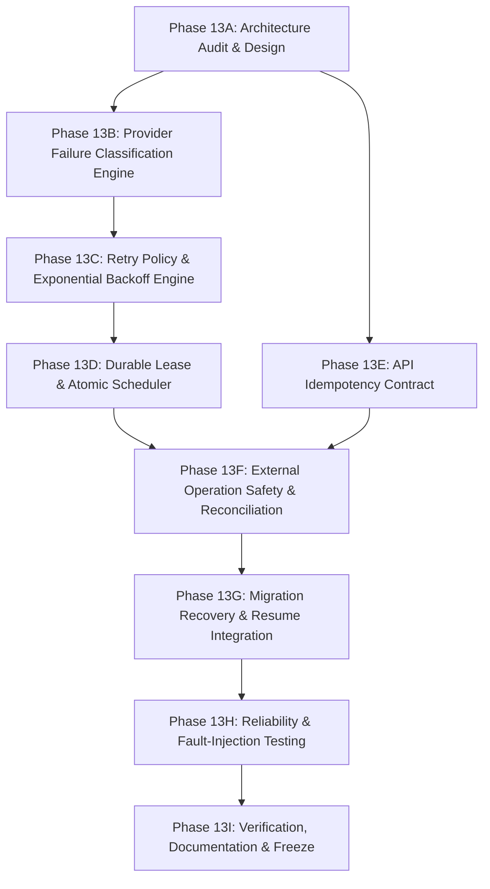

# Phase 13 — Reliability Engineering Architecture & Design Document (Phase 13A — Revised)

**Author:** Senior Java System Architect, Reliability Engineer, Database Architect  
**Status:** REVISED & FINALIZED FOR PHASE 13A (Architecture Review Corrections Integrated)  
**Date:** 2026-11-05  
**Target Subphases:** Phase 13B – Phase 13I  

---

## 1. Executive Summary & Context

Phase 12 established an asynchronous migration execution pipeline with durable database state, atomic worker claiming, progress tracking, and polling rate limiting. However, a rigorous architectural review identified critical reliability vulnerabilities:
- **Retry Metadata Granularity**: Placing retry counters solely on `MigrationExecution` is insufficient because a migration comprises multiple independently retryable operations (destination playlist creation, individual track insertions, and upstream read queries).
- **External Playlist Creation Safety**: Relying on playlist title and creation timestamp matching cannot guarantee playlist ownership. A deterministic correlation marker in the playlist description, combined with pre-allocated creation intent, is required.
- **Worker Lease & Zombie Protection**: Phase 12 relies on a static 5-minute threshold without an active worker heartbeat, lease owner identity, or fencing tokens. A zombie worker waking after a pause could corrupt state.
- **`Retry-After` Semantics**: The original retry formula erroneously shortened provider `Retry-After` instructions when they exceeded local maximums, violating HTTP specifications.
- **Worker Thread Blocking**: Sleeping on worker threads during backoffs starves the bounded thread pool (2–4 threads). Backoffs $> 2\text{ s}$ must be durably scheduled, releasing the thread.
- **Atomic Scheduling Protocol**: `SELECT ... FOR UPDATE SKIP LOCKED` must be part of an end-to-end atomic state transition, lease acquisition, and post-commit dispatch protocol.
- **Track Insertion Reconciliation**: YouTube's eventual consistency (read-after-write replication lag), intentional duplicate source tracks, and user modifications require multi-phase evidence reconciliation rather than a single immediate read.
- **Granular YouTube 403 Classification**: YouTube returns both transient user rate limits (`userRateLimitExceeded`) and permanent daily quota exhaustion (`quotaExceeded`) under HTTP 403; these require completely distinct handling.
- **Idempotency Retention Lifecycle**: Idempotency keys must never expire while an execution is active or recoverable. The 72-hour TTL applies strictly after reaching a terminal state.

---

## 2. Operation-Level Retry Metadata Ownership

A migration execution aggregate (`MigrationExecution`) coordinates multiple distinct operations, each with its own lifecycle, error budget, and retry history:

```
                            MigrationExecution
                             (Aggregate Root)
                                     │
         ┌───────────────────────────┼───────────────────────────┐
         ▼                           ▼                           ▼
[ Playlist Creation ]    [ Track Insertion (0..N) ]     [ Provider Reads ]
- 1 per execution        - 1 per track position         - Spotify/YouTube API
- Owned by MigrationExecution  - Owned by ExecutionTrackRecord - In-flight context
```

### 2.1 Metadata Ownership Model

| Operation Type | Owning Entity | Attempt Count & Max | Next Eligible Attempt | Failure Classification | Lease & Fencing |
|---|---|---|---|---|---|
| **Destination Playlist Creation** | `MigrationExecution` | `playlist_creation_attempt_count`<br>`playlist_creation_max_attempts` (default: 3) | `playlist_creation_next_attempt_at` | `playlist_creation_failure_code` | `lease_owner`<br>`fencing_token` |
| **Track Insertion** | `ExecutionTrackRecord` | `attempt_count`<br>`max_attempts` (default: 3) | `next_attempt_at` | `last_failure_classification`<br>`error_message` | `execution.fencing_token`<br>`track.version` |
| **Provider Read Operations** | In-Memory `RetryContext` | Local attempt counter (max: 3) | Immediate backoff | Transient exception analysis | Local worker thread |

### 2.2 Operational Metadata Contract
For every durable operation, the schema maintains:
1. **Operation Identity**: Immutable UUID (`id` on `ExecutionTrackRecord`, `playlist_creation_operation_id` on `MigrationExecution`).
2. **Attempt Tracking**: `attempt_count` (int $\ge 0$) and `max_attempts` (int $\ge 1$).
3. **Temporal Bounds**: `started_at` (last attempt time), `next_attempt_at` (earliest eligibility), `completed_at`.
4. **Diagnostic Provenance**: `last_failure_classification` (enum/string), `error_message` (sanitized text), `retry_backoff_ms` (long).
5. **Ownership & Lease**: `lease_owner` (worker node/thread ID), `lease_until` (timestamp), `fencing_token` (generational counter).

---

## 3. External Destination Playlist Creation Safety

### 3.1 The Ambiguity Problem
YouTube Data API v3 `POST /playlists` does not support client idempotency tokens. If a creation call times out (`ResourceAccessException`) or encounters HTTP 503, YouTube may have successfully created the playlist. Blindly retrying creates duplicate playlists on the user's account. Matching by title and timestamp alone is error-prone because users may already possess identically named playlists.

### 3.2 Correlation Marker & Pre-Allocated Intent Protocol

```
                        1. Persist Intent (Pre-Allocation)
                        - status: ALLOCATING_DESTINATION
                        - playlist_creation_operation_id: <UUID opId>
                        - destination_playlist_id: NULL
                                       │
                                       ▼
                        2. Construct YouTube Payload
                        - Title: targetPlaylistTitle
                        - Description: userDescription +
                          "\n\n[migrator-ref: <opId>]"
                                       │
                                       ▼
                        3. POST /playlists to YouTube
                                       │
                     ┌─────────────────┴─────────────────┐
                [ Success ]                         [ Timeout / 5xx ]
                     │                                   │
           Store playlistId                              ▼
           Status -> QUEUED             4. Reconcile via GET /playlists?mine=true
                                                         │
                                        ┌────────────────┴────────────────┐
                             [ Discovered Marker ]              [ No Marker Found ]
                                        │                                 │
                             Link discovered playlist        Is matching title present?
                             Status -> QUEUED                ├── NO: Safe to re-create
                                                             └── YES: Ambiguous -> RECOVERY_REQUIRED
```

### 3.3 Protocol Specification
1. **Pre-Allocation Intent**: `MigrationExecution` is persisted with `status = 'ALLOCATING_DESTINATION'` and a newly generated `playlist_creation_operation_id` (UUID).
2. **Correlation Marker in Description**:
   - The backend appends a deterministic, machine-readable correlation signature:
     ```text
     [ref: migrator-op:<playlist_creation_operation_id>]
     ```
   - **User-Visible Implication**: Occupies ~45 characters out of YouTube's 5,000-character limit. It appears unobtrusively at the bottom of the playlist description, establishing indisputable proof of ownership.
3. **Reconciliation Rules**:
   - When a creation attempt experiences a timeout or 5xx, the worker queries `GET https://www.googleapis.com/youtube/v3/playlists?part=snippet&mine=true` (costs 1 quota unit, vs 50 for creation).
   - It iterates user playlists (up to 50 items) checking for `snippet.description` containing `[ref: migrator-op:<playlist_creation_operation_id>]`.
   - **Marker Found**: Conclusively proves YouTube executed the request. The backend extracts `playlist.id`, links it, and transitions to `QUEUED`. Exactly-once destination binding achieved.
   - **Marker Absent & No Duplicate Titles**: Conclusively proves the request was never applied. The backend safely retries creation.
   - **Matching Title Found Without Marker**: A playlist with the identical title exists but lacks the operation marker. The system **refuses to guess**; it transitions to `RECOVERY_REQUIRED` and alerts the user.

---

## 4. Durable Worker Ownership, Heartbeating & Fencing Tokens

Phase 12 uses a passive 5-minute threshold on `started_at` without worker identity, heartbeats, or fencing. This creates a zombie-worker hazard: a worker paused by GC or network partition could resume writing after a new worker has claimed the execution.

### 4.1 Durable Lease Architecture

```
                  Worker Instance W1                         PostgreSQL
                          │                                      │
     1. Claim Execution   ├─────────────────────────────────────>│ UPDATE ... 
                          │                                      │ SET lease_owner = 'W1',
                          │<─────────────────────────────────────┤     lease_generation = 105,
                          │  (Token: 105, Lease: 60s)            │     lease_until = NOW() + 60s
                          │                                      │
     2. Heartbeat Task    ├─────────────────────────────────────>│ UPDATE ...
        (Every 15s)       │                                      │ SET lease_until = NOW() + 60s,
                          │<─────────────────────────────────────┤     heartbeat_at = NOW()
                          │                                      │ WHERE lease_generation = 105
                          │                                      │
     3. Insert Track      │                                      │ UPDATE execution_track_records
        (Pass Token: 105) ├─────────────────────────────────────>│ SET status = 'ADDED'
                          │                                      │ WHERE ... AND 
                          │                                      │ 105 = (SELECT lease_generation ...)
```

### 4.2 Fencing Token Invariants
1. **`lease_generation` (Monotonic Counter)**:
   - Each successful claim increments `lease_generation` by 1.
   - Every mutation query on `execution_track_records` includes a fencing predicate:
     ```sql
     UPDATE execution_track_records
     SET status = :newStatus, destination_playlist_item_id = :itemId, updated_at = NOW()
     WHERE id = :trackId
       AND execution_id = :executionId
       AND :fencingToken = (SELECT lease_generation FROM migration_executions WHERE id = :executionId);
     ```
   - If a zombie worker attempts to write after lease recovery has assigned ownership to a new worker, the row count is $0$, throwing `OptimisticLockException` and stopping the zombie worker immediately.
2. **Heartbeat Protocol**:
   - Lease duration: **60 seconds** (justified by maximum provider socket timeout of 30s + DB write latency).
   - Heartbeat interval: **15 seconds** (executed asynchronously by the active worker while processing tracks).
   - Stale threshold: An execution is considered abandoned if `heartbeat_at < NOW() - INTERVAL '60 seconds'`.
3. **Graceful Shutdown**:
   - On JVM shutdown (`ContextClosedEvent`), the active worker releases its lease cooperatively:
     `UPDATE migration_executions SET status = 'QUEUED', lease_owner = NULL, lease_until = NULL WHERE id = :id AND lease_generation = :fencingToken;`

---

## 5. Correct `Retry-After` Semantics

### 5.1 The RFC 9110 Specification
Under RFC 9110 §10.2.3, when an upstream provider returns HTTP 429 or 503 with a `Retry-After` header, clients **must not** send further requests until the indicated time has elapsed.

The initial formula `min(maxDelay, max(retryAfter, jitter))` was critically flawed: it shortened provider delays $> 30\text{ s}$ down to $30\text{ s}$.

### 5.2 Corrected Evaluation Algorithm

$$\text{effectiveDelay} = \begin{cases}
\text{parsedRetryAfter}, & \text{if } \text{Retry-After header is present and valid} \\
\text{random}(0, \min(M, B \times 2^{\text{attempt}})), & \text{otherwise (Full Jitter)}
\end{cases}$$

Where:
- Delta-Seconds Parser: Non-negative integer seconds.
- HTTP-Date Parser: RFC 1123 / RFC 850 timestamp (`Instant - Instant.now()`).
- Malformed / Negative Fallback: Defaults to exponential backoff with full jitter.

### 5.3 Thread-Release Threshold Rule
- **If $\text{effectiveDelay} \le 2.0\text{ seconds}$**: Bounded in-flight micro-retry on worker thread via non-blocking scheduled task (max 1 attempt).
- **If $\text{effectiveDelay} > 2.0\text{ seconds}$**:
  1. The worker thread **must not sleep**.
  2. Persist `next_attempt_at = NOW() + effectiveDelay`.
  3. Release the worker thread back to the pool immediately.
  4. Scheduled poller claims the job when `next_attempt_at` arrives.
- **Provider Quota Exceeded**:
  YouTube `quotaExceeded` resets at midnight Pacific Time (07:00 / 08:00 UTC). If `quotaExceeded` is encountered, set `next_attempt_at = nextPacificMidnight` or transition to `FAILED` with explicit user notification.

---

## 6. Atomic Durable Scheduling Protocol

A bare `SELECT ... FOR UPDATE SKIP LOCKED` does not prevent race conditions if the claiming transaction remains open during HTTP calls, or if dispatch fails post-commit.

### 6.1 Complete Two-Phase Atomic Claiming Protocol

```
                     [ Scheduler Poller (Every 5s) ]
                                    │
                                    ▼
       Phase 1: Atomic Database Claim (Short Transaction, ~5ms)
       - Lock eligible QUEUED row via SKIP LOCKED
       - Verify lease_until IS NULL OR lease_until < NOW()
       - UPDATE:
           status = 'RUNNING'
           lease_owner = :workerInstanceId
           lease_generation = lease_generation + 1
           lease_until = NOW() + INTERVAL '60s'
           heartbeat_at = NOW()
       - COMMIT Transaction
                                    │
                         ┌──────────┴──────────┐
                    [ Committed ]         [ No Rows ]
                         │                     │
                         ▼                     ▼
       Phase 2: Post-Commit Worker Dispatch   Sleep until next poll
       - Submit to ThreadPoolTaskExecutor
                         │
              ┌──────────┴──────────┐
         [ Accepted ]          [ Rejected (Pool Saturated) ]
              │                     │
              ▼                     ▼
     Worker thread begins      Phase 3: Rollback Claim Transaction
     execution with fresh      - UPDATE:
     fencing token                 status = 'QUEUED'
                                   lease_owner = NULL
                                   lease_until = NULL
                                   next_attempt_at = NOW() + INTERVAL '10s'
                               - COMMIT Transaction
```

### 6.2 Implemented SQL Strategy (PostgreSQL Dialect — Phase 13D-B & 13D-C)

```sql
-- Phase 13D-B: Atomic Claim using CTE and FOR UPDATE SKIP LOCKED
WITH claimable AS (
    SELECT id
    FROM migration_executions
    WHERE (
        (status = 'QUEUED' AND (lease_until IS NULL OR lease_until < clock_timestamp()))
        OR
        (status = 'RUNNING' AND lease_until IS NOT NULL AND lease_until < clock_timestamp())
    )
    AND (next_attempt_at IS NULL OR next_attempt_at <= clock_timestamp())
    ORDER BY next_attempt_at ASC NULLS FIRST, created_at ASC
    LIMIT 1
    FOR UPDATE SKIP LOCKED
)
UPDATE migration_executions m
SET status = 'RUNNING',
    lease_owner = :workerId,
    lease_generation = m.lease_generation + 1,
    lease_until = clock_timestamp() + (:leaseDurationSeconds * INTERVAL '1 second'),
    heartbeat_at = clock_timestamp(),
    next_attempt_at = NULL,
    updated_at = clock_timestamp(),
    version = m.version + 1
FROM claimable
WHERE m.id = claimable.id
RETURNING m.id, m.user_id, m.lease_generation, m.lease_until, m.lease_owner;
```

```sql
-- Phase 13D-C: Conditional Compensation on TaskRejectedException
UPDATE migration_executions
SET status = 'QUEUED',
    lease_owner = NULL,
    lease_until = NULL,
    next_attempt_at = CAST(:nextAttemptAt AS TIMESTAMP WITH TIME ZONE),
    updated_at = clock_timestamp(),
    version = version + 1
WHERE id = :id
  AND status = 'RUNNING'
  AND lease_owner = :workerId
  AND lease_generation = :leaseGeneration
  AND lease_until IS NOT NULL
  AND lease_until > clock_timestamp();
```

### 6.3 Two-Phase Scheduling Protocol Implementation
1. **Phase 1 (Database Claim Transaction)**:
   - Executed via `TransactionTemplate` with `Propagation.REQUIRES_NEW` in `DurableMigrationScheduler.claimNextExecution()`.
   - Atomically locks one eligible row, updates ownership, lease expiry, increments fencing generation, and clears `next_attempt_at`.
   - Returns immutable `ClaimedExecution` record and commits.
2. **Phase 2 (Post-Commit Worker Dispatch)**:
   - Executed strictly after transaction commit outside of any active database transaction.
   - Dispatches execution to `migrationTaskExecutor` bounded pool (`TaskExecutor.execute(...)`).
   - Propagates exact acquired fencing generation token to `MigrationBackgroundWorker.processExecution(executionId, userId, leaseGeneration)`.
   - Worker thread runs with `isActualTransactionActive() == false`.
3. **Phase 3 (Executor Saturation Compensation)**:
   - If executor throws `TaskRejectedException` (queue saturated or shutdown in progress), scheduler catches it.
   - Initiates a discrete `REQUIRES_NEW` compensation transaction: `MigrationExecutionRepository.compensateClaimRejection(...)`.
   - Conditionally resets status to `QUEUED`, clears `lease_owner` and `lease_until`, sets `next_attempt_at` to backoff timestamp.
   - Strictly guarded by `(id, workerId, leaseGeneration)` ensuring stale workers cannot overwrite newer leases.
   - Preserves all track records, track statuses, and count-conservation invariants intact.

---

## 7. Track Insertion Reconciliation with Eventual Consistency & Duplicate Tracks

### 7.1 Nuances Addressed
1. **Eventual Consistency / Replication Lag**: YouTube Data API is distributed. An item inserted via `POST /playlistItems` may not be immediately visible on a subsequent `GET /playlistItems` read. Absence in a single immediate read is **NOT** definitive proof of failed insertion.
2. **Intentional Duplicate Tracks**: Spotify playlists frequently contain identical tracks (same YouTube `videoId`) at multiple positions (e.g., Track 0 and Track 12). Matching must maintain a deterministic bijection between source positions and destination item IDs.
3. **User Interleaving**: The user may concurrently add or delete items on YouTube.

### 7.2 Multi-Stage Evidence Reconciliation Protocol

```
                        Track Insertion Timeout / 503
                                      │
                                      ▼
                        Wait 3s Consistency Delay
                                      │
                                      ▼
                  Query GET /playlistItems (Full Inspection)
                                      │
              Filter out playlistItemIds already mapped to
                 prior ADDED tracks (assignedPlaylistItemIds)
                                      │
                   Match unassigned items by videoId
                                      │
              ┌───────────────────────┼───────────────────────┐
       [ 0 Matches ]             [ 1 Match ]             [ >1 Matches ]
              │                       │                       │
      Wait 5s & Read Again    Check publishedAt vs            │
              │               startedAt (±30s skew)           │
       ┌──────┴──────┐                │                       │
 [ Still 0 ]    [ 1 Found ]     ┌─────┴─────┐                 │
      │              │       [ Valid ]  [ Invalid ]           │
Confirmed NOT      Confirmed Confirmed  Ambiguous             ▼
  Inserted         Inserted    ADDED    (Timestamp       AMBIGUOUS
      │              │           │       mismatch)     (Cannot safely
Revert PENDING    Assign ID      ▼           │          disambiguate)
 & Safe Retry    & Next Track  Proceed       └────────┬───────┘
                                                      │
                                                      ▼
                                            Mark Track UNCERTAIN
                                            Status -> RECOVERY_REQUIRED
```

### 7.3 Canonical Ordering Protection
If reconciliation cannot confirm a track outcome with 100% certainty, the execution transitions to `RECOVERY_REQUIRED` and pauses. Subsequent tracks remain `PENDING`. They are **never** skipped or inserted out of order, preserving canonical ordering and Phase 12 count conservation invariants.

---

## 8. Granular YouTube Provider Error Classification

YouTube API returns diverse error conditions under HTTP 403 and 400 that require distinct handling:

| Status Code | Error Reason / Domain | Meaning | Retry Policy | Action |
|---|---|---|:---:|---|
| **403** | `quotaExceeded` | Daily project quota (10,000 units) exhausted. | **NON-RETRYABLE** (in-window) | Halt execution; set `next_attempt_at = nextPacificMidnight`; alert user. |
| **403** | `userRateLimitExceeded` | Per-user short-term QPS limit exceeded. | **RETRYABLE** | Exponential backoff with full jitter; durable release if $> 2\text{ s}$. |
| **403** | `rateLimitExceeded` | System-wide short-term rate limit exceeded. | **RETRYABLE** | Exponential backoff with full jitter. |
| **403** | `insufficientPermissions`<br>`forbidden` | OAuth scope revoked or account suspended. | **NON-RETRYABLE** | Fast-fail execution; prompt for re-authorization. |
| **401** | `invalidCredentials`<br>`tokenExpired` | Access token expired. | **CONDITIONAL** | Refresh token via `OAuthTokenLifecycleService`. If successful, retry once. If failed, require login. |
| **404** | `videoNotFound` | Video removed or private. | **NON-RETRYABLE** | Mark track `FAILED`; mark subsequent tracks `SKIPPED`. |
| **404** | `playlistNotFound` | Destination playlist deleted on YouTube. | **NON-RETRYABLE** | Halt execution; transition to `FAILED`. |
| **429** | Standard HTTP 429 | Rate limit. | **RETRYABLE** | Parse `Retry-After`; back off accordingly. |
| **500 / 503** | Server Error | Internal provider error during mutation. | **AMBIGUOUS** | Do not blind retry. Invoke Section 7 multi-stage reconciliation. |

### 8.1 Implemented Phase 13B Classification Subsystem
In Phase 13B, the failure classification engine was implemented in `com.spotifyyoutube.migrator.migration.reliability.classification`:
1. **`ProviderFailureCategory` (Enum)**: 9 structured categories (`RATE_LIMITED`, `USER_RATE_LIMITED`, `QUOTA_EXCEEDED`, `PERMISSION_DENIED`, `AUTH_EXPIRED`, `NOT_FOUND`, `INVALID_REQUEST`, `TRANSIENT_SERVER_ERROR`, `UNKNOWN`).
2. **`RetryEligibility` (Enum)**: Signals downstream retry policies whether an error is `RETRYABLE`, `NON_RETRYABLE`, `DEFERRED_RESET`, or `REQUIRES_REAUTHORIZATION`.
3. **`RetryAfterResult` (Record)**: Strongly-typed outcome of `Retry-After` header parsing (`VALID`, `MISSING`, `INVALID`) providing parsed `Duration`, original header value, and failure diagnostics.
4. **`RetryAfterParser` (Class)**: RFC 9110 Section 10.2.3 compliant parser supporting delta-seconds (strictly non-negative decimal digits `1*DIGIT`, rejecting explicit positive signs, negative numbers, and decimals) and RFC-1123 / RFC-850 / ASCTIME HTTP-dates. Never truncates provider-specified delays; returns `Duration.ZERO` for dates in the past; safely handles `Long.MAX_VALUE` overflows; and supports injectable `Clock` for deterministic testing.
5. **`ProviderFailureClassification` (Record)**: Immutable classification result carrying category, HTTP status, provider error reason, retry eligibility, parsed `Duration` delay, and sanitized diagnostic message.
6. **`ProviderFailureClassifier` (Class)**: Engine evaluating status codes, provider JSON error bodies (`error.errors[].reason`), and Spring `RestClient` exceptions. Strictly keeps YouTube HTTP 403 `quotaExceeded` distinct from `userRateLimitExceeded` and treats unknown provider reasons defensively as non-retryable. Implements regex token sanitization redacting credentials from diagnostic messages.
7. **`ExternalProviderException`**: Extended with a backward-compatible `providerReason` field and getter.
8. **Unit Test Coverage**: Comprehensive test suites in `RetryAfterParserTest` (20 tests) and `ProviderFailureClassifierTest` (25 tests) verifying all parsing formats, error categories, edge cases, and credential sanitization.

### 8.2 Implemented Phase 13C Retry Policy & Backoff Engine Subsystem
In Phase 13C, the retry decision and backoff engine was implemented in `com.spotifyyoutube.migrator.migration.reliability.policy`:
1. **`RetryOperationType` (Enum)**: Distinguishes external mutating write operations (`DESTINATION_PLAYLIST_CREATION`, `TRACK_INSERTION`) whose transport failures are ambiguous from idempotent read queries (`PROVIDER_READ`).
2. **`ExecutionTier` (Enum)**: Implements the strict 2.0-second execution boundary (`IN_FLIGHT`, `DEFERRED`, `NONE`).
3. **`DelaySource` (Enum)**: Tracks delay provenance (`PROVIDER_RETRY_AFTER`, `FULL_JITTER_BACKOFF`, `NONE`).
4. **`RetryDecisionType` (Enum)**: Structured decision outcomes (`RETRY_PERMITTED`, `DEFERRED_QUOTA_RESET`, `RECONCILIATION_REQUIRED`, `BUDGET_EXHAUSTED`, `NON_RETRYABLE`, `REQUIRES_REAUTHORIZATION`, `EXCESSIVE_DELAY`).
5. **`RetryBudget` (Record)**: Immutable value object representing total attempt accounting (`totalAttempts`, default: 3) where `maxAttempts` strictly includes the initial attempt (`attempt 1`) plus at most two retries (`attempt 2` and `3`).
6. **`BackoffCalculator` (Class)**: Implements AWS Full Jitter exponential backoff: `delay = random(0, min(cap, baseDelay * 2^attempt))`. Default base delay 500 ms, default cap 30 s. Registered as a Spring `@Component`. Fully overflow-safe against large attempt values (up to $2^{62}$) and extreme durations (up to `Long.MAX_VALUE` with nanosecond, millisecond, and second fallbacks), safely handles sub-millisecond durations without division-by-zero errors, guarantees non-negative lower bound, and supports an injectable `DoubleSupplier` for deterministic unit testing.
7. **`RetryDecision` (Record)**: Immutable decision outcome containing authorization, tier, delay, delay source, budget, and diagnostic rationale. Supports nullable delay for unknown quota reset times via `hasKnownDelay()` and `delayOptional()`.
8. **`RetryPolicy` (Interface) & `DefaultRetryPolicy` (Class)**:
   - Consumes Phase 13B `ProviderFailureClassification` without duplicating classification logic.
   - Enforces RFC 9110 precedence: valid provider `Retry-After` is respected and never shortened by local caps.
   - Excessive provider delay escalation: provider delays exceeding `maxExcessiveDelay` (default 24h) yield `EXCESSIVE_DELAY` and are not labeled as retry-permitted, while preserving the original provider delay.
   - Two-tier execution strategy: delay $\le 2,000\text{ ms}$ on initial attempt retry authorizes `IN_FLIGHT` micro-retry; delay $> 2,000\text{ ms}$ or attempt count $> 1$ requires `DEFERRED` worker thread release.
   - Ambiguous write protection: any retryable failure on mutating operations with null HTTP status (transport failure), 5xx server error, or unknown category yields `RECONCILIATION_REQUIRED` and `DEFERRED` without relying exclusively on diagnostic message substrings. Rate-limit rejections (429, user-rate-limit 403) are preserved as safe to retry.
   - Quota deferral: `quotaExceeded` (`DEFERRED_RESET`) is deferred until quota reset without retrying in the active window. Missing quota reset delays remain unknown without fabricating a 1-hour timestamp.
9. **Unit & Spring Context Test Coverage**: Comprehensive test suites in `BackoffCalculatorTest` (12 tests), `RetryBudgetTest` (6 tests), `RetryPolicyTest` (24 tests), and `DefaultRetryPolicySpringContextTest` (1 test) covering all 43 required test scenarios.

---

## 9. API Idempotency Contract & Lifecycle Retention

### 9.1 Request Fingerprint Specification
To guarantee canonical serialization across platforms and versions, the request fingerprint is computed as:

$$\text{RequestFingerprint} = \text{"v1:"} \parallel \text{HEX}(\text{SHA-256}(U \parallel R \parallel T \parallel D \parallel P))$$

Where fields are separated by the ASCII Unit Separator (`\u001F`):
- $U$: `userId.toString()`
- $R$: `reviewSessionId.toString()`
- $T$: `targetPlaylistTitle.trim()`
- $D$: `targetPlaylistDescription != null ? targetPlaylistDescription.trim() : ""`
- $P$: `isPrivate ? "true" : "false"`

### 9.2 Lifecycle Retention Policy
1. **Active & Recoverable Executions**: Idempotency records associated with executions in `INITIALIZING`, `ALLOCATING_DESTINATION`, `QUEUED`, `RUNNING`, `RECOVERY_REQUIRED`, or `PARTIALLY_COMPLETED` **NEVER EXPIRE** (`expires_at = NULL`).
2. **Terminal Executions**: When an execution transitions to `COMPLETED`, `FAILED`, or `ROLLED_BACK`, the idempotency record's `expires_at` is set to:
   $$\text{expires_at} = \text{NOW}() + \text{INTERVAL '72 hours'}$$
3. **Purge Sweeper Safety**:
   ```sql
   DELETE FROM migration_idempotency_keys
   WHERE expires_at IS NOT NULL AND expires_at < NOW()
     AND status IN ('COMPLETED', 'FAILED');
   ```
   Ensures an active migration can never have its idempotency protection stripped while executing or awaiting recovery.
4. **Header Requirement**: `Idempotency-Key` remains **optional** for backward compatibility on `POST /api/migrations`, but **mandatory** on the typed endpoint `POST /api/migrations/submit`.

### 9.3 Implemented Phase 13E API Idempotency Subsystem
In Phase 13E, the complete API idempotency contract and lifecycle was implemented in package `com.spotifyyoutube.migrator.migration.reliability.idempotency`:
1. **`V11__phase13e_api_idempotency_keys.sql`**: Dedicated table `migration_idempotency_keys` with composite uniqueness `(user_id, idempotency_key)`, foreign key to `migration_executions(id)`, partial index on `(expires_at) WHERE expires_at IS NOT NULL`, and index on `(execution_id)`.
2. **`CanonicalMigrationRequest` & `CanonicalRequestFingerprinter`**: Computes `v1:` + SHA-256 over `user_id \u001F source_playlist_id \u001F target_playlist_name \u001F sorted_track_hashes` (joined with `\u001E`). Preserves duplicate track occurrences, ignores volatile timestamps/IDs, and handles Unicode NFC normalization.
3. **`IdempotencyKeyValidator`**: Validates `Idempotency-Key` header (max 255 chars, non-blank, no control characters).
4. **`MigrationIdempotencyRecord` & `MigrationIdempotencyRepository`**: Spring Data JPA entity and repository supporting atomic terminal expiry (`WHERE expires_at IS NULL`) and bounded batch deletion using PostgreSQL database clock (`clock_timestamp()`).
5. **`MigrationIdempotencyService` & `DefaultMigrationIdempotencyService`**: Coordinates recording of new executions, replay retrieval, 409 conflict detection, concurrent duplicate race handling via PostgreSQL uniqueness, terminal state transition hooks, and scheduled cleanup with injectable `Clock`.
6. **`CachedBodyHttpServletRequest` & `ApiIdempotencyFilter`**: `OncePerRequestFilter` caching request bytes to preserve stream for downstream Spring MVC controllers, verifying header requirements, replaying cached responses on matching key/fingerprint, rejecting mismatches with HTTP 409 `IDEMPOTENCY_FINGERPRINT_MISMATCH`, and capturing response payloads on first execution.
7. **`IdempotencyFingerprintMismatchException`**: Specialized exception mapped to HTTP 409 Conflict in `GlobalExceptionHandler`.
8. **Test Coverage**: 53 tests across 6 classes: `CanonicalRequestFingerprinterTest` (12 tests), `IdempotencyKeyValidatorTest` (7 tests), `DefaultMigrationIdempotencyServiceTest` (11 tests), `ApiIdempotencyFilterTest` (10 tests), `MigrationIdempotencyApiTest` (6 tests), and `MigrationIdempotencyPostgresIT` (7 tests).

---

## 10. Database Schema Evolution Proposals (Flyway V10)

```sql
-- V10__phase13_reliability_and_idempotency.sql

-- 1. Dedicated Idempotency Table
CREATE TABLE migration_idempotency_keys (
    id UUID PRIMARY KEY,
    created_at TIMESTAMP WITH TIME ZONE NOT NULL,
    updated_at TIMESTAMP WITH TIME ZONE NOT NULL,
    user_id UUID NOT NULL,
    idempotency_key VARCHAR(128) NOT NULL,
    request_hash VARCHAR(67) NOT NULL, -- "v1:" + 64 hex chars
    execution_id UUID,
    status VARCHAR(50) NOT NULL DEFAULT 'PROCESSING',
    response_status INT,
    response_body TEXT,
    expires_at TIMESTAMP WITH TIME ZONE, -- NULL while execution is active!
    version BIGINT NOT NULL DEFAULT 0,
    CONSTRAINT fk_idempotency_user FOREIGN KEY (user_id) REFERENCES users (id) ON DELETE CASCADE,
    CONSTRAINT fk_idempotency_execution FOREIGN KEY (execution_id) REFERENCES migration_executions (id) ON DELETE SET NULL,
    CONSTRAINT uq_idempotency_user_key UNIQUE (user_id, idempotency_key)
);

CREATE INDEX idx_idempotency_expires_at ON migration_idempotency_keys(expires_at) WHERE expires_at IS NOT NULL;
CREATE INDEX idx_idempotency_user_created ON migration_idempotency_keys(user_id, created_at);

-- 2. Durable Worker Lease & Playlist Creation Retry on migration_executions
ALTER TABLE migration_executions
ALTER COLUMN destination_playlist_id DROP NOT NULL, -- Nullable during ALLOCATING_DESTINATION!
ADD COLUMN lease_owner VARCHAR(128),
ADD COLUMN lease_until TIMESTAMP WITH TIME ZONE,
ADD COLUMN heartbeat_at TIMESTAMP WITH TIME ZONE,
ADD COLUMN lease_generation BIGINT NOT NULL DEFAULT 0,
ADD COLUMN retry_count INT NOT NULL DEFAULT 0,
ADD COLUMN max_retries INT NOT NULL DEFAULT 3,
ADD COLUMN next_attempt_at TIMESTAMP WITH TIME ZONE,
ADD COLUMN last_failure_reason TEXT,
ADD COLUMN playlist_creation_operation_id UUID,
ADD COLUMN playlist_creation_attempt_count INT NOT NULL DEFAULT 0,
ADD COLUMN playlist_creation_max_attempts INT NOT NULL DEFAULT 3,
ADD COLUMN playlist_creation_next_attempt_at TIMESTAMP WITH TIME ZONE;

CREATE INDEX idx_migrationexecutions_poll 
ON migration_executions(status, next_attempt_at, lease_until) 
WHERE status IN ('QUEUED', 'RUNNING');

-- 3. Track Insertion Retry Metadata on execution_track_records
ALTER TABLE execution_track_records
ADD COLUMN max_attempts INT NOT NULL DEFAULT 3,
ADD COLUMN next_attempt_at TIMESTAMP WITH TIME ZONE,
ADD COLUMN last_failure_classification VARCHAR(50),
ADD COLUMN retry_backoff_ms BIGINT;

CREATE INDEX idx_executiontracks_retry 
ON execution_track_records(execution_id, status, next_attempt_at) 
WHERE status IN ('PENDING', 'ADDING');
```

---

## 11. Updated Phase 13B–13I Implementation Breakdown & Dependencies



| Subphase | Deliverables & Scope | Dependencies |
|---|---|---|
| **13B** | [COMPLETE & TESTED] Provider Failure Classifier: parses YouTube `error.errors[].reason` (separating `quotaExceeded` vs `userRateLimitExceeded`), HTTP 429 `Retry-After` parsing (delta-seconds and HTTP-date). Implemented in `com.spotifyyoutube.migrator.migration.reliability.classification`. | 13A |
| **13C** | [COMPLETE & TESTED] Retry Policy & Backoff Engine: AWS Full Jitter algorithm with overflow protection, thread-release threshold ($> 2\text{ s}$), bounded in-flight micro-retry context, RFC 9110 Retry-After precedence, ambiguous write protection, quota deferral. Implemented in `com.spotifyyoutube.migrator.migration.reliability.policy`. | 13B |
| **13D** | Durable Lease & Atomic Scheduler: Flyway V10, `lease_owner`, `fencing_token`, 60s lease with 15s heartbeat, atomic claim query with `SKIP LOCKED`. | 13C |
| **13E** | [COMPLETE & TESTED] API Idempotency: Flyway V11 `migration_idempotency_keys` table, canonical `v1:SHA-256` fingerprinting with ASCII unit/record separators, `IdempotencyKeyValidator`, `ApiIdempotencyFilter` with stream preservation, `MigrationIdempotencyService`, terminal-only 72h TTL, bounded sweeper. 48 tests implemented. | 13A |
| **13F** | External Operation Safety: Destination playlist creation with `[ref: migrator-op:<id>]` marker and pre-allocation intent; track insertion multi-stage reconciliation. | 13D, 13E |
| **13G** | Recovery & Resume Integration: Orchestrator integration, automatic background resumption, zero manual clicks required for transient faults. | 13F |
| **13H** | Fault-Injection Testing: WireMock simulated 429s with `Retry-After`, 503 cascades, simulated network timeouts during writes, JVM termination mid-batch. | 13G |
| **13I** | Subsystem Verification & Freeze: Documentation reconciliation, 0 Checkstyle violations, all tests passing. | 13H |

---

## 12. Architectural Decisions & Governance Register

### 12.1 Confirmed Decisions
1. **Granular Operation-Level Retry Metadata**: Rejected monolithic execution-level retry counters. Retry metadata is owned independently by `ExecutionTrackRecord` for track insertions, by `MigrationExecution` for destination playlist creation, and by transient `RetryContext` for provider read operations.
2. **Durable Worker Leases with Generational Fencing**: Replaced passive 5-minute timeout with a 60-second lease, 15-second active worker heartbeat, and monotonic `lease_generation` fencing token. All per-track mutations verify the caller's fencing token against `migration_executions`, eliminating zombie-worker split-brain hazards.
3. **Strict RFC 9110 `Retry-After` Adherence**: Provider `Retry-After` instructions (delta-seconds or HTTP-date) must never be shortened by local configuration.
4. **Worker Thread Release on Long Backoffs**: Worker threads must never sleep on long backoffs. Delays $> 2\text{ s}$ immediately release worker threads back to the bounded pool (2–4 threads) and transition to durable scheduled retries via `next_attempt_at`.
5. **Two-Phase Atomic Claiming Protocol**: Implemented using PostgreSQL `WITH claimable AS (...) UPDATE ... RETURNING` with `FOR UPDATE SKIP LOCKED`. Post-commit dispatch safely rolls back to `QUEUED` on executor saturation without holding DB transactions open during external HTTP calls.
6. **Terminal-Only 72-Hour Idempotency Retention**: Idempotency records associated with active or recoverable migrations never expire (`expires_at = NULL`). The 72-hour TTL begins strictly after reaching a terminal state (`COMPLETED`, `FAILED`, `ROLLED_BACK`).
7. **Strict Progress Invariant Preservation**: The 8 track statuses and the Phase 12F mathematical count conservation invariant remain strictly preserved. No database `RETRYING` state is introduced.
8. **YouTube Quota Deferral**: YouTube `quotaExceeded` is non-retryable within the current daily window; executions are deferred until Pacific midnight (quota reset) or fast-failed with actionable user notifications.
9. **Zero Distributed Infrastructure**: Rejects Redis, RabbitMQ, and Kafka. PostgreSQL MVCC and row-level locking satisfy all durable queuing and scheduling requirements.

### 12.2 Proposed Decisions
1. **Description Correlation Marker**: Embed `\n\n[ref: migrator-op:<playlist_creation_operation_id>]` in the YouTube playlist description (~45 characters out of 5,000 limit) to achieve deterministic, machine-verifiable destination ownership without relying on fuzzy title matching.
2. **Pre-Allocation State (`ALLOCATING_DESTINATION`)**: Persist `MigrationExecution` with `destination_playlist_id = NULL` and a unique `playlist_creation_operation_id` before calling YouTube, enabling exact post-timeout reconciliation.
3. **Idempotency Header Requirement Policy**: `Idempotency-Key` remains optional for backward compatibility on legacy `POST /api/migrations`, but is enforced as mandatory on the typed endpoint `POST /api/migrations/submit`.
4. **Replication Lag Multi-Stage Verification**: To account for YouTube's eventual consistency, track reconciliation enforces a 3-second grace period and second verification read before concluding an item was not applied.

### 12.3 Unresolved Questions
1. **Automated Quota Reset Scheduling**: Should the scheduler automatically wake deferred `quotaExceeded` migrations at 00:05 Pacific Time, or should resumption require explicit user initiation the following day? (Proposed resolution: Implement automated scheduling in Phase 13D with an opt-out configuration flag).
2. **Correlation Marker Customization**: Should advanced API callers be permitted to suppress or customize the `[ref: migrator-op:<id>]` description signature? (Proposed resolution: Keep standard and mandatory in Phase 13 to guarantee zero duplicate playlists; evaluate user-facing preferences in Phase 15).
3. **High-Volume Key Purge Optimization**: For large multi-tenant deployments, should `migration_idempotency_keys` adopt monthly table partitioning by `created_at`? (Proposed resolution: Single table with composite index is sufficient for Phase 13; table partitioning deferred to Phase 19 deployment architecture).

### 12.4 Implementation Dependencies
- **Phase 13B $\to$ 13C**: `ProviderFailureClassifier` and `RetryAfterParser` must be implemented before the `RetryPolicy` and `FullJitterEngine`.
- **Phase 13C $\to$ 13D**: The backoff engine must be completed before the PostgreSQL `DurableRetryScheduler`.
- **Phase 13A $\to$ 13E**: `ApiIdempotencyFilter` and `migration_idempotency_keys` schema can proceed in parallel with 13B–13D.
- **Phase 13D + 13E $\to$ 13F**: Destination playlist pre-allocation and multi-stage track reconciliation depend on both the durable lease scheduler and idempotency tracking.
- **Phase 13F $\to$ 13G**: Automatic background resumption in `MigrationBackgroundWorker` depends on external operation safety and reconciliation.
- **Phase 13G $\to$ 13H**: Chaos and fault-injection testing depends on full orchestrator integration.
- **Phase 13H $\to$ 13I**: Documentation freeze and verification requires all unit and integration fault-injection suites to pass.
