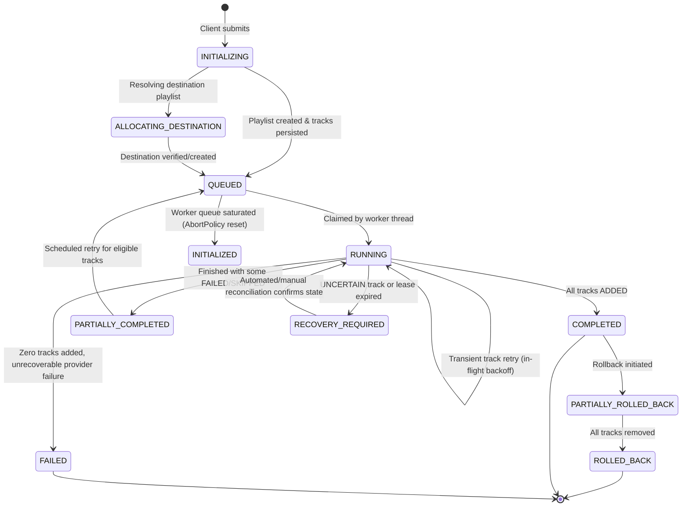

# Phase 13 — Reliability Engineering Architecture & Design Document (Phase 13A)

**Author:** Senior Java System Architect, Reliability Engineer, Database Architect  
**Status:** APPROVED FOR DESIGN / IMPLEMENTATION READY (Phase 13A Complete)  
**Date:** 2026-11-05  
**Target Subphases:** Phase 13B – Phase 13I  

---

## 1. Executive Summary & Context

Phase 12 established an asynchronous migration processing pipeline with durable database state, atomic worker claiming, progress tracking, and polling rate limiting. However, the system currently lacks automated resilience:
- External network timeouts or transient HTTP 5xx responses cause immediate stopping of migration execution and mark all subsequent tracks as `SKIPPED`.
- In-memory worker queue tasks (`ThreadPoolTaskExecutor`'s `LinkedBlockingQueue`) are volatile: an unhandled process termination or server restart drops pending migrations, requiring manual intervention.
- Remote mutation calls (playlist creation and track insertion) to YouTube do not support upstream idempotency tokens. Ambiguous outcomes (timeouts or 503 errors during mutations) risk either creating duplicate destination playlists or duplicating tracks.
- Clients resubmitting requests without or with repeated tokens face inconsistent HTTP 409 Conflict rejections instead of clean idempotent replay semantics.

Phase 13 introduces **end-to-end reliability engineering**:
1. Provider-neutral failure classification and retry policies with exponential backoff and full jitter.
2. Durable, PostgreSQL-backed retry and crash recovery scheduling (zero distributed infrastructure dependencies: no Redis, Kafka, or RabbitMQ).
3. First-class API idempotency (`Idempotency-Key` header, canonical request fingerprinting, user scoping).
4. Evidence-based reconciliation for ambiguous external mutations, ensuring zero duplicate playlists and zero duplicate track insertions.
5. Strict preservation of Phase 11/12 domain boundaries: `MigrationExecution` remains the single authoritative aggregate, and the 8-state track progress conservation invariant remains strictly enforced.

---

## 2. Phase 12 Architecture Audit & Reliability Gap Analysis

### 2.1 Current Architecture Components
- **Orchestration Boundary**: `ApprovedMigrationOrchestrator` / `DefaultApprovedMigrationOrchestrator` coordinates pre-mutation validation, destination playlist creation, durable execution initialization, and sequential track insertion.
- **Durable Persistence Aggregate**: `MigrationExecution` entity binds `review_session_id` (unique 1:1) to a destination playlist on YouTube. Tracks individual track states via `ExecutionTrackRecord` (ordered by `target_position`).
- **Worker & Dispatcher**: `MigrationJobDispatcher` executes Stage 1 (synchronous preparation) and Stage 2 (async submit to `ThreadPoolTaskExecutor`).
- **Worker Concurrency**: Core pool size: 2, max pool size: 4, queue capacity: 50. Rejection policy: `AbortPolicy` with controlled reset from `QUEUED` to `INITIALIZED`.
- **Claim Locking**: Atomic conditional database updates using `claimExecutionRunningWithVersion` and `claimTrackRollingBack` with `@Version` optimistic concurrency.
- **Reconciliation & Rollback**: Phase 11F failure classification and rollback (`ExecutionRollbackRecord`), and Phase 11G remote state verification (`ExecutionReconciliationRecord`) using `MusicDestination.inspectPlaylist`.

### 2.2 Reliability Gaps Identified in Phase 12

| ID | Component | Current Behavior | Reliability Risk / Failure Mode |
|---|---|---|---|
| **GAP-01** | `DefaultDestinationPlaylistCreationService` | Performs remote playlist creation before persisting `MigrationExecution`. | If YouTube creates the playlist but the network times out or the JVM crashes before database insertion, an orphaned playlist is leaked. Resubmission creates a **duplicate playlist**. |
| **GAP-02** | `DefaultMigrationExecutionStateService.executePendingTracks` | Catch blocks for `ResourceAccessException` or `ExternalProviderException` immediately set `stopRemaining = true` and abort. | Transient 503 or network socket timeouts immediately abort the entire migration and mark remaining tracks as `SKIPPED` without a single retry attempt. |
| **GAP-03** | `AsyncMigrationConfig` & Dispatcher | Queue is an in-memory `LinkedBlockingQueue<Runnable>` in JVM heap. | JVM restart or pod crash permanently drops all queued migrations from memory. While state remains `QUEUED` or `RUNNING` in PostgreSQL, there is no automatic startup or polling sweeper to resume them. |
| **GAP-04** | `MigrationController` Submission Endpoints | Does not support or evaluate the standard `Idempotency-Key` HTTP header. | Network disconnections during client submission can cause duplicate submissions. Resubmissions of `RUNNING` or `QUEUED` migrations throw `InvalidStateException` returning HTTP 409 Conflict rather than returning the existing execution. |
| **GAP-05** | Track Insertion Ambiguity | On timeout during `addTrackToPlaylist`, the track is marked `UNCERTAIN` and paused for manual intervention. | Does not attempt automated evidence-based verification against the remote playlist before halting the worker pipeline. |
| **GAP-06** | Rate Limit Replenishment | On 429 Too Many Requests, worker thread aborts track processing. | Does not parse or wait for upstream `Retry-After` headers; immediately stops remaining tracks. |
| **GAP-07** | Concurrent Submission Race | Two concurrent requests for the same review session can both pass `getExecutionByReviewSession == null` check before either inserts. | Both threads invoke YouTube API to create a playlist concurrently, creating two playlists on the user's account before one fails database unique constraint. |

---

## 3. Comprehensive Failure Scenario Matrix

The table below catalogs external and system failure modes across Spotify, YouTube, network, database, and process lifecycles.

| Scenario ID | Operation & Failure Trigger | Classification | Retry Safe? | External Reconciliation Required? | State Transition (Execution / Track) | Manual Recovery Required? | Resolution & Architectural Action |
|---|---|---|:---:|:---:|---|:---:|---|
| **F-01** | Spotify Playlist/Tracks: HTTP 429 | `CONFIRMED_RETRYABLE_PROVIDER_REJECTION` | **YES** | NO | No transition (in-flight read) | NO | Respect `Retry-After` header; apply exponential backoff with full jitter up to max budget. |
| **F-02** | Spotify Playlist/Tracks: HTTP 500/502/503/504 | `CONFIRMED_RETRYABLE_PROVIDER_REJECTION` | **YES** | NO | No transition (in-flight read) | NO | Read operation is idempotent. Retry with exponential backoff (attempts $\le$ 3). |
| **F-03** | Spotify API: Read/Connect Timeout | `CONFIRMED_RETRYABLE_PROVIDER_REJECTION` | **YES** | NO | No transition (in-flight read) | NO | Transient network fault on read. Retry with exponential backoff. |
| **F-04** | Spotify / Google: OAuth Token Expired (401) | `AUTHENTICATION_OR_AUTHORIZATION_FAILURE` | **CONDITIONAL** | NO | `FAILED` / unchanged | CONDITIONAL | Attempt synchronous token refresh via `OAuthTokenLifecycleService`. If refresh succeeds, retry operation once; if refresh fails, transition to `FAILED` with actionable message. |
| **F-05** | Google / YouTube: 403 `quotaExceeded` | `CONFIRMED_PROVIDER_OPERATION_FAILURE` | **NO** | NO | `FAILED` / `FAILED` (remaining `SKIPPED`) | **YES** | Daily quota exhausted (10,000 units). Fast-fail execution immediately; log quota exhaustion; do not retry until quota resets (midnight Pacific). |
| **F-06** | Google / YouTube: 403 Insufficient Scope | `AUTHENTICATION_OR_AUTHORIZATION_FAILURE` | **NO** | NO | `FAILED` / `FAILED` | **YES** | User revoked or withheld required OAuth scopes (`youtube` or `youtube.force-ssl`). Re-authentication required. |
| **F-07** | YouTube: Create Playlist HTTP 429 | `CONFIRMED_RETRYABLE_PROVIDER_REJECTION` | **YES** | NO | `QUEUED` / `PENDING` | NO | Parse `Retry-After`; schedule durable retry. |
| **F-08** | YouTube: Create Playlist Timeout / 500/503 | `MANUAL_INTERVENTION_REQUIRED` (UNCERTAIN) | **NO** (blind) | **YES** | `INITIALIZED` (with intent) or `RECOVERY_REQUIRED` | NO (if automated) | **Ambiguous Playlist Creation**: Query user's channel (`playlists.list?mine=true`) for playlist matching title created in last 10m. If found, adopt; if not, safe to create. |
| **F-09** | YouTube: Add Track HTTP 429 | `CONFIRMED_RETRYABLE_PROVIDER_REJECTION` | **YES** | NO | `RUNNING` / `ADDING` $\to$ `ADDING` | NO | Rate limit is checked before insertion mutation occurs. Safe to back off and retry in-flight. |
| **F-10** | YouTube: Add Track Timeout / Socket Reset | `MANUAL_INTERVENTION_REQUIRED` (UNCERTAIN) | **NO** (blind) | **YES** | `RUNNING` $\to$ `RECOVERY_REQUIRED` / `ADDING` $\to$ `UNCERTAIN` | NO (if automated) | **Ambiguous Track Insertion**: Do NOT blind retry. Execute inline inspection of destination playlist. If confirmed present, mark `ADDED`; if confirmed absent, mark `PENDING` and retry. |
| **F-11** | YouTube: Add Track HTTP 500/503 | `MANUAL_INTERVENTION_REQUIRED` (UNCERTAIN) | **NO** (blind) | **YES** | `RUNNING` $\to$ `RECOVERY_REQUIRED` / `ADDING` $\to$ `UNCERTAIN` | NO (if automated) | Server internal error during mutation may have committed. Reconcile against playlist items before retrying. |
| **F-12** | YouTube: Add Track HTTP 404 Video Not Found | `CONFIRMED_NON_RETRYABLE_PROVIDER_REJECTION` | **NO** | NO | `PARTIALLY_COMPLETED` / `FAILED` | NO | Video removed, copyright blocked, or private. Mark track `FAILED`. Mark subsequent tracks `SKIPPED` to preserve canonical ordering. |
| **F-13** | JVM Crash / Termination during `ADDING` | `MANUAL_INTERVENTION_REQUIRED` (Stale Lease) | **NO** (blind) | **YES** | `RUNNING` $\to$ `RECOVERY_REQUIRED` / `ADDING` $\to$ `UNCERTAIN` | NO (if automated) | Lease expiration ($> 5$ min). Startup sweeper identifies stale `ADDING` tracks and invokes Phase 11G remote state verification. |
| **F-14** | JVM Crash with migrations in `QUEUED` | `LOCAL_PERSISTENCE_FAILURE` (Lost Task) | **YES** | NO | `QUEUED` $\to$ `RUNNING` | NO | In-memory queue dropped. PostgreSQL startup recovery sweeper claims unexecuted `QUEUED` jobs and re-submits to worker pool. |
| **F-15** | Concurrent Submissions for Same Session | Concurrency Race Condition | **NO** | NO | Original `QUEUED`; Duplicate `REJECTED` | NO | Idempotency key or distributed database mutex (`uq_migrationexecution_reviewsession`) ensures only one execution is initialized; second caller receives existing execution. |
| **F-16** | Database Transaction Failure / Deadlock | `LOCAL_PERSISTENCE_FAILURE` | **YES** | NO | Rollback to prior committed state | NO | Transient DB deadlock or lock timeout during per-track state update. Retry the short DB transaction with backoff. |

---

## 4. Provider-Neutral Retry Architecture (Phase 13B, 13C, 13D)

### 4.1 Retry Classification & Policy Abstraction
The retry engine defines a strict separation between **Confirmed Failures** and **Ambiguous Operations**:
- **Confirmed Retryable**: The provider explicitly confirmed the request was rejected prior to state change (e.g., HTTP 429, temporary connection rejection, read timeout).
- **Confirmed Non-Retryable**: The provider rejected the request permanently (e.g., HTTP 400 Bad Request, HTTP 403 Quota Exceeded, HTTP 404 Video Not Found).
- **Ambiguous Mutation (Uncertain)**: Network dropped or server errored (HTTP 500/503/timeout) during a state-changing write. Blind retry is strictly forbidden. Must undergo remote state verification prior to any re-attempt.

```
                              ┌────────────────────────┐
                              │    Operation Error     │
                              └───────────┬────────────┘
                                          │
                        Is it a Read or Write Mutation?
                                          │
                     ┌────────────────────┴────────────────────┐
                     ▼                                         ▼
            [ Read Operation ]                        [ Write Mutation ]
                     │                                         │
        Is HTTP 429, 5xx, or Timeout?             Is HTTP 429 Rate Limit?
        ├── YES: CONFIRMED_RETRYABLE              ├── YES: CONFIRMED_RETRYABLE (Checked pre-mutation)
        └── NO: Check Auth / Client               ├── 400/404/Quota 403: NON_RETRYABLE
                                                  └── 5xx / Timeout: UNCERTAIN (Ambiguous)
                                                                │
                                                                ▼
                                                    [ Remote Reconciliation ]
                                                    ├── Verified Absent: Safe to Retry
                                                    ├── Verified Present: Mark ADDED (Done)
                                                    └── Indeterminate: Pause for Review
```

### 4.2 Exponential Backoff and Full Jitter Algorithm
To prevent thundering herds when upstream providers (or the local database) recover, the system uses the standard AWS Full Jitter backoff algorithm:

$$\text{sleep} = \text{random}(0, \min(M, B \times 2^{\text{attempt}}))$$

Where:
- $B$ = Base backoff delay (Default: $1.0\text{ s}$)
- $M$ = Maximum backoff delay (Default: $30.0\text{ s}$)
- $\text{attempt}$ = Zero-indexed retry attempt count ($0, 1, 2, \dots$)
- $\text{random}(0, X)$ = Uniform random duration between $0$ and $X$.

**Upstream `Retry-After` Handling**:
When the provider supplies a `Retry-After` header (integer seconds or RFC 1123 HTTP date):
$$\text{effectiveDelay} = \min(M, \max(\text{retryAfterHeader}, \text{calculatedJitterDelay}))$$

### 4.3 Two-Tier Retry Hierarchy: In-Flight vs. Durable Scheduled

#### Tier 1: In-Flight Transient Retry (Local Worker Thread)
- **Scope**: Transient HTTP 429, brief network blips, or read timeouts.
- **Budget**: Maximum 3 attempts, maximum elapsed time 45 seconds per track.
- **Thread Model**: Non-blocking sleep on worker thread using `Thread.sleep` or scheduled executor task.
- **Invariant**: No database connection or open transaction is held during the backoff sleep.

#### Tier 2: Durable Scheduled Retry (PostgreSQL-Backed)
- **Scope**: Prolonged rate limits, worker saturation, or recovery across application restarts.
- **Mechanism**: The execution or track record is persisted in PostgreSQL with:
  - `status = 'QUEUED'`
  - `retry_count = retry_count + 1`
  - `next_retry_at = NOW() + calculated_delay`
  - `last_failure_reason = sanitized_error`
- **Zero External Infrastructure**: Evaluates PostgreSQL using `FOR UPDATE SKIP LOCKED`.

### 4.4 PostgreSQL Durable Retry & Startup Recovery Sweeper
A lightweight Spring component running at fixed intervals (default: 5 seconds) polls for ready executions:

```sql
SELECT id FROM migration_executions
WHERE status = 'QUEUED'
  AND (next_retry_at IS NULL OR next_retry_at <= NOW())
ORDER BY next_retry_at ASC NULLS FIRST, created_at ASC
FOR UPDATE SKIP LOCKED
LIMIT :batchSize;
```

**Crash Recovery on Startup**:
When the application starts, a dedicated recovery scan executes:
1. Queries executions in `status = 'RUNNING'` whose `updated_at` is older than the lease threshold (5 minutes).
2. For each, reconciles in-flight `ADDING` tracks (marking them `UNCERTAIN` under Phase 11E/11G invariants).
3. If no uncertain tracks exist, resets the execution to `QUEUED` with immediate `next_retry_at` so it resumes processing automatically.

---

## 5. API Idempotency Architecture (Phase 13E)

### 5.1 The `Idempotency-Key` Contract
The asynchronous migration submission endpoint (`POST /api/migrations` and `POST /api/migrations/submit`) supports the standard IETF draft `Idempotency-Key` HTTP request header:

- **Header Name**: `Idempotency-Key` (case-insensitive)
- **Format**: Valid UUID or ASCII string ($1 \le \text{length} \le 128$)
- **Scope**: User-scoped. Uniqueness is enforced on `(user_id, idempotency_key)`. Different users may supply the identical key without collision.
- **Retention**: Idempotency records are retained for 72 hours.

### 5.2 Canonical Request Fingerprinting
To detect payload tampering or accidental key reuse with different parameters, the backend computes a SHA-256 fingerprint of the canonicalized request payload:

$$\text{RequestFingerprint} = \text{SHA-256}\left(\text{reviewSessionId} \parallel \text{targetTitle} \parallel \text{targetDescription} \parallel \text{isPrivate}\right)$$

### 5.3 Idempotency State Machine & Replay Semantics

```
Client Request with Idempotency-Key: K, Payload: P
                     │
                     ▼
       Lookup (user_id, K) in Database
                     │
        ┌────────────┴────────────┐
   [ Found ]                 [ Not Found ]
        │                         │
  Matches Fingerprint(P)?     Atomic INSERT (user_id, K, Fingerprint(P), status=PROCESSING)
  ├── NO:  Return HTTP 409    (If DB duplicate key collision -> Re-read existing)
  │        (Conflict: Key reused with different payload)
  │
  └── YES: Check Execution State:
           ├── status = PROCESSING: Return HTTP 202 Accepted (In progress)
           ├── status = QUEUED:     Return HTTP 202 Accepted (Location: /progress)
           ├── status = RUNNING:    Return HTTP 202 Accepted (Location: /progress)
           └── status = COMPLETED:  Return HTTP 200 OK       (Location: /progress)
```

- **Same Key + Identical Payload**: Returns the existing execution and progress URL with the appropriate HTTP status (202 Accepted if in-flight/queued, 200 OK if completed).
- **Same Key + Different Payload**: Rejects immediately with HTTP 409 Conflict and error code `IDEMPOTENCY_CONFLICT`.
- **Concurrent Submissions with Same Key**: PostgreSQL unique constraint on `(user_id, idempotency_key)` guarantees exactly one thread succeeds in claiming; concurrent requests wait or read the committed record.

---

## 6. External Operation Safety & Ambiguity Reconciliation (Phase 13F)

### 6.1 Safe Destination Playlist Creation
**Problem**: YouTube Data API v3 `POST /playlists` does not accept client idempotency tokens. If a creation call times out or throws HTTP 503, YouTube may have created the playlist, and a retry creates a duplicate.

**Architecture Solution: Two-Phase Allocation & Pre-Creation Verification**:
1. **Durable Intent Record**: The backend initializes `MigrationExecution` in a new pre-mutation state `ALLOCATING_DESTINATION` *before* invoking YouTube.
2. **Ambiguity Reconciliation on Timeout**:
   If `createPlaylist` times out or fails with 5xx:
   - The backend queries `GET https://www.googleapis.com/youtube/v3/playlists?part=snippet&mine=true` (costs only 1 quota unit, compared to 50 for creation).
   - Filters user playlists for title matching `targetPlaylistTitle` created within $\pm 5$ minutes of the recorded start time.
   - **If a matching playlist is discovered**: The backend links that playlist ID and transitions execution to `QUEUED`. Zero duplicate playlists created!
   - **If verified absent**: The backend safely creates the playlist on retry.

```
                  ┌──────────────────────────────────────────────┐
                  │ 1. Record Execution: ALLOCATING_DESTINATION  │
                  └──────────────────────┬───────────────────────┘
                                         │
                         2. POST /playlists to YouTube
                                         │
                       ┌─────────────────┴─────────────────┐
                  [ Success ]                         [ Timeout / 5xx ]
                       │                                   │
             Store playlistId                              ▼
             Transition -> QUEUED         3. Query GET /playlists?mine=true
                                                           │
                                            ┌──────────────┴──────────────┐
                                       [ Found ]                     [ Absent ]
                                            │                             │
                                  Link discovered playlist       Safely re-invoke createPlaylist
                                  Transition -> QUEUED           Transition -> QUEUED
```

### 6.2 Safe Ordered Track Insertion
**Problem**: YouTube Data API v3 `POST /playlistItems` does not accept client idempotency tokens. Retrying an ambiguous timeout blindly causes duplicate tracks in the playlist and corrupts canonical ordering. Furthermore, Spotify source playlists may legitimately contain duplicate tracks (e.g., Track 2 and Track 10 are the same video ID).

**Architecture Solution: Evidence-Based Inline Reconciliation**:
Before retrying any track that experienced a network timeout or 503:
1. Invoke `MusicDestination.inspectPlaylist(...)` (Phase 11G remote state verification).
2. Retrieve all items currently in the YouTube playlist.
3. Exclude all `playlistItemId`s already assigned to existing confirmed `ADDED` tracks (`assignedPlaylistItemIds`).
4. Evaluate unassigned items matching `destinationTrackId`:
   - **Zero unassigned items found**: Proves the item was **never inserted**. Transition track back to `PENDING` and safely retry.
   - **Exactly one unassigned item found with matching timestamp**: Proves the item was **successfully inserted**. Transition track to `ADDED`, record `destinationPlaylistItemId`, increment destination index, and proceed to next track.
   - **Multiple unassigned items found**: Ambiguous duplicate condition. Mark track `UNCERTAIN`, transition execution to `RECOVERY_REQUIRED`, and require human review.

This completely eliminates duplicate track insertions without relying on blind retries!

---

## 7. State Transition Machine & Invariants

### 7.1 Authoritative Execution Lifecycle State Machine



### 7.2 Track Lifecycle States & Count Conservation Invariant

The 8 track statuses established in Phase 11E/12F remain strictly conserved:
$$\text{totalTracks} = \text{pending} + \text{adding} + \text{added} + \text{failed} + \text{uncertain} + \text{skipped} + \text{rollingBack} + \text{rolledBack}$$

$$\text{processedTracks} = \text{added} + \text{failed} + \text{uncertain} + \text{skipped} + \text{rolledBack}$$

$$\text{remainingTracks} = \text{totalTracks} - \text{processedTracks}$$

$$\text{progressPercentage} = \text{round}\left(\frac{\text{processedTracks}}{\text{totalTracks}} \times 100.0, 1\right)$$

**State Transition Safety Rule**:
During an automatic retry, a track transitions:
$$\text{ADDING} \longrightarrow \text{RETRYING} \longrightarrow \text{ADDING} \longrightarrow \text{ADDED}$$
To preserve the 8-state invariant without altering database check constraints or breaking Phase 12 progress calculations:
- While waiting between retry attempts, the track remains in status `PENDING` (with `attempt_count` incremented) or `ADDING`.
- When an attempt begins, it is `ADDING`.
- Only settled terminal attempts transition to `ADDED`, `FAILED`, or `UNCERTAIN`.

---

## 8. Database Schema Evolution Proposals (Flyway V10)

The proposed schema changes build cleanly on the existing `migration_executions` and `execution_track_records` tables without creating redundant job aggregates.

### 8.1 Flyway Migration `V10__phase13_reliability_and_idempotency.sql`

```sql
-- V10__phase13_reliability_and_idempotency.sql
-- Phase 13: Reliability Engineering, Durable Retries & API Idempotency

-- 1. Dedicated Idempotency Table
CREATE TABLE migration_idempotency_keys (
    id UUID PRIMARY KEY,
    created_at TIMESTAMP WITH TIME ZONE NOT NULL,
    updated_at TIMESTAMP WITH TIME ZONE NOT NULL,
    user_id UUID NOT NULL,
    idempotency_key VARCHAR(128) NOT NULL,
    request_hash VARCHAR(64) NOT NULL,
    execution_id UUID,
    status VARCHAR(50) NOT NULL DEFAULT 'PROCESSING',
    response_status INT,
    response_body TEXT,
    expires_at TIMESTAMP WITH TIME ZONE NOT NULL,
    version BIGINT NOT NULL DEFAULT 0,
    CONSTRAINT fk_idempotency_user FOREIGN KEY (user_id) REFERENCES users (id) ON DELETE CASCADE,
    CONSTRAINT fk_idempotency_execution FOREIGN KEY (execution_id) REFERENCES migration_executions (id) ON DELETE SET NULL,
    CONSTRAINT uq_idempotency_user_key UNIQUE (user_id, idempotency_key)
);

CREATE INDEX idx_idempotency_expires_at ON migration_idempotency_keys(expires_at);
CREATE INDEX idx_idempotency_user_created ON migration_idempotency_keys(user_id, created_at);

-- 2. Enhance migration_executions for Durable Retry Scheduling
ALTER TABLE migration_executions
ADD COLUMN retry_count INT NOT NULL DEFAULT 0,
ADD COLUMN max_retries INT NOT NULL DEFAULT 3,
ADD COLUMN next_retry_at TIMESTAMP WITH TIME ZONE,
ADD COLUMN last_retry_at TIMESTAMP WITH TIME ZONE,
ADD COLUMN last_failure_reason TEXT;

CREATE INDEX idx_migrationexecutions_retry_poll 
ON migration_executions(status, next_retry_at) 
WHERE status = 'QUEUED';

-- 3. Enhance execution_track_records for Retry Diagnostics
ALTER TABLE execution_track_records
ADD COLUMN last_retry_at TIMESTAMP WITH TIME ZONE,
ADD COLUMN retry_backoff_ms BIGINT;
```

---

## 9. API Contract Proposals

### 9.1 Request Header Specifications
Clients may supply `Idempotency-Key` when submitting migrations:

```http
POST /api/migrations HTTP/1.1
Host: api.spotifyyoutubemigrator.com
Authorization: Bearer <user_jwt>
Idempotency-Key: 7b9c1d2e-3f4a-4b5c-8d9e-0f1a2b3c4d5e
Content-Type: application/json

{
  "reviewSessionId": "3fa85f64-5717-4562-b3fc-2c963f66afa6"
}
```

### 9.2 Response Headers & Schemas
Responses generated from idempotent endpoints include:
- `Idempotency-Key`: Echoes the provided key.
- `Location`: `/api/migrations/{executionId}/progress`
- `Retry-After`: Included when returning HTTP 429 (saturation or rate limit).

#### Error Response: Idempotency Conflict (HTTP 409)
Returned when an `Idempotency-Key` is reused with a different request payload:
```json
{
  "code": "CONFLICT",
  "message": "Idempotency key '7b9c1d2e-...' was previously used with a different request payload",
  "timestamp": "2026-11-05T00:30:00Z",
  "path": "/api/migrations"
}
```

---

## 10. Phase 13B–13I Implementation Plan

| Subphase | Title & Scope | Involved Components | Required Tests | Acceptance Criteria |
|---|---|---|---|---|
| **13B** | **Provider Failure Classification** | `ExecutionFailureClassifier`, `ExecutionFailureAnalysis`, `ExternalProviderException` | Unit tests for all Spotify/YouTube 4xx/5xx/timeout codes and mutation contexts. | Deterministic classification: confirmed retryable, confirmed non-retryable, or ambiguous (uncertain). |
| **13C** | **Retry Policy & Backoff Engine** | `RetryPolicy`, `ExponentialBackoff`, `FullJitterEngine`, `RetryContext` | Mathematical unit tests for backoff progression, full jitter distribution, and `Retry-After` capping. | Sleep duration is bounded by min/max; thundering herds prevented; provider `Retry-After` respected. |
| **13D** | **Durable Retry Scheduling** | `DurableRetryScheduler`, `MigrationExecutionRepository`, Flyway V10 | PostgreSQL integration tests with `SKIP LOCKED`, concurrent sweeper claiming, startup crash recovery. | Stale `RUNNING` jobs recovered on startup; retryable `QUEUED` jobs scheduled and executed automatically without Redis. |
| **13E** | **API Idempotency** | `IdempotencyFilter`, `IdempotencyService`, `migration_idempotency_keys` | WebMvc & concurrency tests: duplicate requests, mismatched payload 409, 202/200 replay, user scoping. | Zero duplicate executions created; concurrent identical calls return identical responses; cross-user isolation. |
| **13F** | **External Operation Idempotency & Reconciliation** | `DefaultDestinationPlaylistCreationService`, `DefaultMigrationExecutionStateService`, `YouTubePlaylistService` | Mock destination tests: simulated timeouts during playlist creation and track insertion. | Zero duplicate playlists created on YouTube; zero duplicate tracks inserted; ambiguous mutations verified via inspection. |
| **13G** | **Migration Recovery & Resume Integration** | `ApprovedMigrationOrchestrator`, `DefaultApprovedMigrationOrchestrator`, `MigrationJobDispatcher` | End-to-end integration tests with injected transient failures and automatic resumption. | Multi-track migrations recover seamlessly from simulated network drops without manual user clicks. |
| **13H** | **Reliability & Fault-Injection Testing** | Testcontainers, WireMock / MockWebServer fault injection suite | Chaos testing: dropped connections, 503 cascades, rate limits, JVM killed mid-track. | 100% state conservation maintained; zero data corruption; zero orphaned in-flight locks. |
| **13I** | **Documentation, Verification & Freeze** | `.ai/CURRENT_STATE.md`, `.ai/ROADMAP.md`, `.ai/ARCHITECTURE.md` | Full Maven verification: `mvn clean verify` with Testcontainers. | 0 Checkstyle violations; 0 test failures; formal architectural freeze of Phase 13. |

---

## 11. Risk Register & Unresolved Architectural Decisions

| ID | Category | Risk / Decision Description | Impact | Proposed Mitigation / Decision |
|---|---|---|:---:|---|
| **R-01** | External API | YouTube API daily quota exhaustion (10,000 units/day). Retrying too aggressively will rapidly consume daily quota. | **HIGH** | Strict retry caps on mutation calls: maximum 2 retries for track insertion (each insert = 50 units). Immediate non-retryable halt on `quotaExceeded`. |
| **R-02** | Concurrency | Concurrent database polling sweepers in clustered deployment could contend for retry records. | **MEDIUM** | Use PostgreSQL `FOR UPDATE SKIP LOCKED` on the retry polling query to ensure zero lock contention between instances. |
| **R-03** | Storage | `migration_idempotency_keys` table growth over time. | **LOW** | Include `expires_at` column (72-hour TTL). A lightweight daily scheduled purge removes expired keys. |
| **R-04** | Latency | Inline remote playlist inspection adds latency to worker processing during network timeouts. | **MEDIUM** | Only perform inspection when a timeout or 5xx occurs; inspection is paginated (up to 50 items/page). Total timeout budget capped at 15s. |
| **DEC-01** | Architecture | **Decision**: Use PostgreSQL for durable retry scheduling instead of introducing Redis or RabbitMQ. | **CONFIRMED** | In accordance with ADR-003 and ADR-007, PostgreSQL MVCC with `SKIP LOCKED` fully satisfies throughput requirements for our bounded pool (4 workers) without infrastructure complexity. |
| **DEC-02** | Architecture | **Decision**: Retain 8 track statuses in domain model; do not introduce `RETRYING` track status in database. | **CONFIRMED** | Preserves Phase 12 mathematical count conservation invariant and Flyway check constraints without regression. |

---

*Phase 13A Architecture & Design Document Complete. Implementation ready to begin in Phase 13B upon architecture review.*
