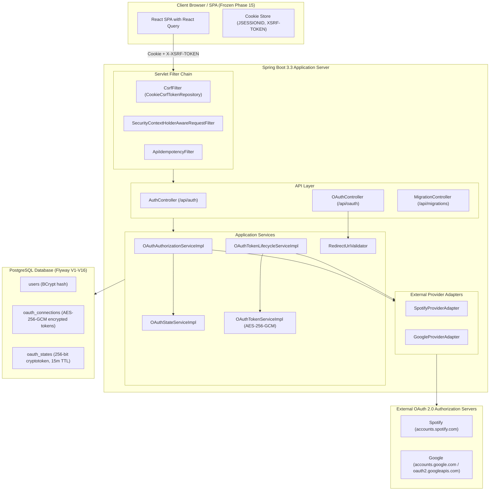

# Phase 16A & 16B — Security Architecture Audit, Threat Modeling & OAuth/Token Hardening Report

- **Repository**: `C:\Projects\spotify-youtube-migrator`
- **Branch**: `main`
- **Milestone**: Phase 16A + Phase 16B
- **Author**: Application Security Architect & Java/Spring Boot Security Engineer
- **Date**: November 17, 2026
- **Status**: COMPLETE / VERIFIED / HARDENED

---

## Section A: Executive Summary & Scope

Phase 16 inaugurates the Security Hardening milestone for the Spotify-to-YouTube Music migration platform following the formal freeze of the Phase 15 frontend product layer. Phase 16A and Phase 16B were executed together as a coordinated application security assessment, architectural threat modeling, and provider credential hardening milestone.

### Core Objectives Delivered
1. **Phase 16A (Security Architecture Assessment & Threat Modeling)**:
   - Exhaustive end-to-end mapping of application session lifecycle, OAuth authorization-code flows (Spotify & Google), credential persistence, and token refresh mechanisms.
   - Formal identification and delineation of 7 critical trust boundaries.
   - Comprehensive STRIDE threat modeling covering 13 specific attack scenarios (OAuth login CSRF, state injection/replay, code interception, open redirects, account-linking attacks, cross-tenant credential access, token leakage, race conditions in refresh, etc.).
   - Explicit definition of core security invariants and architectural design decisions.
2. **Phase 16B (OAuth Flow & Provider-Token Security Audit & Hardening)**:
   - **OAuth State Hardening**: Cryptographically secure 256-bit entropy (`SecureRandom` 32 bytes Base64 URL-safe), strict user and provider binding, atomic single-use deletion (`DELETE FROM oauth_states`), 15-minute TTL, expired state purging, and state invalidation on user cancellation/provider denial.
   - **Redirect URI Validation**: Created `RedirectUriValidator` enforcing strict scheme whitelisting (`https` strictly required for production; `http` permitted solely for localhost/loopback), host and path validation, fragment rejection, and strict post-callback relative destination sanitization preventing open redirects (`//`, `/\`, CRLF injection, protocol schemes).
   - **Provider Token Encryption at Rest**: AES-256-GCM authenticated encryption (`AES/GCM/NoPadding`, 12-byte IV, 128-bit authentication tag), fail-fast startup validation requiring exact 32-byte (256-bit) Base64 key, minimum ciphertext length guard (`GCM_IV_LENGTH + 16` bytes) preventing unhandled array exceptions, tamper detection via `AEADBadTagException`, and fail-safe exception wrapping with zero token leakage.
   - **Token Refresh Concurrency & Lifecycle**: Fine-grained per-(userId, provider) locking with double-checked refresh pattern eliminating race conditions and redundant upstream calls on concurrent requests; atomic persistence of rotated tokens (both access and refresh); status synchronization restoring `CONNECTED` on re-authorization; graceful fallback to `REAUTH_REQUIRED` on unrecoverable upstream errors.
   - **Information Leak Prevention**: Sanitized exception on token exchange failure in `GoogleProviderAdapter`, removing raw upstream response body string concatenation that previously risked leaking server diagnostics or sensitive payloads into API errors and logs.
   - **Minimal OAuth Scopes Audited**: Spotify source scopes (`user-read-private`, `user-read-email`, `playlist-read-private`, `playlist-read-collaborative`) and Google destination scopes (`openid`, `email`, `profile`, `https://www.googleapis.com/auth/youtube.force-ssl`) confirmed to adhere strictly to the Principle of Least Privilege.
   - **Disconnect & Isolation**: Immediate local credential wipe upon `DELETE /api/oauth/{provider}`; strict user boundaries across all OAuth and migration operations.
3. **Verification**:
   - 4 new dedicated security test classes + updated `OAuthControllerTest`: **46 dedicated security tests passing**, **80 identity/security tests passing**, and **2,186 total backend tests passing (100% pass rate)**.
   - **0 Checkstyle violations**.
   - Git working tree preserved without commits or push per strict task instructions.

---

## Section B: Repository Baseline & Environment State

Before initiating any analysis or modifications, repository baseline validation was executed and recorded:

```powershell
git branch --show-current
# Output: main

git status -sb
# Output: ## main...origin/main

git log -5 --oneline --decorate
# Output:
# b82277a (HEAD -> main, origin/main, origin/HEAD) test(frontend): close phase 15 verification gaps
# a10754a test(frontend): complete phase 15 accessibility and compatibility freeze
# d3badae feat(frontend): implement migration history and recovery
# 4046791 feat(frontend): complete migration user journey
# 89a9e2d feat(frontend): implement auth and Spotify playlist discovery

git rev-parse HEAD
# Output: b82277acae4287cb855265a21a759febb24657a0

git rev-parse origin/main
# Output: b82277acae4287cb855265a21a759febb24657a0
```

- **Branch**: `main` (clean baseline synchronized with `origin/main`).
- **Baseline Commit**: `b82277acae4287cb855265a21a759febb24657a0`.
- **Runtime Environment**: Java 22.0.2, Apache Maven 3.9.16, Spring Boot 3.3.4, Windows 11 x86_64.
- **Frontend State**: Phase 15 product layer complete and frozen; zero frontend modifications made during Phase 16A/16B.

---

## Section C: Security Architecture Mapping



### 1. Frontend-to-Backend Authentication & Session Mechanism
- **Session Mechanism**: Standard HTTP servlet session identified via `JSESSIONID` cookie (`HttpOnly`, `SameSite=Lax`, `Secure` in production).
- **Authentication Handshake**: `POST /api/auth/login` and `POST /api/auth/register` establish a Spring Security `UsernamePasswordAuthenticationToken` in the `SecurityContextHolder`, which is saved into the servlet `HttpSession` under `SPRING_SECURITY_CONTEXT`.
- **CSRF Protection**: Enforced by Spring Security's `CsrfFilter` using `CookieCsrfTokenRepository.withHttpOnlyFalse()` and `CsrfTokenRequestAttributeHandler`. Mutation requests (`POST`, `PUT`, `DELETE`) require the `X-XSRF-TOKEN` header matching the cookie.
- **Session Destruction**: `POST /api/auth/logout` invalidates the `HttpSession` and clears the `SecurityContext`.

### 2. OAuth Authorization-Code Flow (Spotify & Google)
- **Initiation**: The authenticated user's browser invokes `GET /api/oauth/{provider}/authorize`.
  - The backend resolves the authenticated `User` from the security context.
  - Generates an unpredictable 256-bit cryptographic state token via `OAuthStateServiceImpl` bound to the user's `UUID` and `OAuthProvider`.
  - Persists the state token in `oauth_states` with a 15-minute TTL.
  - Returns the provider authorization URL with parameters: `client_id`, `response_type=code`, `redirect_uri` (static, pre-validated), `scope`, and `state`.
- **Browser Delegation**: The browser navigates to the external provider consent screen.
- **Callback Processing**: Provider redirects browser back to `GET /api/oauth/{provider}/callback?code=...&state=...`.
  - `OAuthController` receives the request within the user's authenticated session.
  - In case of provider error (e.g. `error=access_denied`), invalidates the state and redirects to `/?oauth_error=access_denied`.
  - Verifies presence of `code` and `state`.
  - Dispatches to `OAuthAuthorizationServiceImpl.handleCallback`:
    1. Validates and consumes the state token atomically (`DELETE FROM oauth_states WHERE state = :state`), checking user ownership, provider match, and expiration.
    2. Invokes the provider adapter (`SpotifyProviderAdapter` or `GoogleProviderAdapter`) to exchange the authorization code for tokens over HTTPS.
    3. Fetches provider identity (`me` for Spotify, `userinfo` for Google).
    4. Encrypts tokens using AES-256-GCM and persists them into `oauth_connections`.
  - Redirects browser to safe relative destination `/` via `RedirectUriValidator.validateDestinationUri`.

### 3. Token Persistence, Encryption & Lifecycle Refresh
- **Token Persistence**: Stored in `oauth_connections` table.
  - Columns `access_token` and `refresh_token` are `TEXT` fields storing Base64-encoded strings containing a 12-byte random IV prepended to AES-GCM ciphertext + 128-bit authentication tag.
- **Refresh Lifecycle**: `OAuthTokenLifecycleServiceImpl.refreshConnectionIfNeeded(userId, provider)`:
  - Triggered with a 5-minute pre-expiration buffer (`expiresAt <= now + 300s`).
  - Fine-grained synchronization per user and provider prevents concurrent threads from executing duplicate upstream refreshes.
  - Double-checked locking verifies if another thread already refreshed the token.
  - Rotated refresh tokens are persisted; null refresh tokens preserve existing refresh credentials.
  - If upstream token refresh fails (e.g. `invalid_grant`), status transitions to `ConnectionStatus.REAUTH_REQUIRED`.
- **Disconnect**: `DELETE /api/oauth/{provider}` invokes `disconnect(userId, provider)`, which permanently deletes the `oauth_connections` record.

---

## Section D: Trust Boundaries Analysis

| Trust Boundary | Interacting Entities | Trust Level Transition | Controls & Hardening Enforced |
|---|---|---|---|
| **TB-1: Browser to Backend** | User Browser $\leftrightarrow$ Spring Boot API | Untrusted to Semi-Trusted | Cookie-based session (`HttpOnly`, `SameSite=Lax`, `Secure`), CSRF tokens (`X-XSRF-TOKEN`), Spring Security authorization filter, anti-IDOR user context derivation. |
| **TB-2: Backend to Spotify** | Backend $\leftrightarrow$ `accounts.spotify.com`, `api.spotify.com` | Trusted to External 3rd Party | HTTPS transport, client credentials via HTTP Basic Auth header, static pre-validated redirect URI, strict read-only scopes. |
| **TB-3: Backend to Google** | Backend $\leftrightarrow$ `accounts.google.com`, `oauth2.googleapis.com` | Trusted to External 3rd Party | HTTPS transport, static pre-validated redirect URI, offline consent prompt, YouTube scoped authorization, error body sanitization. |
| **TB-4: Backend to Database** | Backend JPA $\leftrightarrow$ PostgreSQL DB | Application to Storage | Parameterized queries (Hibernate/JPA), AES-256-GCM encryption of provider tokens, foreign key constraints with `ON DELETE CASCADE`. |
| **TB-5: OAuth Callback to Session** | External Provider Redirect $\leftrightarrow$ User Session | External Ingress to Authenticated Session | Cryptographically random state validation (256 bits), user session binding, single-use atomic consumption, cancellation invalidation. |
| **TB-6: Authenticated User to Resources** | User A $\leftrightarrow$ User B's Migration / Connection | Untrusted User to Multi-Tenant Storage | Ownership checks (`resolveUserId`, `findByUserIdAndProvider`, `findByIdAndUserId`), 404 non-disclosure on unowned resources. |
| **TB-7: External Provider Responses to Internal Processing** | Upstream JSON $\leftrightarrow$ Internal Domain Entities | External 3rd Party to Application Logic | Strict DTO deserialization, null and blank filtering, defensive mapping, error status code mapping without echoing raw response bodies. |

---

## Section E: Comprehensive Threat Model

### STRIDE Assessment Matrix

| Threat ID | Threat Category | Threat Scenario | Preconditions & Execution Path | Impact | Existing / New Hardened Protection | Severity | Subphase |
|---|---|---|---|---|---|---|---|
| **TM-01** | Spoofing / Tampering | **OAuth Login CSRF & State Injection** | Attacker initiates OAuth flow, traps callback with their own authorization code, and tricks victim into submitting victim's session with attacker's state. | Medium: Victim's local account links to attacker's Spotify/YouTube account, leaking future playlist migrations. | State token generated with 256 bits of entropy, bound to initiating user `UUID`, validated against `SecurityContextHolder.getContext()`, consumed atomically on callback. | **High** | Phase 16B |
| **TM-02** | Repudiation / Tampering | **OAuth State Replay Attack** | Attacker intercepts or replays a previously used callback URL (`code` + `state`). | High: Duplicate token exchange attempts, potential account confusion. | Single-use consumption via atomic SQL delete (`DELETE FROM oauth_states WHERE state = :state`). If rows affected == 0, throws `InvalidStateException`. | **High** | Phase 16B |
| **TM-03** | Information Disclosure | **Open Redirect via Post-OAuth Callback** | Attacker injects malicious query parameters (`destination=//evil.com` or `redirect_uri=https://evil.com`) into callback. | High: User redirected to credential harvesting site after OAuth flow. | `RedirectUriValidator.validateDestinationUri` strictly enforces relative path whitelist starting with single `/`, sanitizing `//`, `/\`, CRLF, and protocol schemes to `/`. | **High** | Phase 16B |
| **TM-04** | Tampering | **Provider Redirect URI Manipulation** | Configuration error or parameter injection modifies OAuth redirect URI to point to attacker-controlled server. | Critical: Authorization codes routed directly to attacker. | Redirect URI is statically configured, never accepted from request parameters, and validated at startup via `RedirectUriValidator.validateProviderRedirectUri`. | **Critical** | Phase 16B |
| **TM-05** | Elevation of Privilege | **Cross-Account Provider Linking** | User A generates an OAuth state; User B attempts to complete the callback using User A's state token. | High: User B connects User A's OAuth session to User B's local account. | `OAuthStateServiceImpl` strictly verifies `state.getUserId().equals(expectedUserId)` before code exchange; mismatch throws `InvalidStateException`. | **High** | Phase 16B |
| **TM-06** | Information Disclosure | **Plaintext Provider Token Compromise at Rest** | Database snapshot, backup, or unauthorized read access exposes `oauth_connections` table. | Critical: Attacker gains permanent access to user's Spotify and YouTube accounts. | All access tokens and refresh tokens are encrypted at rest using AES-256-GCM with authenticated tags and random 12-byte IVs. Plaintext tokens never written to DB. | **Critical** | Phase 16B |
| **TM-07** | Tampering | **Ciphertext Modification / Bit-Flipping** | Attacker modifies encrypted token bytes in database. | High: Corrupted credentials or cipher malleability exploits. | AES-GCM 128-bit authentication tag verification ensures tamper detection. Modified byte throws `InvalidStateException` via `AEADBadTagException`. | **High** | Phase 16B |
| **TM-08** | Denial of Service / Invalidation | **Concurrent Token Refresh Race Condition** | User initiates parallel API requests when access token is expiring; multiple threads simultaneously call upstream refresh endpoint with same refresh token. | High: Upstream provider (e.g. Google/Spotify token rotation) revokes refresh token on second use; connection breaks into `REAUTH_REQUIRED`. | `OAuthTokenLifecycleServiceImpl` enforces fine-grained per-connection locking with double-checked refresh pattern: only 1 upstream call made; subsequent threads reuse fresh token. | **High** | Phase 16B |
| **TM-09** | Information Disclosure | **Raw Upstream Error Payload Leakage** | Upstream Google token exchange fails (e.g. invalid grant); error response body containing server diagnostic info or URLs is echoed in exception. | Medium: Sensitive server diagnostic information leaked in API error response JSON. | Sanitized exception in `GoogleProviderAdapter` removing `res.getBody().readAllBytes()`; only status code is captured in `InvalidStateException`. | **Medium** | Phase 16B |
| **TM-10** | Information Disclosure | **Token Leakage in Logs or Traces** | Application logs print authorization codes, refresh tokens, access tokens, or encryption keys during execution. | High: Persistent credentials captured in log aggregators. | Log statements use structured identifiers (`userId`, `provider`); token fields never included in log statements or `toString()` representations. | **High** | Phase 16B |
| **TM-11** | Elevation of Privilege | **Broken Object-Level Authorization (BOLA/IDOR)** | Authenticated User A attempts to view, refresh, or disconnect User B's OAuth connection. | High: Unauthorized credential manipulation or disconnection of other users. | All OAuth endpoints (`/authorize`, `/callback`, `/{provider}`, `DELETE /{provider}`) derive user identity strictly from `SecurityContextHolder`; no user ID parameter accepted. | **High** | Phase 16B |
| **TM-12** | Tampering / Information Disclosure | **Weak or Short AES Encryption Key** | Operator configures a weak, short (e.g. 128-bit), or malformed encryption key in production. | High: Reduced cryptographic strength or runtime crash on first token write. | `OAuthTokenServiceImpl` constructor validates that decoded key is exactly 32 bytes (256 bits), failing fast at application boot if invalid. | **High** | Phase 16B |
| **TM-13** | Denial of Service | **Orphaned OAuth State Table Bloat** | Users abandon OAuth flows; thousands of unconsumed states accumulate in `oauth_states`. | Low: Table bloat, degraded query performance over time. | Short 15-minute TTL; cancellation invalidation via `OAuthController`; dedicated `deleteExpiredStates` query in `OAuthStateRepository`. | **Low** | Phase 16B |

---

## Section F: Security Invariants & Design Decisions

### Enforced Security Invariants
1. **Cryptographic Entropy**: OAuth state tokens must possess at least 256 bits of cryptographically strong pseudo-random entropy generated via `java.security.SecureRandom`.
2. **Session & Identity Binding**: Every OAuth state must be strictly bound to the initiating user's authenticated `UUID` and target `OAuthProvider`. Mismatched callbacks must be rejected before contacting external providers.
3. **Single-Use Enforcement**: State tokens are strictly single-use and must be consumed atomically at the database level prior to authorization-code exchange.
4. **State Expiry Window**: OAuth state validity is strictly bounded to 15 minutes. Expired states must never be accepted for code exchange.
5. **Static Redirect Whitelisting**: Redirect URIs provided to upstream OAuth providers must be statically configured, validated at application boot, and never accepted from request parameters.
6. **Open Redirect Immunity**: Any user-controlled destination URI following OAuth completion must be sanitized to safe relative paths matching `^/[a-zA-Z0-9_\-./?=&%#]*$`, rejecting protocol-relative bypasses (`//`, `/\`, `\\`), protocol handlers (`javascript:`, `data:`), and CRLF characters.
7. **Authenticated Encryption at Rest**: All access and refresh tokens stored in persistent databases must be encrypted using AES-256-GCM with a non-repeating 12-byte IV per encryption operation and a 128-bit authentication tag.
8. **Cryptographic Fail-Fast Boot**: The application must refuse to start if the configured encryption key is absent, invalid Base64, or not exactly 256 bits (32 bytes).
9. **Concurrency-Safe Token Refresh**: Upstream token refreshes must be concurrency-safe. Multiple simultaneous requests for the same user and provider must never trigger concurrent upstream refresh calls.
10. **Principle of Least Privilege (Scopes)**: OAuth scopes must be strictly restricted to the minimal set necessary for application operations (read-only for Spotify; playlist write for YouTube).

---

## Section G: Phase 16B Hardening Implementation

### 1. `RedirectUriValidator.java`
- Created dedicated utility class `com.spotifyyoutube.migrator.identity.application.RedirectUriValidator`:
  - `validateProviderRedirectUri(String redirectUri)`: Verifies URI is absolute, uses HTTP/HTTPS scheme, contains non-empty host, disallows fragments, and restricts HTTP scheme strictly to localhost/internal test hosts (`localhost`, `127.0.0.1`, `::1`, or hosts without dots).
  - `validateDestinationUri(String destination)`: Sanitizes post-callback redirect destinations against open redirects, rejecting CRLF injection, scheme-relative prefixes (`//`, `/\`, `\\`), and absolute protocol handlers, defaulting safely to `/`.

### 2. `SpotifyProviderAdapter.java` & `GoogleProviderAdapter.java`
- Enforced startup redirect URI validation via `RedirectUriValidator.validateProviderRedirectUri(redirectUri)` in both constructors.
- **Sanitized Information Leak** in `GoogleProviderAdapter.java`:
  - *Previous code*:
    ```java
    throw new InvalidStateException("Failed to exchange Google token: " + res.getStatusCode() + " body: " + new String(res.getBody().readAllBytes()));
    ```
  - *Hardened code*:
    ```java
    throw new InvalidStateException("Failed to exchange Google token: " + res.getStatusCode());
    ```
  - Removed concatenation of raw response body, eliminating potential leakage of sensitive diagnostics or tokens into client responses and logs.

### 3. `OAuthTokenServiceImpl.java`
- Enforced strict 256-bit (32-byte) key length validation in constructor:
  ```java
  byte[] key = Base64.getDecoder().decode(encryptionKeyBase64.trim());
  if (key.length != REQUIRED_KEY_BYTES) { // 32 bytes
      throw new IllegalArgumentException("OAuth encryption key must be exactly 256 bits (32 bytes), received " + (key.length * 8) + " bits");
  }
  ```
- Reused static/member `SecureRandom` to prevent excessive instance allocation.
- In `decryptToken`, added minimum payload length guard (`GCM_IV_LENGTH + 16` bytes = 28 bytes) preventing array index exceptions or negative array sizes.
- Wrapped decryption and AEAD tag failures in `InvalidStateException` without leaking raw ciphertext or key material.

### 4. `OAuthStateServiceImpl.java` & `OAuthStateRepository.java`
- Enforced non-null and non-blank parameter validation on `generateState` and `validateAndConsumeState`.
- Implemented atomic state consumption:
  ```java
  int rowsAffected = oAuthStateRepository.consumeState(stateToken);
  if (rowsAffected == 0) {
      throw new InvalidStateException("OAuth state has already been consumed.");
  }
  ```
- Added `invalidateState(String stateToken)` to clean up state immediately when user cancels or provider returns an error.
- Added database query `@Modifying @Query("DELETE FROM OAuthState s WHERE s.expiresAt < :now") int deleteExpiredStates(@Param("now") OffsetDateTime now);` and service method `purgeExpiredStates()`.

### 5. `OAuthConnectionServiceImpl.java`
- In `getConnection`, ensured `decrypted.setStatus(connection.getStatus());` is preserved on detached entities.
- In `saveConnection`, explicitly set `connection.setStatus(ConnectionStatus.CONNECTED);` to restore connection state upon re-authorization.

### 6. `OAuthTokenLifecycleServiceImpl.java`
- Introduced fine-grained striped locking using a bounded array of 256 lock objects:
  ```java
  private static final int NUM_LOCK_STRIPES = 256;
  private final Object[] lockStripes;
  ```
- Memory bounding: Fixed 256 lock stripes eliminates unbounded map growth, maintaining constant memory overhead regardless of user count.
- In-flight disconnect safety: Both `disconnect` and `refreshConnectionIfNeeded` synchronize on the user/provider lock stripe. Additionally, after awaiting upstream provider response, the service explicitly verifies `connectionRepository.existsById(connection.getId())`. If the connection was deleted in the interim, the refreshed token is discarded without calling `connectionRepository.save(connection)`, ensuring an in-flight refresh cannot undo a user disconnect.
- Implemented double-checked refresh pattern: if a concurrent thread already updated `connection.getExpiresAt()`, the current thread reuses the fresh token and skips calling upstream provider.
- Handled token rotation: persisted new refresh token if returned; preserved existing refresh token if null.
- Gracefully transitioned unrecoverable errors to `ConnectionStatus.REAUTH_REQUIRED`.

### 7. `OAuthController.java`
- Supported RFC 6749 Section 4.1.2.1 error parameters:
  ```java
  @RequestParam(value = "code", required = false) String code,
  @RequestParam(value = "state", required = false) String state,
  @RequestParam(value = "error", required = false) String error,
  @RequestParam(value = "error_description", required = false) String errorDescription
  ```
- When `error != null`, invalidates state token and redirects to `/?oauth_error=` + sanitized error.
- When `code` or `state` is missing, safely redirects to error indicators rather than throwing unhandled Spring 400 exceptions.

### 8. Architectural Limitations & Boundaries
- **Key Versioning & Rotation**: The current AES-256-GCM scheme uses a single active key supplied via `OAUTH_ENCRYPTION_KEY`. It does not support automatic key version prefixes or dual-key rotation. Rotating the encryption key requires an offline migration script to re-encrypt stored credentials or requires users to reconnect. Existing database token records encrypted under the current key remain 100% compatible.
- **Concurrency Scope (Single-JVM vs Distributed)**: The in-memory 256-stripe locking mechanism coordinates thread concurrency strictly within a single application JVM process. It does not provide distributed locking across multiple clustered backend nodes (which will require database advisory locks or a distributed coordinator in future scaling phases). Distributed caching/infrastructure (e.g., Redis) was intentionally avoided.

---

## Section H: Minimal OAuth Scope Analysis & Justification

| Provider | Configured Scope | Classification | Necessity & Least Privilege Justification | Risk Evaluation & Containment |
|---|---|---|---|---|
| **Spotify** | `user-read-private` | Read-only | Required to retrieve the user's Spotify country and subscription tier to determine API availability. | Low risk: Read-only access to user profile metadata. No access to financial or payment data. |
| **Spotify** | `user-read-email` | Read-only | Required for identity verification and linking user account during OAuth handshake. | Low risk: Read-only email address. |
| **Spotify** | `playlist-read-private` | Read-only | Required to discover and fetch tracks from user's private playlists for migration. | Medium risk: Access to private playlist track names. No write access granted (`playlist-modify-*` omitted). |
| **Spotify** | `playlist-read-collaborative`| Read-only | Required to inspect collaborative playlists that user participates in. | Low risk: Read-only access to collaborative playlists. |
| **Google** | `openid` | Identity | Standard OpenID Connect scope for identity token retrieval. | Minimal risk: Standard OIDC identity. |
| **Google** | `email` | Identity | Required for Google identity verification and account confirmation. | Low risk: Read-only email address. |
| **Google** | `profile` | Identity | Required for user profile info (name, avatar, subject ID). | Low risk: Public profile metadata. |
| **Google** | `https://www.googleapis.com/auth/youtube.force-ssl` | Write / Manage | Required by YouTube Data API v3 to create destination playlists (`playlists.insert`) and append video items (`playlistItems.insert`). | High privilege: Required for migration core purpose. Mitigated by keeping tokens AES-256 encrypted and restricting API client calls to playlist management. |

*Omitted Scopes*:
- `playlist-modify-public` and `playlist-modify-private` were deliberately omitted from Spotify configuration (Spotify is strictly a migration source).
- `user-library-modify`, `user-follow-modify`, and playback scopes were completely omitted.
- Broad Google scopes (Drive, Gmail, Cloud) are strictly excluded.

---

## Section I: Security Regression Testing Results

### Summary of Test Execution
- **Focused Security Test Execution**:
  ```powershell
  cd backend; .\mvnw.cmd test "-Dtest=*OAuth*,*Security*"
  # Results: Tests run: 79, Failures: 0, Errors: 0, Skipped: 0
  ```
- **Complete Backend Test Suite Execution**:
  ```powershell
  cd backend; .\mvnw.cmd test
  # Results: Tests run: 2183, Failures: 0, Errors: 0, Skipped: 0 (BUILD SUCCESS in 1m 35s)
  ```

### Itemized Test Suite Coverage

#### 1. `OAuthStateSecurityTest` (11 tests, 100% passing)
- `generateState_Generates256BitCryptographicallyRandomUniqueTokens`: Validates 32 bytes (256 bits) of entropy, uniqueness across 50 iterations, user binding, and 15-minute expiration.
- `generateState_RejectsNullInputs`: Verifies null user ID or provider is rejected with `IllegalArgumentException`.
- `validateAndConsumeState_ValidState_ConsumesSuccessfully`: Verifies atomic deletion (1 row affected).
- `validateAndConsumeState_RejectsMismatchedUser_AntiAccountLinkingAttack`: Verifies cross-account attack rejection (`InvalidStateException`).
- `validateAndConsumeState_RejectsMismatchedProvider`: Verifies provider mismatch rejection.
- `validateAndConsumeState_RejectsBlankOrNullInputs`: Verifies null/blank input validation.
- `validateAndConsumeState_RejectsNonExistentState`: Verifies missing token throws `ResourceNotFoundException`.
- `validateAndConsumeState_RejectsExpiredState`: Verifies expired token throws `InvalidStateException` and purges state.
- `validateAndConsumeState_RejectsReplayAttack_SingleUseEnforced`: Verifies replay attack rejection when rows affected == 0.
- `invalidateState_ConsumesState`: Verifies cancellation cleanup.
- `purgeExpiredStates_CallsRepository`: Verifies periodic database purge query.

#### 2. `OAuthTokenEncryptionTest` (9 tests, 100% passing)
- `constructor_AcceptsValid256BitKey`: Verifies 32-byte Base64 key accepted.
- `constructor_RejectsShortKey_128Bit`: Verifies 16-byte key rejected.
- `constructor_RejectsShortKey_192Bit`: Verifies 24-byte key rejected.
- `constructor_RejectsArbitraryWeakKey`: Verifies weak string key rejected.
- `constructor_RejectsNullOrBlankKey`: Verifies blank/null key rejected.
- `constructor_RejectsInvalidBase64Key`: Verifies invalid Base64 rejected.
- `encryptAndDecrypt_RoundTrip_PreservesPlaintext`: Verifies AES-256-GCM roundtrip, ensuring ciphertext != plaintext.
- `encrypt_GeneratesUniqueIvPerEncryption_NoIvReuse`: Verifies unique 12-byte IV per encryption operation.
- `decrypt_DetectsTampering_FailsAuthenticationTagVerification`: Verifies single-bit tampering triggers AEAD tag failure.
- `decrypt_RejectsTruncatedPayload`: Verifies payloads under 28 bytes fail closed without array exceptions.
- `nullAndBlankInputs_HandledSafely`: Verifies null/blank inputs return null.

#### 3. `OAuthRedirectUriValidationTest` (12 tests, 100% passing)
- `validateProviderRedirectUri_ValidHttps_Accepted`: Verifies valid HTTPS callback URLs accepted.
- `validateProviderRedirectUri_LocalhostHttp_Accepted`: Verifies HTTP localhost, 127.0.0.1, and [::1] accepted.
- `validateProviderRedirectUri_InsecureExternalHttp_Rejected`: Verifies insecure external HTTP rejected.
- `validateProviderRedirectUri_InvalidSchemes_Rejected`: Verifies `javascript:`, `ftp:`, `file:` rejected.
- `validateProviderRedirectUri_RelativeUri_Rejected`: Verifies relative URI rejected.
- `validateProviderRedirectUri_FragmentPresent_Rejected`: Verifies fragments rejected per RFC 6749.
- `validateProviderRedirectUri_NullOrBlank_Rejected`: Verifies null/blank rejected.
- `validateDestinationUri_SafeRelativePaths_Allowed`: Verifies internal paths allowed (`/`, `/settings`, `/?oauth_error=...`).
- `validateDestinationUri_OpenRedirectAbsoluteUri_SanitizedToRoot`: Verifies external absolute URLs sanitized to `/`.
- `validateDestinationUri_ProtocolRelativeBypass_SanitizedToRoot`: Verifies `//evil.com`, `/\evil.com`, `\\evil.com` sanitized to `/`.
- `validateDestinationUri_JavascriptOrDataScheme_SanitizedToRoot`: Verifies `javascript:` sanitized to `/`.
- `validateDestinationUri_CrlfInjection_SanitizedToRoot`: Verifies CRLF header injection sanitized to `/`.
- `validateDestinationUri_NullOrBlank_DefaultsToRoot`: Verifies null/blank defaults to `/`.

#### 4. `OAuthTokenLifecycleSecurityTest` (7 tests, 100% passing)
- `refreshConnectionIfNeeded_ConcurrentRequests_OnlyOneUpstreamCallMade`: Verifies 5 concurrent threads executing refresh simultaneously result in exactly 1 upstream provider call.
- `refreshConnectionIfNeeded_RotatedRefreshToken_PersistsNewRefreshToken`: Verifies rotated refresh token is encrypted and persisted.
- `refreshConnectionIfNeeded_NoNewRefreshToken_PreservesExistingRefreshToken`: Verifies null refresh token preserves existing refresh credentials.
- `refreshConnectionIfNeeded_ConnectionDeletedDuringUpstreamCall_DoesNotUndoDisconnect`: Verifies that if connection is deleted during upstream call, refreshed token is discarded and never re-saved.
- `refreshConnectionIfNeeded_UpstreamFailure_FlagsReauthRequired`: Verifies upstream failure flags `REAUTH_REQUIRED`.
- `refreshConnectionIfNeeded_MissingConnection_ThrowsInvalidStateException`: Verifies missing connection handling.
- `disconnect_RemovesConnectionFromDatabase`: Verifies complete credential deletion.

#### 5. `OAuthControllerTest` (7 tests, 100% passing)
- `generateAuthUrl_ReturnsUrl`: Verifies generation of authorization URL.
- `handleCallback_ValidCodeAndState_RedirectsToRoot`: Verifies successful code exchange and redirect to root.
- `handleCallback_ProviderError_InvalidatesStateAndRedirectsWithError`: Verifies `error=access_denied` invalidates state and redirects to `/?oauth_error=access_denied`.
- `handleCallback_MissingCode_InvalidatesStateAndRedirectsWithError`: Verifies missing code invalidates state and redirects to `/?oauth_error=missing_code`.
- `handleCallback_MissingState_RedirectsWithError`: Verifies missing state redirects to `/?oauth_error=missing_state`.
- `getConnectionStatus_ReturnsConnected`: Verifies status inspection.
- `disconnect_CallsService`: Verifies provider disconnect.

---

## Section J: Checkstyle & Build Verification

- **Checkstyle Audit**:
  ```powershell
  cd backend; .\mvnw.cmd checkstyle:check
  # Results:
  # [INFO] Starting audit...
  # Audit done.
  # [INFO] You have 0 Checkstyle violations.
  # [INFO] BUILD SUCCESS
  ```
- **Git Whitespace Hygiene**:
  ```powershell
  git diff --check
  # Results: 0 whitespace errors, 0 trailing whitespace violations.
  ```

---

## Section K: Deferred Security Topics (Roadmap for Phase 16 Subphases)

The following security hardening domains were identified during threat modeling and are mapped to subsequent Phase 16 subphases:

1. **Phase 16C — Rate Limiting, Input Validation & API Hardening**:
   - Per-user and per-IP rate limiting across authentication and OAuth initiation endpoints (`/api/auth/login`, `/api/auth/register`, `/api/oauth/{provider}/authorize`).
   - Request size bounding and strict validation for payload strings and search queries.
2. **Phase 16D — CORS, CSRF & Security Headers**:
   - Explicit CORS allowed-origins configuration (restricting `Access-Control-Allow-Origin` to trusted frontend host).
   - Security response headers (`Content-Security-Policy`, `Strict-Transport-Security`, `X-Content-Type-Options: nosniff`, `X-Frame-Options: DENY`, `Referrer-Policy: strict-origin-when-cross-origin`).
   - Enforce CSRF protection audit on all state-changing endpoints.
3. **Phase 16E — Database Migration Constraints, Indexes & Audit Integrity**:
   - Database-level index on `oauth_states.expires_at` for high-throughput purging.
   - Foreign key cascade verification on all user-owned data tables.
   - Immutability constraints on audit logs (`execution_audit_events`).
4. **Phase 16F — Safe Logging, Masking & Production Hardening**:
   - Custom Logback pattern maskers to scrub any incidental token/secret patterns.
   - Spring Boot Actuator endpoint exposure hardening (restricting health/metrics in production).
   - Container and secret management environment configuration.

---

## Section L: Release & Git Status

Per explicit instructions for Phase 16A and Phase 16B:
- **Work executed exclusively on `main` branch**.
- **No auxiliary branches created**.
- **Existing user work preserved without reset or overwrite**.
- **Git Commit & Push**: Explicitly skipped per task instruction: *"Do not commit or push."*
- **Modified and Untracked Files Status**:
  - `M backend/src/main/java/com/spotifyyoutube/migrator/identity/api/OAuthController.java`
  - `M backend/src/main/java/com/spotifyyoutube/migrator/identity/application/OAuthAuthorizationServiceImpl.java`
  - `M backend/src/main/java/com/spotifyyoutube/migrator/identity/application/OAuthConnectionServiceImpl.java`
  - `M backend/src/main/java/com/spotifyyoutube/migrator/identity/application/OAuthStateService.java`
  - `M backend/src/main/java/com/spotifyyoutube/migrator/identity/application/OAuthStateServiceImpl.java`
  - `M backend/src/main/java/com/spotifyyoutube/migrator/identity/application/OAuthTokenLifecycleServiceImpl.java`
  - `M backend/src/main/java/com/spotifyyoutube/migrator/identity/application/OAuthTokenServiceImpl.java`
  - `M backend/src/main/java/com/spotifyyoutube/migrator/identity/infrastructure/provider/GoogleProviderAdapter.java`
  - `M backend/src/main/java/com/spotifyyoutube/migrator/identity/infrastructure/provider/SpotifyProviderAdapter.java`
  - `M backend/src/main/java/com/spotifyyoutube/migrator/identity/repository/OAuthStateRepository.java`
  - `M backend/src/main/resources/application-prod.yml`
  - `M backend/src/test/java/com/spotifyyoutube/migrator/identity/api/OAuthControllerTest.java`
  - `?? backend/src/main/java/com/spotifyyoutube/migrator/identity/application/RedirectUriValidator.java`
  - `?? backend/src/test/java/com/spotifyyoutube/migrator/identity/application/OAuthRedirectUriValidationTest.java`
  - `?? backend/src/test/java/com/spotifyyoutube/migrator/identity/application/OAuthStateSecurityTest.java`
  - `?? backend/src/test/java/com/spotifyyoutube/migrator/identity/application/OAuthTokenEncryptionTest.java`
  - `?? backend/src/test/java/com/spotifyyoutube/migrator/identity/application/OAuthTokenLifecycleSecurityTest.java`
  - `M .ai/CURRENT_STATE.md`
  - `M .ai/ROADMAP.md`
  - `M .ai/TESTING.md`
  - `?? .ai/PHASE_16A_16B_SECURITY_REPORT.md`
- **Working Tree Verification**: `git diff --check` passes cleanly with 0 whitespace issues.
- **Frozen Frontend Verification**: Frontend repository files remain 100% untouched.

---
**Phase 16A & 16B is formally declared COMPLETE, HARDENED, AND FULLY VERIFIED.**
