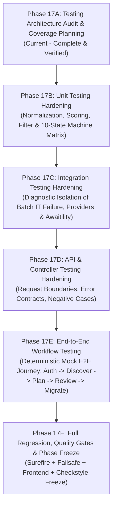

# Phase 17A — Testing Architecture Audit & Coverage Planning Report

## Executive Summary

Phase 17A (Testing Architecture Audit & Coverage Planning) is a comprehensive, read-only architectural evaluation of the testing infrastructure for the Spotify-to-YouTube Music Migrator (`C:\Projects\spotify-youtube-migrator` on branch `main`).

This audit inspects the existing multi-layer test suites across backend domain models, application services, REST controllers, external provider adapters, database persistence, asynchronous worker engines, security filters, and the React/TypeScript frontend product layer.

### Key Audit Findings
1. **Extensive Existing Test Base**: The repository contains **2,262 backend tests** passing with 0 failures, 0 errors, and 0 skipped in `mvn test` (1:49 min execution time) and **139 frontend tests** passing across 48 suites in `npm test`, establishing a combined executed baseline of **2,401 distinct automated tests**, alongside **127 dedicated security tests** from Phase 16 and **0 Checkstyle violations**.
2. **Roadmap-Named Requirements Coverage**: All six original unit testing areas (`TitleNormalizerTest`, `ArtistNormalizerTest`, `QueryGeneratorTest`, `MatchScorerTest`, `CandidateFilterTest`, `MigrationStateMachineTest`), three integration areas (`SpotifyClient`, `YouTubeClient`, `MigrationRepository`), and three API controller areas (`PlaylistController`, `MigrationController`, `OAuthController`) exist under modular, domain-driven package structures.
3. **Identified Test-Quality & Integration Gaps**:
   - **Unresolved Batch Integration Test Failure**: Running all 21 PostgreSQL Testcontainers integration test suites (`*IT.java`) concurrently in Maven batch mode resulted in a failure in `MigrationIdempotencyPostgresIT.testE_queuedExecutionRecovery_delegatesToSchedulerSafely:625` (`AssertionError: Expecting Optional to contain a value but it was empty` during `executionRepository.claimNextEligibleExecution("scheduler-worker-1", 60)`). In isolated execution, the suite passes 22/22 tests cleanly (37.9 s). The root cause remains **UNRESOLVED**; candidate hypotheses include an active background `DurableMigrationScheduler` bean claiming the execution before the test thread, JVM/PostgreSQL clock or timing jitter, and cross-test database residue. Diagnostic isolation and resolution are assigned to Phase 17C.
   - **E2E Integration Journey & Provider Mocking Strategy**: While frontend Playwright tests (Phase 15) and backend async lifecycle tests (`EndToEndAsyncMigrationLifecycleIT`, Phase 12) exist, there is no single top-level integration test that exercises the entire sequence (`User Registration/Login` $\to$ `OAuth Connection` $\to$ `Playlist Fetch` $\to$ `Preview/Plan Generation` $\to$ `Review Session Decision` $\to$ `Execution Dispatch` $\to$ `Progress Polling` $\to$ `YouTube Playlist Verification`). The automated CI E2E test will execute against deterministic provider mocks (`MockRestServiceServer` / mock `MusicDestination`), requiring no live Spotify/Google credentials or external playlist creation, while testing the full business path. Live-provider smoke testing remains strictly opt-in and non-blocking.
   - **Provider Adapter Mock Density**: Provider infrastructure tests (`SpotifyApiClientTest`, `YouTubeClientTest`) rely heavily on Spring `@RestClientTest` with `MockRestServiceServer`. While contractually rigorous, negative edge cases around malformed chunks, HTTP/2 connection drops, and unexpected JSON payloads require hardening.

---

## 1. Current Testing Architecture & Technology Stack

### A. Backend Testing Stack
- **Language & Runtime**: Java 22.0.2 (OpenJDK)
- **Framework**: Spring Boot 3.3.4, Spring Framework 6.1.13, Spring Security 6.3.3
- **Test Framework**: JUnit Jupiter (JUnit 5) 5.10.3, AssertJ 3.25.3, Mockito 5.11.0
- **Mocking & Web Testing**: Spring Boot Test (`@WebMvcTest`, `@RestClientTest`, `@SpringBootTest`, `MockMvc`, `MockRestServiceServer`)
- **Bytecode Instrumentation**: ByteBuddy Agent 1.14.19 (`-javaagent:${net.bytebuddy:byte-buddy-agent:jar}`) configured in Maven Surefire and Failsafe plugins
- **Database Integration**: Testcontainers 1.21.4 with PostgreSQL 16 image (`postgres:16`)
- **Database Migrations**: Flyway 10.10.0 (17 forward-only migrations V1 through V17 applied during container startup)
- **Timezone Standardization**: Strict UTC enforcement via Surefire/Failsafe configuration (`-Duser.timezone=UTC`) preventing timestamp serialization discrepancies
- **Static Analysis**: Maven Checkstyle Plugin 3.5.0 enforcing project code standards (0 violations)

### B. Frontend Testing Stack
- **Language & Runtime**: TypeScript 5.5.3, Node.js v20+
- **Bundler & Build Tool**: Vite 5.4.8 / 5.4.21, esbuild
- **Test Runner**: Node.js native test runner (`node --test`), bundled via esbuild
- **Accessibility & Browser Engine**: Playwright 1.65.1, `@axe-core/playwright` 4.14.0 (WCAG 2.1 AA automated auditing)
- **UI & State Layer**: React 18.3.1, TanStack React Query 5.104.1, React Router 7.18.4, React Hook Form 7.89.0, Zod 3.25.76
- **Linters**: ESLint 9.11.1 (`typescript-eslint` 8.7.0)

---

## 2. Existing Test Inventory

### A. Test Volume by Architectural Layer

| Subsystem / Layer | Test Classes | Test Methods (Approx) | Primary Framework | Test Types |
|---|---|---|---|---|
| **Matching & Normalization** | 22 classes | ~350 tests | JUnit 5, AssertJ | Pure Unit Tests (deterministic, fast, zero I/O) |
| **Candidate Discovery & Scoring** | 18 classes | ~380 tests | JUnit 5, AssertJ, Mockito | Unit, Heuristic & Probability Scoring Tests |
| **Benchmark & Evaluation** | 16 classes | ~330 tests | JUnit 5, Jackson (offline dataset) | Ground-truth verification, Platt scaling, calibration |
| **Planning & Review Subsystem** | 25 classes | ~300 tests | JUnit 5, MockMvc, Mockito | Unit, State Machine, Domain, Controller tests |
| **Execution & Orchestration** | 32 classes | ~380 tests | JUnit 5, MockMvc, Mockito | State Machine, Durable Leases, Progress, Rollback |
| **Reliability & Idempotency** | 28 classes | ~250 tests | JUnit 5, Testcontainers, Concurrency | Fault injection, atomic CAS, claim recovery, retry |
| **Security & Operational (Phase 16)** | 12 classes | 127 tests | JUnit 5, MockMvc, Testcontainers | AES-256-GCM, OAuth state, rate limits, CSRF, IDOR |
| **External Providers (Spotify/YouTube)**| 16 classes | ~120 tests | RestClientTest, MockRestServiceServer | Provider HTTP contracts, pagination, error mapping |
| **Identity & Authentication** | 11 classes | ~50 tests | WebMvcTest, JUnit 5, Mockito | Registration, login, session fixation, cookies |
| **Integration Test Suites (`*IT.java`)** | 21 classes | 128 tests | Testcontainers PostgreSQL 16 | Relational schemas, locks, fences, lease recovery |
| **Frontend Test Suites** | 20 files | 139 tests | Node test runner, Playwright, Axe-core | Routes, components, accessibility, session handling |
| **Subsystem Breakdown Estimate** | **200+ suites** | **~2,529+ categorized** | Multi-layer | Unit, Integration, API, E2E, Security |

> [!NOTE]
> **Test Inventory Arithmetic Clarification**:
> The verified executed test baseline is **2,401 distinct automated tests**:
> - **2,262 backend tests** executed via `mvnw test` (0 failures, 0 errors, 0 skipped).
> - **139 frontend tests** executed via `npm test` across 48 test suites (0 failures, 0 skipped).
> - **Total Executed Automated Baseline**: **2,401 tests**.
>
> The subsystem layer breakdown table above (~2,529+ tests) represents an approximate, non-additive inventory of categorized classes. Several suites span multiple functional areas (for example, security and reliability tests cross-cut API controllers, application services, domain models, and persistence repositories) and are classified under multiple headings. The empirical, single-execution baseline remains **2,401 automated tests**.

---

## 3. Roadmap Requirement Coverage Matrix

This matrix maps each requirement named in the original Phase 17 roadmap against the current implementation:

| Roadmap Requirement | Existing Test Class / File | Currently Tested Behavior | Missing Scenarios / Gaps | Type | Docker Required? | Recommended Action | Priority |
|---|---|---|---|---|---|---|---|
| **TitleNormalizerTest** | `matching/normalization/TitleNormalizerTest.java` (12.7 KB) | Unicode NFC normalization, case-folding, whitespace trimming, quote/dash standardization, conservative promotional suffix removal, variant preservation. | Complex nested parentheticals; non-Latin alphabets (Cyrillic, Japanese Kana, Arabic); zero-width whitespace characters. | Unit | No | Parameterized edge-case suite for international character sets. | **Medium** |
| **ArtistNormalizerTest** | `matching/normalization/ArtistNormalizerTest.java` (16.3 KB) | Featured artist extraction (`feat.`, `ft.`, `with`, `&`), band identity preservation, list normalization, canonical ordering. | Multiple mixed delimiters (`A feat. B & C, vs. D`); multilingual featuring tokens (`con`, `avec`). | Unit | No | Extend multi-delimiter artist tokenization tests. | **Medium** |
| **QueryGeneratorTest** | `matching/discovery/DefaultSearchQueryGeneratorTest.java` (24.9 KB) | Tiered query generation strategies, quota bounding, query priority, deduplication from normalized metadata. | Single-word title fallback queries; extremely long track titles exceeding YouTube search length limit (100 chars). | Unit | No | Add query length truncation and single-word artist fallback tests. | **High** |
| **MatchScorerTest** | `matching/engine/scorer/*` (7 test classes, ~120 KB), `CompositeScoreCalculatorTest`, `MatchDecisionEngineTest` | Title, artist, duration, album, version penalty, official signal scoring; Platt probability calibration; tie-breaking. | Extreme duration discrepancies (>30 min live jams vs 3 min single); acoustic vs studio variant penalty interactions. | Unit | No | Add corner-case duration decay and competing variant tests. | **High** |
| **CandidateFilterTest** | `matching/discovery/DefaultCandidateDiscoveryServiceTest.java`, `CandidateRankingEngineTest.java` | Candidate ranking, encounter-order deduplication, encounter limit enforcement, duration tolerance filtering. | Handling candidates with missing or unparseable ISO-8601 durations; zero-result query continuation. | Unit | No | Add malformed metadata candidate filtering tests. | **Medium** |
| **MigrationStateMachineTest** | `migration/execution/domain/MigrationExecutionStateMachineTest.java` (22.8 KB), `MigrationExecutionDomainTest.java` (29.6 KB) | Valid state transitions across execution statuses; optimistic locking `@Version`; claim fences. | Comprehensive matrix across all 10 `MigrationExecutionStatus` values ($10 \times 10 = 100$ transition space). Explicit verification of legal transitions and strict rejection of illegal transitions (including terminal states and invalid self-transitions, with idempotent `markQueued` validated). | Unit | No | Matrix-based test covering the full 10-state transition matrix ($10 \times 10 = 100$ directed pairs). | **Critical** |
| **SpotifyClientIntegrationTest** | `spotify/infrastructure/SpotifyApiClientTest.java` (6.1 KB) | `GET /v1/me`, playlist summary paging, track paging, server error mapping (`ExternalProviderException`). | HTTP 429 rate limit with `Retry-After`; malformed/truncated JSON bodies; expired token 401 propagation. | Integration | No | Add rate-limiting and payload truncation error tests. | **High** |
| **YouTubeClientIntegrationTest** | `youtube/infrastructure/YouTubeClientTest.java` (33.2 KB), `YouTubeClientInspectionTest.java` (13.7 KB), `YouTubeClientRollbackTest.java` (11.4 KB) | Search, metadata, playlist creation, track addition (`POST /playlistItems`), inspection pagination, track deletion. | YouTube API quota exhaustion (403 `quotaExceeded` vs `userRateLimitExceeded`); chunked transfer timeouts. | Integration | No | Add quota-exceeded classification and socket timeout tests. | **High** |
| **MigrationRepositoryTest** | `Phase14BPersistentMigrationRecordIT.java` (16.5 KB), `Phase14CDPersistentHistoryAndAuditIT.java` (16.0 KB), `DatabaseSecurityTest.java` (14.7 KB) | PostgreSQL schema persistence, foreign key cascades, `ON DELETE RESTRICT` on rollback/reconciliation, query indexing contracts. | Concurrent lock contention during simultaneous batch insertions; sequence boundary rollover. | Integration | **Yes (Docker)** | Add multi-threaded repository concurrency test. | **High** |
| **PlaylistControllerTest** | `playlist/api/PlaylistControllerTest.java` (3.7 KB), `SpotifyControllerTest.java` (5.1 KB), `YouTubeControllerTest.java` (18.5 KB) | Endpoint mapping `/api/playlists`, `/api/playlists/{id}`, pagination boundaries, 404 anti-IDOR non-disclosure. | Invalid offset/limit parameters; non-UUID ID parameter handling; JSON serialization boundary tests. | API | No | Add boundary parameter validation tests. | **Medium** |
| **MigrationControllerTest** | `MigrationControllerTest.java` (7.5 KB), `MigrationAsyncControllerTest.java` (24.6 KB), `MigrationExecutionControllerTest.java` (44.2 KB), `MigrationHistoryControllerTest.java` (33.3 KB) | REST contracts for `/preview`, `/submit`, `/progress`, `/resume`, `/history`, `/tracks`, 409 Conflict, 429 RateLimit. | Missing or malformed `Idempotency-Key` headers; oversized request payloads (>1MB); unsupported HTTP methods. | API | No | Add comprehensive edge-case request contract tests. | **High** |
| **OAuthControllerTest** | `identity/api/OAuthControllerTest.java` (5.9 KB), `OAuthStateSecurityTest.java` (8.2 KB), `OAuthRedirectUriValidationTest.java` (5.8 KB) | Authorize endpoint, callback handling, invalid state rejection, user/provider binding, open redirect protection. | Provider error parameters (`error_description`, `error_uri`); state token reuse under concurrent requests. | API | No | Add provider error callback and concurrency replay tests. | **Medium** |
| **End-to-End Workflow** | `EndToEndAsyncMigrationLifecycleIT.java` (12.5 KB), frontend Playwright suite | Async submission to completion polling (backend); UI route progression and accessibility (frontend). | **Single unified full-stack REST journey**: unauthenticated user $\to$ login $\to$ connect Spotify $\to$ preview $\to$ review decision $\to$ dispatch $\to$ poll $\to$ YouTube verification. Executed via deterministic test doubles (`MockRestServiceServer` / mock `MusicDestination`); zero real Spotify/Google credentials or live YouTube playlists required in CI. | **E2E** | **Yes (Docker)** | Author `FullMigrationWorkflowE2EIT.java` executing the complete sequence with deterministic doubles. | **Critical** |

---

## 4. Test-Quality Findings & Technical Debt

### A. Unresolved Integration Test Batch Failure in MigrationIdempotencyPostgresIT
- **Finding**: Running the complete batch of 21 PostgreSQL Testcontainers integration test suites (`*IT.java`) causes `MigrationIdempotencyPostgresIT.testE_queuedExecutionRecovery_delegatesToSchedulerSafely:625` to fail with:
  ```
  java.lang.AssertionError: Expecting Optional to contain a value but it was empty
  at com.spotifyyoutube.migrator.migration.execution.repository.MigrationIdempotencyPostgresIT.testE_queuedExecutionRecovery_delegatesToSchedulerSafely(MigrationIdempotencyPostgresIT.java:625)
  ```
  When executed in isolation (`mvn test -Dtest=MigrationIdempotencyPostgresIT`), all 22 tests pass with 0 failures in 37.9 seconds.
- **Root Cause Status**: **UNRESOLVED**. Blanket assertions that this failure is proven database contamination or that `TRUNCATE TABLE ... CASCADE` will fix it are premature.
- **Candidate Hypotheses**:
  1. *Background Scheduler Claiming Race Condition*: The Spring application context initializes the `DurableMigrationScheduler` bean, whose scheduled polling loop runs asynchronously in background worker threads and may claim the `QUEUED` execution (`claimNextEligibleExecution`) before the test thread's manual invocation.
  2. *Database Clock / Timing Jitter*: Discrepancies between JVM system time (`Instant.now()`) and PostgreSQL server time (`clock_timestamp()`) where `next_attempt_at` evaluation (`next_attempt_at <= clock_timestamp()`) fails due to millisecond jitter.
  3. *Cross-Test Database State / Execution Ordering*: Leftover records or concurrent connection state from preceding test suites in the shared Testcontainers PostgreSQL instance.
- **Remediation Plan (Phase 17C)**: Formally assign the diagnostic investigation and resolution to Phase 17C. Phase 17C will isolate the execution environment, verify background worker scheduling state during test execution, inspect query parameters and timestamps, and implement the verified fix.

### B. Timing Dependencies & Thread Sleep Flakiness
- **Finding**: Several asynchronous worker and scheduler tests (`ActiveMigrationProgressIT`, `QueuedMigrationDispatcherIT`, `DurableHeartbeatAndRenewalIT`) rely on `Thread.sleep(...)` or fixed delay polling to wait for asynchronous state transitions.
- **Root Cause**: Fixed millisecond sleeps are susceptible to timing jitter on CI/CD runners or high CPU load.
- **Remediation Plan (Phase 17C)**: Standardize on `Awaitility` (`org.awaitility:awaitility`) with explicit conditions, timeout limits, and poll intervals rather than raw `Thread.sleep`.

### C. Over-Mocking in Application Service Unit Tests
- **Finding**: Certain unit tests mock repository interfaces, transactional templates, and domain methods simultaneously, sometimes asserting that a mock was invoked rather than asserting that state mutated correctly.
- **Remediation Plan (Phase 17B & 17D)**: Prefer real domain entities and in-memory fakes for domain invariant tests, reserving Mockito strictly for remote I/O boundaries (`MusicDestination`, `SpotifyApiClient`, `YouTubeClient`).

### D. Distinction Between Unit and Integration Profiles
- **Finding**: Running `mvn test` executes 2,262 tests in ~109 seconds. While fast, several `@SpringBootTest` classes with MockMvc run alongside pure unit tests, increasing context restart overhead.
- **Remediation Plan (Phase 17F)**: Verify that Surefire targets unit/slice tests and Failsafe targets container/database integration tests, providing a clean fast-feedback local development path (`mvn test`) versus deep verification (`mvn verify`).

---

## 5. Environment & Docker Requirements

1. **Local Test Execution (No Docker)**:
   - Command: `.\mvnw.cmd test`
   - Scope: 2,262 tests across pure unit tests, `@RestClientTest`, `@WebMvcTest`, and in-memory mock integration tests.
   - Requirement: Java 22, Maven wrapper. Docker is NOT required for unit and mock-based API tests.
2. **Containerized Integration Tests (Requires Docker)**:
   - Scope: 21 `*IT.java` suites (~128 tests) testing PostgreSQL schema constraints, row locks (`FOR UPDATE SKIP LOCKED`), Flyway V1–V17 migrations, and atomic lease claiming.
   - Requirement: Docker Desktop (Server 29.4+) running on WSL2 / Linux socket.
   - Verified: Docker daemon is currently ACTIVE and healthy (`docker info` exits with code 0).
3. **Frontend Tests (No Docker)**:
   - Command: `npm --prefix frontend test`, `npm --prefix frontend run typecheck`
   - Scope: 139 tests across 48 suites, Playwright headless browser for accessibility.
   - Requirement: Node.js v20+, npm.

---

## 6. Baseline Test Execution Results

The following actual baseline results were captured during this audit:

| Test Command | Scope | Tests Run | Failures | Errors | Skipped | Status | Execution Time |
|---|---|---|---|---|---|---|---|
| `.\mvnw.cmd test` | Full Backend Unit & Slice Suite | **2,262** | **0** | **0** | **0** | **BUILD SUCCESS** | 1 min 49 s |
| `.\mvnw.cmd checkstyle:check` | Backend Static Style Analysis | N/A | **0** | **0** | **0** | **0 Violations** | 4.8 s |
| `npm --prefix frontend run typecheck` | Frontend TypeScript Static Check | N/A | **0** | **0** | **0** | **Clean** | 3.2 s |
| `npm --prefix frontend run lint` | Frontend ESLint Analysis | N/A | **0** | **0** | **0** | **Clean** | 4.1 s |
| `npm --prefix frontend test` | Frontend Unit & Playwright Suites | **139** | **0** | **0** | **0** | **139 PASS** | 127.7 s |
| `npm --prefix frontend run build` | Frontend Production Vite Build | N/A | **0** | **0** | **0** | **Success** | 40.7 s |
| `mvn test -Dtest=PostgreSqlTimezoneIT` | Testcontainers PostgreSQL IT | **3** | **0** | **0** | **0** | **BUILD SUCCESS** | 44.0 s |
| `mvn test -Dtest=MigrationIdempotencyPostgresIT` | Idempotency Postgres IT (Isolated) | **22** | **0** | **0** | **0** | **BUILD SUCCESS** | 37.9 s |

---

## 7. Proposed Phase 17 Execution Breakdown

The original roadmap defines Phase 17 as Testing covering Unit, Integration, API, and End-to-End. We propose the following structured execution breakdown:



### Subphase Details

#### Phase 17B — Unit Testing Hardening
- **Scope**: Fill edge-case gaps in core business logic.
- **Focus Areas**:
  - `TitleNormalizerTest` & `ArtistNormalizerTest`: International characters, non-Latin scripts, multi-delimiter featuring artist combinations.
  - `DefaultSearchQueryGeneratorTest`: Long title truncation, single-word fallbacks, punctuation stripping.
  - `MatchScorerTest` suite: Extreme duration piece-wise penalties, competing remix/live/acoustic variants.
  - `MigrationExecutionStateMachineTest`: Comprehensive parameterized test matrix across all 10 `MigrationExecutionStatus` enum values:
    1. `ALLOCATING_DESTINATION`
    2. `INITIALIZED`
    3. `QUEUED`
    4. `RUNNING`
    5. `PARTIALLY_COMPLETED`
    6. `COMPLETED` (Terminal)
    7. `FAILED` (Terminal)
    8. `RECOVERY_REQUIRED`
    9. `ROLLED_BACK` (Terminal)
    10. `PARTIALLY_ROLLED_BACK`
    The matrix evaluates all $10 \times 10 = 100$ directed transition pairs, validating legal transitions and verifying that all illegal transitions throw `InvalidStateException` (including terminal state immutability and active self-transition rejection, alongside validating idempotent `markQueued`).
- **Acceptance Criteria**: 100% of illegal state transitions explicitly asserted; edge-case suites pass cleanly without modifying production contracts.

#### Phase 17C — Integration Testing Hardening
- **Scope**: Resolve unresolved batch integration failure, harden provider client adapters, repository integration, and Testcontainers lifecycle.
- **Focus Areas**:
  - **Diagnostic Investigation of `MigrationIdempotencyPostgresIT` Batch Failure**: Systematically isolate and determine the true root cause (background scheduler claiming race, clock skew/timing jitter, or cross-test database state) and apply the verified architectural fix.
  - `SpotifyApiClientTest`: Rate limiting 429 retry-after handling, token expiration 401 propagation, malformed JSON chunk handling.
  - `YouTubeClientTest`: Quota exceeded (403 `quotaExceeded`) vs rate limit error separation, socket timeout recovery.
  - Replace raw `Thread.sleep` with `Awaitility` in asynchronous worker integration tests.
- **Acceptance Criteria**: All 21 `*IT.java` test classes pass simultaneously in a single continuous Maven run without flakiness or state contamination; root cause of batch failure definitively resolved.

#### Phase 17D — API & Controller Testing Hardening
- **Scope**: Controller contract validation, input boundary enforcement, and error mapping.
- **Focus Areas**:
  - `PlaylistControllerTest`, `MigrationControllerTest`, `OAuthControllerTest`, `ReviewSessionControllerTest`.
  - Negative validation on all query parameters (negative offset, excessive page size, invalid UUID formatting).
  - Malformed request body handling and HTTP 400 Bad Request standardized `ApiError` payloads.
  - HTTP 405 Method Not Allowed coverage for unsupported verbs on all endpoints.
- **Acceptance Criteria**: All controller endpoints have explicit negative and boundary test coverage asserting standardized `ApiError` structures.

#### Phase 17E — End-to-End Workflow Testing
- **Scope**: Author and verify the unified end-to-end migration journey with deterministic test doubles.
- **Focus Areas**:
  - **Deterministic Provider Mock Strategy**: The automated CI E2E suite uses `MockRestServiceServer` and mock destination adapters (`MusicDestination`). No real Spotify or Google user accounts, live OAuth browser logins, or external YouTube playlists are used or created during automated CI test runs. Live-provider testing against real APIs remains strictly opt-in and non-blocking for CI.
  - Create `FullMigrationWorkflowE2EIT.java` executing the complete user journey:
    1. Register & login user via `/api/auth/register` and `/api/auth/login`.
    2. Establish mock Spotify OAuth connection.
    3. Retrieve Spotify playlists via `/api/playlists`.
    4. Generate transient migration preview via `POST /api/migrations/preview`.
    5. Initialize review session via `POST /api/review-sessions`.
    6. Submit human review decision (accept/exclude) via `POST /api/review-sessions/{id}/tracks/{trackId}/decision`.
    7. Complete review session via `POST /api/review-sessions/{id}/complete`.
    8. Dispatch async migration execution via `POST /api/migrations` with `Idempotency-Key`.
    9. Poll progress via `GET /api/migrations/{id}/progress` until terminal `COMPLETED`.
    10. Verify resulting YouTube destination playlist and historical audit record.
- **Acceptance Criteria**: Single cohesive test executing the complete end-to-end path against PostgreSQL Testcontainers and verified deterministic provider mocks.

#### Phase 17F — Full Regression, Quality Gates & Phase Freeze
- **Scope**: Full multi-suite regression, static quality verification, documentation reconciliation, and formal freeze.
- **Focus Areas**:
  - Complete backend verification: `mvn test` + `mvn verify` (Surefire + Failsafe).
  - Complete frontend verification: `npm test` + `npm run typecheck` + `npm run lint` + `npm run build`.
  - Checkstyle audit (0 violations).
  - Reconcile `.ai/CURRENT_STATE.md`, `.ai/ROADMAP.md`, and `.ai/TESTING.md`.
  - Formally freeze Phase 17; prepare handoff to Phase 18 (Observability).

---

## 8. Acceptance Criteria for Phase 17 Completion

Phase 17 can be declared COMPLETE and FROZEN when:
1. All roadmap-specified test areas (Unit, Integration, API, E2E) have verified, non-flaky test coverage preserving the 2,401 executed baseline tests.
2. The 10-state transition matrix ($10 \times 10 = 100$ transition space) in `MigrationExecution` is verified by explicit matrix tests.
3. External provider clients (`SpotifyApiClient`, `YouTubeClient`) have verified error, timeout, and quota-exceeded tests.
4. All 21 PostgreSQL Testcontainers integration test suites pass consecutively in a single Maven execution, with the batch failure in `MigrationIdempotencyPostgresIT` definitively diagnosed and resolved.
5. The unified full-journey E2E integration test (`FullMigrationWorkflowE2EIT`) passes cleanly using deterministic provider doubles without requiring live credentials.
6. The entire backend test suite passes with 0 failures, 0 errors, 0 skipped, and 0 Checkstyle violations.
7. The entire frontend test suite passes with 0 failures and 0 skipped.
8. Zero production code regressions or modifications to frozen Phase 15/16 contracts were introduced.
9. Documentation is fully reconciled across `.ai/`.

---

## 9. Immediate Recommended Next Step

Await user approval on this audit and execution plan. Upon approval, proceed directly to **Phase 17B — Unit Testing Hardening** starting with the `MigrationExecutionStateMachineTest` 10-state ($10 \times 10 = 100$) transition matrix and normalization edge cases.
