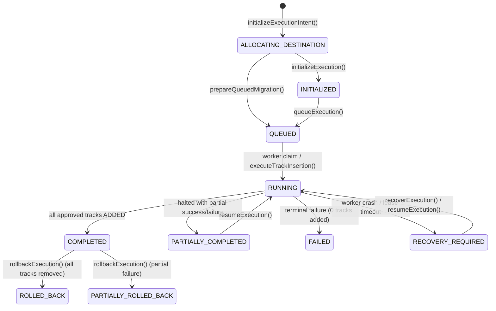
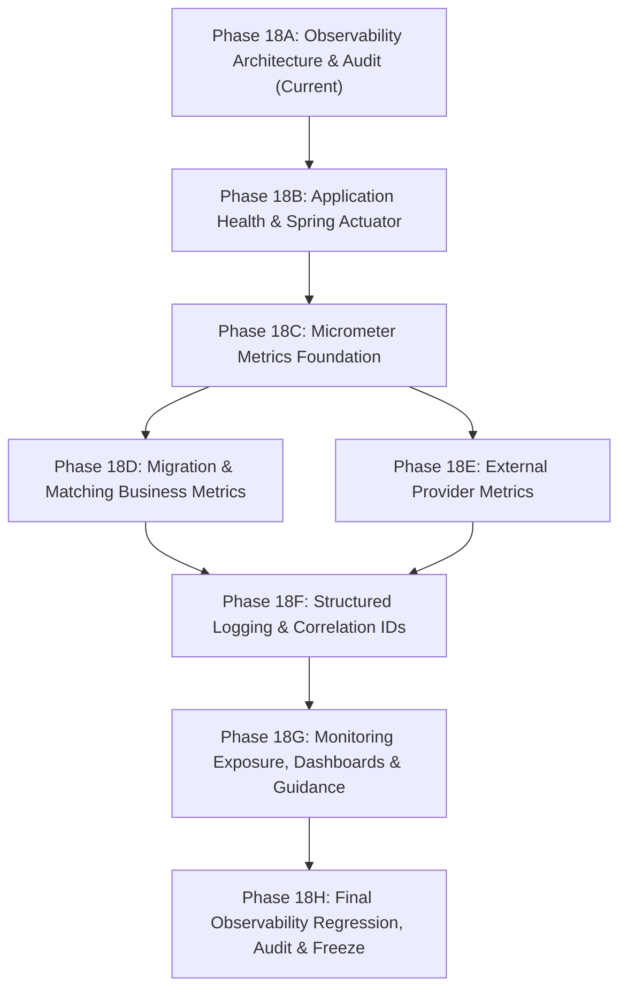

# Phase 18A — Observability Architecture & Audit Report

- **Phase:** Phase 18A — Observability Architecture & Audit (Audit-Only)
- **Date:** 2026-11-19
- **Repository:** `C:\Projects\spotify-youtube-migrator`
- **Branch:** `main`
- **Verified Baseline Commit:** `53e1064282658a872cfd8722a7aa494c9430fe6b`
- **Remote:** `origin/main` (Synchronized, clean working tree)
- **Status:** `COMPLETE — AUDIT VERIFIED`

---

## 1. Executive Summary

Phase 18 of the Spotify–YouTube Migrator roadmap is titled **Observability & Production — Metrics + Monitoring**. Phase 18A is the mandatory, read-only architectural investigation and audit phase conducted prior to any observability implementation.

In strict adherence to the project guidelines, **Phase 18A is an audit-only phase**. Zero production Java code, configuration files, test suites, or dependencies were added or modified. The preflight Git verification confirmed that the repository is on branch `main` at commit `53e1064282658a872cfd8722a7aa494c9430fe6b`, synchronized with `origin/main` with a clean working tree. The full baseline test suite was verified: 2,500 unit and architectural tests pass with zero failures, zero errors, and zero Checkstyle violations.

### Key Audit Findings

1. **Spring Boot & Micrometer Foundation:**
   - Spring Boot version is **3.3.4** on **Java 22** (`CONFIRMED`).
   - `spring-boot-starter-actuator` is already present in `backend/pom.xml` (`CONFIRMED`), pulling in `io.micrometer:micrometer-core:1.13.4` transitively.
   - However, `micrometer-registry-prometheus` is **NOT PRESENT** in `pom.xml`, and no Prometheus scraping endpoint (`/actuator/prometheus`) is currently available.
   - Zero custom metrics, counters, timers, or distribution summaries currently exist in the codebase.

2. **Spring Actuator & Health Architecture:**
   - Actuator is already configured in `SecurityConfig.java` and `application.yml` (`CONFIRMED`).
   - Public access is strictly restricted to `/actuator/health` (including liveness and readiness probe sub-paths) and `/actuator/info` (`CONFIRMED`).
   - `management.endpoint.health.show-details: never` is enforced in production and base configurations, preventing credential, component, or disk leakage (`CONFIRMED`).
   - `/actuator/metrics` is currently locked down with HTTP 403 Forbidden under unauthenticated access and excluded from `management.endpoints.web.exposure.include` (`CONFIRMED`).
   - A legacy controller `HealthController.java` maps `GET /api/health` returning `{"status": "UP"}`, but requires authentication under `SecurityConfig` (`CONFIRMED`).

3. **Migration Lifecycle Instrumentation Points:**
   - The migration engine operates on a durable state machine (`MigrationExecutionStatus`) with 10 explicit states and 8 per-track execution states (`ExecutionTrackStatus`).
   - Authoritative recording boundaries for migration starts, completions, failures, retries, and rollbacks exist inside `DefaultMigrationExecutionStateService.java` and `DefaultExecutionAuditService.java`.
   - Polling endpoints (`GET /api/migrations/{executionId}/progress`) must be strictly decoupled from metric recording to prevent catastrophic duplicate counting during high-frequency frontend polling.

4. **Matching Engine Observability:**
   - Track matching is coordinated through `DefaultTrackMatchingEngine.java` and `DefaultPlaylistMigrationPlanGenerator.java`.
   - The composite similarity score (`score`) is already computed for every evaluated candidate.
   - Calculating `average_match_score` can be accomplished with **zero computational overhead or recalculation** by recording scores directly into a Micrometer `DistributionSummary`, which natively maintains count, sum, max, and percentiles for Prometheus aggregation (`rate(sum)/rate(count)`).

5. **External Provider Boundaries:**
   - Both `SpotifyApiClient` and `YouTubeClient` use Spring Framework 6's synchronous `RestClient` (`CONFIRMED`).
   - `YouTubeClientConfig` configures `RestClientCustomizer` setting explicit connect/read timeouts.
   - Provider metrics (`youtube_api_requests_total`, `youtube_api_errors_total`, latency, retries) can be cleanly, uniformly instrumented via a `ClientHttpRequestInterceptor` registered through `RestClientCustomizer` without invasive modifications to business logic.

6. **Worker & Async Propagation:**
   - Asynchronous migrations execute on a bounded `ThreadPoolTaskExecutor` (`migrationTaskExecutor`, core=2, max=4, queue=50).
   - In the existing architecture, `ThreadLocal` Mapped Diagnostic Context (MDC) is **lost** when work is handed off to worker threads.
   - Furthermore, scheduler-initiated processing (`DurableMigrationScheduler`) runs decoupled from any HTTP request context.
   - A dedicated `TaskDecorator` and entity-based MDC population mechanism are required to propagate correlation context across asynchronous and scheduled execution boundaries.

7. **Logging & Sensitive Data Protection:**
   - Current logging is plain-text console logging via Logback (Spring Boot default). No custom `logback-spring.xml` or JSON encoder exists (`NOT PRESENT`).
   - MDC is completely unused (`NOT PRESENT`).
   - However, the project possesses a battle-tested, high-performance sanitizer: `SensitiveDataSanitizer.java` (`com.spotifyyoutube.migrator.common.security.logging`). It provides pre-compiled regex redaction for Bearer tokens, Basic credentials, Authorization headers, query parameters, JSON fields, cookies, CRLF log injection neutralization, and circular-safe exception cause chain traversal.

---

## 2. Audit Scope & Baseline

### Preflight Verification Record

| Check | Expected | Actual | Status |
| :--- | :--- | :--- | :--- |
| **Repository Path** | `C:\Projects\spotify-youtube-migrator` | `C:\Projects\spotify-youtube-migrator` | `CONFIRMED` |
| **Current Branch** | `main` | `main` | `CONFIRMED` |
| **HEAD Commit** | `53e1064282658a872cfd8722a7aa494c9430fe6b` | `53e1064282658a872cfd8722a7aa494c9430fe6b` | `CONFIRMED` |
| **Remote HEAD (`origin/main`)** | `53e1064282658a872cfd8722a7aa494c9430fe6b` | `53e1064282658a872cfd8722a7aa494c9430fe6b` | `CONFIRMED` |
| **Working Tree Status** | Clean | Clean (0 modified, 0 staged, 0 untracked) | `CONFIRMED` |
| **Baseline Test Suite** | 2,500 tests passing | 2,500 unit/slice tests passing (0 failures, 0 errors, 0 skipped) | `CONFIRMED` |
| **Checkstyle Violations** | 0 | 0 Checkstyle violations | `CONFIRMED` |

### Audit Constraints

- **Mode:** Audit-only / read-only architecture investigation.
- **Production Modifications:** 0 files changed.
- **Configuration Modifications:** 0 files changed.
- **Dependency Changes:** 0 dependencies added or updated.
- **Git State:** Preserved without stash, checkout, rebase, reset, or history manipulation.

---

## 3. Current Architecture Overview

### A. Core Stack & Frameworks

| Component | Technology | Version | Location / Reference |
| :--- | :--- | :--- | :--- |
| **Language Runtime** | Java | 22 (pinned `22.0.2`) | `backend/pom.xml` (`<java.version>22</java.version>`) |
| **Framework** | Spring Boot | 3.3.4 | `backend/pom.xml` (`spring-boot-starter-parent:3.3.4`) |
| **Spring Framework** | Spring Framework | 6.1.13 | Transitive from Spring Boot 3.3.4 |
| **Web Layer** | Spring MVC + WebFlux | 6.1.13 | `spring-boot-starter-web`, `spring-boot-starter-webflux` |
| **HTTP Client** | Spring RestClient | 6.1.13 | Synchronous fluent `RestClient` in `SpotifyApiClient`, `YouTubeClient` |
| **Security Layer** | Spring Security | 6.3.3 | `spring-boot-starter-security`, `SecurityConfig.java` |
| **Persistence** | Spring Data JPA / Hibernate | 6.5.3.Final | `spring-boot-starter-data-jpa`, PostgreSQL Driver `42.7.4` |
| **Database Migrations** | Flyway | 10.10.0 | `V1` through `V17` in `db/migration/` |
| **Validation** | Jakarta Bean Validation | 3.0.2 / Hibernate Validator 8.0.1 | `spring-boot-starter-validation` |
| **Operational Health** | Spring Boot Actuator | 3.3.4 | `spring-boot-starter-actuator` |
| **Testing Engine** | JUnit 5, AssertJ, Mockito, Testcontainers | 1.21.4 (Testcontainers) | `application-test.yml`, 23 integration test suites |

### B. Backend Package Organization

The backend follows a domain-driven, modular package structure under `com.spotifyyoutube.migrator`:

```text
com.spotifyyoutube.migrator
├── common                      # Cross-cutting infrastructural concerns
│   ├── config                  # SecurityConfig, JpaConfig
│   ├── domain                  # BaseEntity
│   ├── exception               # GlobalExceptionHandler, ApiError, ErrorCode, Custom exceptions
│   ├── security                # CSRF filter, rate limiters, SensitiveDataSanitizer
│   └── web                     # HealthController
├── identity                    # Authentication, User management, OAuth 2.0 flows
│   ├── api                     # AuthController, OAuthController, UserController
│   ├── application             # AuthenticationService, OAuthTokenLifecycleService
│   └── domain / repository     # User, OAuthConnection, OAuthState
├── matching                    # Pure matching, scoring, normalization, calibration, benchmark
│   ├── benchmark               # Benchmark runner, datasets, metrics calculators
│   ├── discovery               # CandidateDiscoveryService, SearchQueryGenerator
│   ├── engine                  # TrackMatchingEngine, CompositeScoreCalculator, DecisionEngine
│   └── normalization           # NormalizationOrchestrator, TitleNormalizer, ArtistNormalizer
├── migration                   # Core migration execution, async scheduling, recovery, review
│   ├── api                     # MigrationController, MigrationExecutionController, MigrationPlanController
│   ├── application             # ApprovedMigrationOrchestrator, MigrationExecutionStateService
│   ├── async                   # AsyncMigrationConfig, MigrationBackgroundWorker, MigrationJobDispatcher
│   ├── execution               # MigrationExecution, ExecutionTrackRecord, ExecutionAuditEvent
│   ├── progress                # MigrationProgressService, InMemoryProgressPollingRateLimiter
│   ├── reliability             # Schedulers, Leases, Idempotency, Classifiers, RetryPolicies
│   └── review                  # ReviewSessionController, ReviewSessionService
├── playlist                    # Playlist and Track domain definitions, Platform enum
├── spotify                     # SpotifyApiClient, SpotifyPlaylistService, SpotifyController
└── youtube                     # YouTubeClient, YouTubePlaylistService, YouTubeMusicDestinationAdapter
```

### C. Controllers & REST Surface

| Controller | Base Path | Responsibilities | Auth Requirement |
| :--- | :--- | :--- | :--- |
| `HealthController` | `/api/health` | Legacy basic status check (`{"status": "UP"}`) | `authenticated()` |
| `AuthController` | `/api/auth` | User registration, login, logout | `permitAll()` |
| `OAuthController` | `/api/oauth` | OAuth authorization URLs, callbacks, disconnection | Callback: `permitAll()`; Others: `authenticated()` |
| `UserController` | `/api/users` | Current user profile retrieval | `authenticated()` |
| `MigrationPlanController` | `/api/migrations/plans` | Preview migration plan without mutations | `authenticated()` |
| `ReviewSessionController` | `/api/migrations/review-sessions` | Interactive track review decisions | `authenticated()` |
| `MigrationController` | `/api/migrations` | Async submission, progress polling, history | `authenticated()` |
| `MigrationExecutionController` | `/api/migrations/executions` | Execution lifecycle inspection, recovery, rollback | `authenticated()` |
| `PlaylistController` | `/api/playlists` | Internal playlist query endpoints | `authenticated()` |
| `SpotifyController` | `/api/spotify` | Spotify playlist & track retrieval | `authenticated()` |
| `YouTubeController` | `/api/youtube` | YouTube playlist & video management | `authenticated()` |

### D. Exception & Error-Handling Architecture

All application exceptions are centralized in `GlobalExceptionHandler.java` (`@RestControllerAdvice`). It maps business, security, and provider exceptions into a standardized immutable response record:

```java
public record ApiError(
    ErrorCode code,
    String message,
    String timestamp,
    String path
) {}
```

- **Error Codes:** `ErrorCode` defines 11 discrete categories: `INVALID_REQUEST`, `UNAUTHORIZED`, `FORBIDDEN`, `NOT_FOUND`, `CONFLICT`, `INVALID_STATE`, `EXTERNAL_PROVIDER_ERROR`, `TOO_MANY_REQUESTS`, `INTERNAL_SERVER_ERROR`, `IDEMPOTENCY_FINGERPRINT_MISMATCH`, and `METHOD_NOT_ALLOWED`.
- **Security Invariant:** Internal SQL exceptions, class names, database connection parameters, and raw provider payloads are never exposed to clients.
- **Rate-Limiting Response:** Handlers emit RFC 9110 compliant `Retry-After` headers when throttling or rate limiting occurs.
- **Missing Field:** Currently, `ApiError` does **not** include a `requestId` or `correlationId`.

### E. Security Configuration

Configured in `SecurityConfig.java`:
- **CORS:** Configured with strict origin whitelisting (`cors.allowed-origins`).
- **CSRF:** `CookieCsrfTokenRepository.withHttpOnlyFalse()` with `CsrfCookieFilter` for SPA client integration.
- **Session Fixation:** Protected via `sessionManagement.sessionFixation().changeSessionId()`.
- **Filter Chain:**
  1. `CsrfCookieFilter` (after `BasicAuthenticationFilter`)
  2. `ApiRateLimitingFilter` (before `AuthorizationFilter`)
  3. `AuthorizationFilter` (Spring Security authorization rules)
  4. `ApiIdempotencyFilter` (after `AuthorizationFilter`, scoped to `/api/migrations/submit`)
- **Actuator Lockdown:**
  - `/actuator/health`, `/actuator/health/**`, and `/actuator/info` are `permitAll()`.
  - All other `/actuator/**` paths require authentication (`.authenticated()`).

---

## 4. Existing Observability Inventory

The following inventory evaluates every observability capability across the repository:

| Capability | Status | Implementation Details / Evidence | Assessment / Gap |
| :--- | :--- | :--- | :--- |
| **Spring Actuator** | `PARTIALLY IMPLEMENTED` | Present in `pom.xml` (`spring-boot-starter-actuator`). Configured in `SecurityConfig.java` and `application.yml`. | Actuator framework is present and locked down, but limited to health and info. |
| **Micrometer Core** | `PARTIALLY IMPLEMENTED` | Transitively present on classpath (`io.micrometer:micrometer-core:1.13.4`). | Present as a dependency, but zero meters (Counters, Gauges, Timers) are instantiated or registered. |
| **Prometheus Registry** | `NOT PRESENT` | Absent from `pom.xml`. No `micrometer-registry-prometheus` dependency. | Prometheus scraper endpoint (`/actuator/prometheus`) cannot function without this dependency. |
| **Health Endpoints** | `PARTIALLY IMPLEMENTED` | `/actuator/health` active. `management.endpoint.health.show-details: never` enforced. | Returns basic status; no custom health indicators for YouTube/Spotify or background workers. |
| **Liveness Checks** | `PARTIALLY IMPLEMENTED` | `/actuator/health/liveness` active via `management.endpoint.health.probes.enabled: true`. | Standard Spring Boot liveness probe; verifies process is running. |
| **Readiness Checks** | `PARTIALLY IMPLEMENTED` | `/actuator/health/readiness` active via `management.endpoint.health.probes.enabled: true`. | Checks DB DataSource availability; does not check worker scheduler readiness. |
| **Application Info** | `IMPLEMENTED` | `/actuator/info` active. In `application-prod.yml`, `management.info.env.enabled: false`. | Safe metadata exposure without leaking secrets. |
| **Structured / JSON Logging** | `NOT PRESENT` | Logs are standard plain-text console output from Logback. No custom encoder. | Difficult to ingest into modern log collectors (Datadog, Loki, CloudWatch) without JSON parsing. |
| **Logback Configuration** | `PARTIALLY IMPLEMENTED` | Default Spring Boot Logback auto-configuration. Logging levels set in `application.yml`. | No `logback-spring.xml` file exists. |
| **MDC Usage** | `NOT PRESENT` | Zero occurrences of `org.slf4j.MDC` in `backend/src`. | Logs cannot correlate asynchronous actions to a common originating request. |
| **Correlation / Request IDs** | `NOT PRESENT` | No HTTP request correlation filters or response headers (`X-Correlation-ID`). | Only `ExecutionAuditEvent` table has a `correlation_id` DB column for audit events. |
| **Trace IDs / Tracing** | `NOT PRESENT` | No distributed tracing (OpenTelemetry, Micrometer Tracing, Brave). | Expected for current monolithic architecture; not required for Phase 18. |
| **HTTP Access Logging** | `NOT PRESENT` | No Tomcat access log or request/response logging filter. | Inbound request rates and HTTP status codes are invisible unless controllers log them. |
| **Monitoring Dashboards** | `NOT PRESENT` | No Grafana, Prometheus, or monitoring dashboards configured. | Conceptual design required in Phase 18A; implementation in Phase 18G. |
| **Sensitive Data Redaction** | `IMPLEMENTED` | `SensitiveDataSanitizer.java` in `com.spotifyyoutube.migrator.common.security.logging`. | High quality, circular-safe, multi-pattern credential sanitizer from Phase 16F. |

---

## 5. Migration Lifecycle Instrumentation Map

The migration subsystem is governed by a 10-state lifecycle:



### Authoritative Instrumentation Boundaries

| Lifecycle Phase | Source Class & Method | Authoritative Metric Boundary | Recommended Metric Action | Duplicate Risk & Mitigation |
| :--- | :--- | :--- | :--- | :--- |
| **Plan Preview (Transient)** | `DefaultPlaylistMigrationPlanGenerator.generatePlan(userId, playlistId, deduplicate)` | End of track evaluation loop (line 155) | `tracks_matched_total`<br>`tracks_unmatched_total`<br>`average_match_score` | High risk: Users click "Preview" repeatedly. Must tag metrics with `phase="preview"` or measure during persistent plan creation. |
| **Review Session Initialization** | `DefaultReviewSessionService.createSession(userId, sourcePlaylistId)` | Review session persisted (line 85) | `review_session_created_total` | Scoped to explicit user creation. |
| **Review Decision Submission** | `DefaultReviewSessionService.submitDecision()` / `selectCandidate()` | Review track updated | `review_decisions_total` (`type="select|exclude"`) | Incremented strictly upon decision mutation. |
| **Migration Submission (Queued)** | `MigrationJobDispatcher.dispatchMigration(request, userId)` | Synchronous preparation complete (line 83) | `migration_queued_total` | Do not count as started until active processing begins. |
| **Scheduler Claim & Lease** | `DurableMigrationScheduler.claimNextEligibleExecution()` | Successful atomic claim transaction (line 203) | `scheduler_claim_total` | Measured outside track loops; exactly one increment per lease claim. |
| **Migration Execution Start** | `DefaultMigrationExecutionStateService.executeTrackInsertion(executionId, userId)` | State transition to `RUNNING` (line 1649) | `migration_started_total`<br>Start `migration_duration` timer | Differentiate `mode="initial"` vs `mode="resumed"`. Never increment on scheduler poll. |
| **Per-Track Insertion** | `DefaultMigrationExecutionStateService.executeTrackInsertion()` | Outcome switch block (lines 1203, 1229, 1250) | `tracks_inserted_total` (`status="added|failed|uncertain|skipped"`) | Recorded per track attempt; idempotent resumptions only process `PENDING` tracks. |
| **Terminal Completion** | `DefaultMigrationExecutionStateService.checkTerminalTransition(execution)` | `execution.getStatus() == COMPLETED` (line 3009) | `migration_completed_total`<br>Stop `migration_duration` timer | **Strict boundary:** Never record on `GET /api/migrations/{id}/progress` polling! Only inside `checkTerminalTransition`. |
| **Terminal Failure** | `DefaultMigrationExecutionStateService.checkTerminalTransition(execution)` | `execution.getStatus() == FAILED` (line 3009) | `migration_failed_total`<br>Stop `migration_duration` timer | Recorded only when terminal state is reached, not during transient in-flight retries. |
| **Partial Completion** | `DefaultMigrationExecutionStateService.executeTrackInsertion()` | Final status is `PARTIALLY_COMPLETED` | `migration_partially_completed_total` | Distinguishes stopped/resumable executions from hard terminal failures. |
| **Rollback Execution** | `DefaultMigrationExecutionStateService.rollbackExecution()` | Rollback summary finalized | `migration_rollback_total`<br>`tracks_rolled_back_total` | Recorded when user requests rollback of completed/partial migration. |

---

## 6. Matching System Instrumentation Map

### Matching Architecture Components

1. **Normalization (`NormalizationOrchestrator`):** Cleans metadata, strips acoustic/remaster tokens, standardizes artist credits.
2. **Candidate Discovery (`CandidateDiscoveryService`):** Generates search queries and retrieves candidates via `YouTubeSearchService`.
3. **Similarity Scoring (`CandidateSimilarityScorer`):** Computes title, artist, album, duration, and version penalty scores.
4. **Composite Score (`CompositeScoreCalculator`):** Combines weighted component similarities into a normalized numerical score `[0.0, 1.0]`.
5. **Probability Calibration (`MatchProbabilityCalibrator`):** Applies Platt scaling regularized model to estimate true match probability.
6. **Decision Engine (`MatchDecisionEngine`):** Applies 7-gate decision policy yielding `MATCH`, `REVIEW_REQUIRED`, or `NO_MATCH`.

### Authoritative Instrumentation Points for Matching

```text
DefaultPlaylistMigrationPlanGenerator.generatePlan()
  │
  ├── For each source track:
  │     │
  │     ├── matchingEngine.matchTrack(matchReq)
  │     │     └── TrackMatchResult:
  │     │           ├── decision: MATCH | REVIEW_REQUIRED | NO_MATCH
  │     │           ├── score: Double [0.0, 1.0]
  │     │           ├── calibratedProbability: Double [0.0, 1.0]
  │     │           └── confidence: HIGH | MEDIUM | LOW
  │     │
  │     ├── [Authoritative Boundary 1: Decision Counters]
  │     │     ├── decision == MATCH           --> Increment tracks_matched_total
  │     │     ├── decision == REVIEW_REQUIRED  --> Increment tracks_review_required_total
  │     │     └── decision == NO_MATCH        --> Increment tracks_unmatched_total
  │     │
  │     └── [Authoritative Boundary 2: Distribution Summary]
  │           └── matching.score.record(score) --> Updates count, sum, max, percentiles
```

### Evaluation of `average_match_score`

- **Feasibility:** `CONFIRMED`. Every `TrackMatchResult` already carries the composite numerical score in `matchResult.score()`.
- **Zero Overhead Guarantee:** Micrometer's `DistributionSummary` records each track score (`0.0` to `1.0`) in $O(1)$ memory and time.
- **Why Gauge Is Inadvisable for Averages:** A standalone Micrometer `Gauge` representing an average requires maintaining an in-memory window or accumulating sums that do not scale across multiple application instances.
- **Recommended Implementation:**
  ```java
  DistributionSummary matchScoreSummary = DistributionSummary.builder("matching.score")
      .description("Distribution of track matching similarity scores")
      .minimumExpectedValue(0.0)
      .maximumExpectedValue(1.0)
      .publishPercentiles(0.5, 0.9, 0.95)
      .register(meterRegistry);
  ```
  In Prometheus, `average_match_score` is queried as:
  $$\text{average\_match\_score} = \frac{\text{rate}(\text{matching\_score\_sum}[5m])}{\text{rate}(\text{matching\_score\_count}[5m])}$$

---

## 7. Spotify Integration Instrumentation Map

### Client Architecture

- **Class:** `SpotifyApiClient.java` (`com.spotifyyoutube.migrator.spotify.infrastructure`).
- **Underlying Client:** Spring Framework 6 `RestClient` initialized with base URL `https://api.spotify.com/v1`.
- **Endpoints:**
  1. `getCurrentUserProfile(accessToken)`: `GET /me`
  2. `getUserPlaylists(accessToken, limit, offset)`: `GET /me/playlists`
  3. `getPlaylistMetadata(accessToken, playlistId)`: `GET /playlists/{id}`
  4. `getPlaylistTracks(accessToken, playlistId, limit, offset)`: `GET /playlists/{id}/tracks`
- **Error Handling:** `onStatus(status.isError())` inspects HTTP status, parses `Retry-After` header, and throws `ExternalProviderException` or `ResourceNotFoundException`.

### Proposed Instrumentation Boundary

Rather than modifying every individual method in `SpotifyApiClient`, the recommended pattern is registering a `ClientHttpRequestInterceptor` on the `RestClient.Builder`:

```text
SpotifyApiClient --> RestClient --> [SpotifyMetricsInterceptor] --> HTTP Transport
                                          │
                                          ├── Timer: spotify.api.requests (duration)
                                          ├── Counter: spotify.api.requests.total (by operation, status)
                                          ├── Counter: spotify.api.errors.total (by operation, error_category)
                                          └── Counter: spotify.api.rate_limits.total (on HTTP 429)
```

- **Operations Tagged:** `get_profile`, `list_playlists`, `get_playlist`, `get_playlist_tracks`.
- **Error Categories:** `UNAUTHORIZED` (401), `RATE_LIMITED` (429), `NOT_FOUND` (404), `SERVER_ERROR` (5xx), `NETWORK_TIMEOUT`.

---

## 8. YouTube Integration Instrumentation Map

### Client Architecture

- **Class:** `YouTubeClient.java` (`com.spotifyyoutube.migrator.youtube.infrastructure`).
- **Configuration:** `YouTubeClientConfig.java` configures `RestClientCustomizer` setting connect and read timeouts on `SimpleClientHttpRequestFactory`.
- **Endpoints & Operations:**
  1. `searchVideos(query, maxResults, pageToken)`: `GET /search?part=snippet&type=video` (Cost: 100 quota units)
  2. `getVideoMetadata(videoId)`: `GET /videos?part=snippet,contentDetails` (Cost: 1 quota unit)
  3. `createPlaylist(accessToken, request)`: `POST /playlists?part=snippet,status` (Cost: 50 quota units)
  4. `addVideoToPlaylist(accessToken, playlistId, videoId, position)`: `POST /playlistItems?part=snippet` (Cost: 50 quota units)
  5. `getPlaylist(accessToken, playlistId)`: `GET /playlists?part=snippet,status` (Cost: 1 quota unit)
  6. `getMyPlaylists(accessToken, maxResults, pageToken)`: `GET /playlists?part=snippet,status&mine=true` (Cost: 1 quota unit)
  7. `removeVideoFromPlaylist(accessToken, playlistItemId)`: `DELETE /playlistItems?id=...` (Cost: 50 quota units)
  8. `getPlaylistItems(accessToken, playlistId, maxResults, pageToken)`: `GET /playlistItems?part=snippet` (Cost: 1 quota unit)

### Quota & Rate Limit Vulnerability

- YouTube Data API v3 enforces a default project quota of **10,000 units per day**.
- A migration of a 50-track playlist involves:
  - Up to 100 search queries = **10,000 quota units** (immediately exhausts standard daily quota if uncached or unconstrained).
  - 1 playlist creation = **50 units**.
  - 50 track insertions = **2,500 units**.
- **Crucial Metric Boundary:** Outgoing requests and error responses must be tracked with granular operation tags to provide immediate visibility into quota exhaustion (`HTTP 403 quotaExceeded`) versus transient rate limits (`HTTP 429`).

### Proposed Instrumentation Boundary

Attach a `ClientHttpRequestInterceptor` via `YouTubeClientConfig`:

```java
// Conceptual design for Phase 18E
@Bean
public RestClientCustomizer youTubeMetricsCustomizer(MeterRegistry meterRegistry) {
    return restClientBuilder -> {
        restClientBuilder.requestInterceptor(new YouTubeMetricsInterceptor(meterRegistry));
    };
}
```

---

## 9. Worker & Async Context Analysis

### Existing Worker Architecture

1. **Async Worker Pool:** `AsyncMigrationConfig.java` configures `ThreadPoolTaskExecutor` bean named `migrationTaskExecutor`:
   - Core Pool Size: `2`
   - Max Pool Size: `4`
   - Queue Capacity: `50`
   - Thread Prefix: `migration-worker-`
   - Rejection Policy: `ThreadPoolExecutor.AbortPolicy` (throws `TaskRejectedException`)
2. **Scheduler:** `DurableMigrationScheduler.java` runs `@Scheduled(fixedDelayString = "5000")`.
   - Uses PostgreSQL `FOR UPDATE SKIP LOCKED` to claim executions.
   - Enforces fencing tokens (`lease_generation`) to prevent stale split-brain execution.
3. **Heartbeat Services:**
   - `DurableLeaseHeartbeatService` extends worker leases every 15 seconds.
   - `IdempotencyClaimHeartbeatService` extends idempotency reservations.

### Technical Limitations in Existing Context Propagation

1. **Loss of MDC Across Worker Threads:**
   - When an HTTP request calls `MigrationController.submitMigrationDirect()`, it executes on a Tomcat servlet container thread (e.g., `http-nio-8080-exec-1`).
   - `MigrationJobDispatcher` dispatches the task to `taskExecutor.execute(() -> worker.processMigration(...))`.
   - The task executes on a worker thread (e.g., `migration-worker-1`).
   - Standard SLF4J MDC is stored in `ThreadLocal`. **The worker thread does not inherit the servlet thread's MDC context.**
2. **Scheduled Execution Has No HTTP Origin:**
   - When `DurableMigrationScheduler` claims a stalled, queued, or retried migration from PostgreSQL, execution begins on the scheduler thread without any preceding HTTP request.
   - There is no incoming `X-Correlation-ID` header.
3. **Thread Reuse Context Pollution:**
   - Both Tomcat worker threads and `ThreadPoolTaskExecutor` worker threads are pooled and reused across requests.
   - If MDC is not cleared in a `finally` block, subsequent unrelated tasks executed on the same thread will inherit stale correlation IDs, user IDs, or execution IDs.

### Architectural Solution for Phase 18F

1. **Async ThreadPool Decorator:**
   Configure `ThreadPoolTaskExecutor.setTaskDecorator()` in `AsyncMigrationConfig.java`:
   ```java
   // Copies MDC map from submitting thread to worker thread and cleans up on completion
   executor.setTaskDecorator(runnable -> {
       Map<String, String> contextMap = MDC.getCopyOfContextMap();
       return () -> {
           try {
               if (contextMap != null) {
                   MDC.setContextMap(contextMap);
               }
               runnable.run();
           } finally {
               MDC.clear();
           }
       };
   });
   ```
2. **Entity-Based Correlation Context for Scheduler:**
   For background jobs claimed by the scheduler, populate MDC directly from the persistent entity:
   ```java
   MDC.put("correlation_id", execution.getCorrelationId() != null ? execution.getCorrelationId() : execution.getId().toString());
   MDC.put("execution_id", execution.getId().toString());
   MDC.put("user_id", execution.getUser().getId().toString());
   ```

---

## 10. Roadmap Metrics Specification

Detailed architectural specification for the 9 roadmap metrics:

| Metric Name | Type | Description | Authoritative Location | Timing / Boundary | Recommended Bounded Tags | Duplicate-Counting Risks & Safeguards |
| :--- | :--- | :--- | :--- | :--- | :--- | :--- |
| `migration_started_total` | Counter | Total number of migration execution runs started | `DefaultMigrationExecutionStateService.executeTrackInsertion()` | Upon state transition to `RUNNING` | `mode` (`initial`, `resume`, `recovery`) | **Risk:** Polling or scheduler loops counting runs repeatedly.<br>**Safeguard:** Increment strictly on directed transition into `RUNNING`. |
| `migration_completed_total` | Counter | Total number of migrations successfully reaching terminal completion | `DefaultMigrationExecutionStateService.checkTerminalTransition()` | When final status is `COMPLETED` | `outcome` (`full`) | **Risk:** Incrementing on client polling `/progress`.<br>**Safeguard:** Record strictly inside `checkTerminalTransition()` once per execution. |
| `migration_failed_total` | Counter | Total number of migrations terminating in failure | `DefaultMigrationExecutionStateService.checkTerminalTransition()` | When final status is `FAILED` | `error_category` (`RATE_LIMITED`, `AUTH_ERROR`, `QUOTA_EXCEEDED`, `INTERNAL_ERROR`) | **Risk:** In-flight retries counted as failures.<br>**Safeguard:** Record only upon terminal state entry, never on retryable transient exceptions. |
| `tracks_matched_total` | Counter | Total source tracks matched to destination candidates | `DefaultPlaylistMigrationPlanGenerator.generatePlan()` | Inside evaluation loop when `decision == MATCH` | `confidence` (`high`, `medium`, `low`), `phase` (`preview`, `execution`) | **Risk:** Repeated plan preview clicks.<br>**Safeguard:** Tag with `phase="preview"` vs `phase="execution"`. |
| `tracks_unmatched_total` | Counter | Total source tracks where no match could be identified | `DefaultPlaylistMigrationPlanGenerator.generatePlan()` | Inside evaluation loop when `decision == NO_MATCH` | `reason` (`no_candidates`, `score_below_threshold`), `phase` | **Risk:** Conflating `REVIEW_REQUIRED` with `NO_MATCH`.<br>**Safeguard:** Keep `tracks_review_required_total` separate. |
| `youtube_api_requests_total` | Counter | Total outbound HTTP requests sent to YouTube Data API | `YouTubeClientConfig` / `YouTubeMetricsInterceptor` | Transport boundary per request execution | `operation` (`search`, `video_details`, `create_playlist`, `add_playlist_item`, `get_playlist`), `status` (`2xx`, `4xx`, `5xx`) | **Risk:** Measuring inside business retries without counting transport attempts.<br>**Safeguard:** Measure at HTTP client interceptor layer. |
| `youtube_api_errors_total` | Counter | Total failed HTTP responses from YouTube Data API | `YouTubeClientConfig` / `YouTubeMetricsInterceptor` | Transport boundary when status $\ge 400$ | `operation`, `status_code` (`400`, `401`, `403`, `404`, `429`, `500`), `error_category` | **Risk:** Counting benign 404s (e.g. searching missing video) as critical provider outages.<br>**Safeguard:** Tag by `status_code` and `error_category`. |
| `average_match_score` | Distribution Summary | Distribution and average of composite matching scores | `DefaultTrackMatchingEngine.matchTrack()` | Candidate evaluation completion | `confidence` (`high`, `medium`, `low`) | **Risk:** Redundant re-computation.<br>**Safeguard:** Record pre-calculated `matchResult.score()` into `DistributionSummary`. |
| `migration_duration` | Timer | Elapsed processing duration of migration executions | `DefaultMigrationExecutionStateService.checkTerminalTransition()` | Terminal transition (`COMPLETED` or `FAILED`) | `status` (`completed`, `failed`, `partially_completed`) | **Risk:** Measuring user review delay.<br>**Safeguard:** Measure execution time between worker claim and completion, not review session idle time. |

---

## 11. Additional Metrics Recommendations

| Proposed Metric | Type | Classification | Operational Value & Justification |
| :--- | :--- | :--- | :--- |
| `migration_active_count` | Gauge | **Recommended for Phase 18** | Tracks currently running migrations (`RUNNING`). Critical for worker pool capacity monitoring. |
| `migration_queue_depth` | Gauge | **Recommended for Phase 18** | Counts executions waiting in `QUEUED` status in the database. Detects worker backlog. |
| `tracks_review_required_total` | Counter | **Recommended for Phase 18** | Tracks requiring manual review (`REVIEW_REQUIRED`). Essential for measuring matching model automation rate. |
| `tracks_inserted_total` | Counter | **Recommended for Phase 18** | Actual physical track insertions into YouTube (`ADDED`, `FAILED`, `UNCERTAIN`, `SKIPPED`). Measures destination throughput. |
| `spotify_api_requests_total` | Counter | **Recommended for Phase 18** | Symmetric visibility into Spotify provider traffic. Essential for end-to-end provider health. |
| `spotify_api_errors_total` | Counter | **Recommended for Phase 18** | Tracks Spotify rate limiting (429) and authentication expirations. |
| `provider_request_duration_seconds` | Timer | **Recommended for Phase 18** | Outbound latency timer for Spotify and YouTube API calls. Detects remote degradation. |
| `provider_rate_limit_events_total` | Counter | **Recommended for Phase 18** | Outbound HTTP 429 rate limit events across Spotify and YouTube. Triggers rate-limit alerts. |
| `migration_retry_total` | Counter | **Recommended for Phase 18** | Tracks in-flight micro-retries and scheduled deferred retries. Measures transient resilience. |
| `migration_recovery_total` | Counter | **Recommended for Phase 18** | Tracks executions recovered from `RECOVERY_REQUIRED` or worker crashes. |
| `migration_rollback_total` | Counter | **Recommended for Phase 18** | Tracks rollback actions initiated and settled. |
| `matching_confidence_distribution` | Distribution Summary | **Optional Future Enhancement** | Calibrated probability distribution ($p \in [0.0, 1.0]$). Valuable for model tuning. |
| `stalled_migration_count` | Gauge | **Optional Future Enhancement** | Measures executions with expired leases not yet reclaimed. Useful for distributed health. |
| `worker_pool_saturation_ratio` | Gauge | **Optional Future Enhancement** | Ratio of active threads to maximum pool size (`active / max`). |
| *Per-query raw string counters* | Counter | **Not Justified** | Unbounded cardinality; causes memory exhaustion. |
| *Per-track individual timers* | Timer | **Not Justified** | Excessive metric proliferation; provider timer already captures per-item latency. |

---

## 12. Metric Naming & Tagging Convention

### Naming Conventions

- **Syntax:** Standard Prometheus / Micrometer lower snake_case: `<namespace>_<subsystem>_<name>_<unit>`.
- **Counters:** Suffix with `_total` (e.g., `migration_completed_total`).
- **Timers:** Express in base units (seconds) with suffix `_seconds` (e.g., `migration_duration_seconds`).
- **Gauges:** Named for the current state (e.g., `migration_active_current`, `migration_queue_depth`).
- **Distribution Summaries:** Suffix with base unit (e.g., `matching_score_ratio`).

### Standard Bounded Tag Matrix

| Tag Name | Permitted Values | Forbidden Values |
| :--- | :--- | :--- |
| `provider` | `spotify`, `youtube` | Any dynamic provider name |
| `operation` | `search`, `video_details`, `create_playlist`, `add_playlist_item`, `delete_playlist_item`, `get_playlist`, `list_playlist_items`, `list_playlists`, `get_profile`, `get_tracks` | Raw URLs, endpoints with IDs |
| `status` | `success`, `error` | Detailed status descriptions |
| `status_code` | `200`, `201`, `204`, `400`, `401`, `403`, `404`, `409`, `429`, `500`, `502`, `503` | Arbitrary integers |
| `error_category` | `RATE_LIMITED`, `AUTHENTICATION_ERROR`, `QUOTA_EXCEEDED`, `NOT_FOUND`, `INVALID_REQUEST`, `SERVER_ERROR`, `NETWORK_TIMEOUT` | Exception messages, stack traces |
| `mode` | `initial`, `resume`, `recovery` | Freeform text |
| `phase` | `preview`, `execution` | Dynamic strings |
| `outcome` | `full`, `partial`, `rolled_back` | Execution IDs |
| `decision` | `auto_match`, `review_required`, `no_match` | Track IDs |
| `confidence` | `high`, `medium`, `low`, `unknown` | Raw floating-point probabilities |

---

## 13. Cardinality Risk Assessment

### High-Cardinality Hazards in Metrics Systems

In Prometheus and Micrometer, every unique combination of key-value tag pairs generates a distinct time series in memory. Storing dynamic, unbounded data in tags causes exponential time series explosion:
- **Memory Impact:** A single metric with 100,000 distinct time series can consume hundreds of megabytes of JVM heap, triggering GC pauses and eventual `OutOfMemoryError`.
- **Scrape Latency:** The `/actuator/prometheus` scrape payload expands dramatically, causing timeouts and monitoring dropouts.
- **TSDB Crash:** Prometheus TSDB index memory scales directly with total series count.

### Explicitly Forbidden Tags

Under no circumstances may any of the following fields be included as metric tags:
1. `userId` or `username` (Unbounded: scales with user base)
2. `executionId` or `reviewSessionId` (Unbounded: generates a new series per migration)
3. `spotifyPlaylistId` or `youtubePlaylistId` (Unbounded: unique per playlist)
4. `trackId`, `videoId`, or `playlistItemId` (Unbounded: millions of songs)
5. `trackTitle`, `artistName`, or `albumName` (Unbounded: millions of distinct strings)
6. `rawQuery` (Unbounded: arbitrary user/search input)
7. `exceptionMessage` or `errorDetails` (Unbounded: variable exception strings)
8. `url` or `path` containing IDs (Unbounded: e.g. `/api/migrations/550e8400-...`)
9. `correlationId` or `requestId` (Unbounded: unique per HTTP request)
10. `idempotencyKey` (Unbounded: unique per client request)

---

## 14. Structured Logging Architecture

### Current State vs Future Target

- **Current State:** Plain text console output via standard Logback formatting (`%d{yyyy-MM-dd HH:mm:ss.SSS} [%thread] %-5level %logger{36} - %msg%n`).
- **Target State (Phase 18F):** Structured JSON logging in production profile; human-readable colored text in local profile.

### Proposed JSON Log Schema

```json
{
  "timestamp": "2026-11-19T08:15:30.123Z",
  "level": "INFO",
  "service": "migrator-backend",
  "environment": "production",
  "logger": "com.spotifyyoutube.migrator.migration.application.execution.DefaultMigrationExecutionStateService",
  "thread": "migration-worker-2",
  "message": "Migration execution completed successfully",
  "context": {
    "request_id": "a1b2c3d4-e5f6-7890-abcd-ef1234567890",
    "correlation_id": "c0ffee00-1234-5678-9abc-def012345678",
    "execution_id": "f47ac10b-58cc-4372-a567-0e02b2c3d479",
    "user_id": "3fa85f64-5717-4562-b3fc-2c963f66afa6",
    "operation": "track_insertion",
    "provider": "youtube",
    "duration_ms": 1420,
    "tracks_added": 48,
    "tracks_failed": 2
  }
}
```

### Security & Redaction Audit

The logging architecture must strictly integrate with `SensitiveDataSanitizer.java` to enforce zero secret leakage:
1. **OAuth Secrets:** `access_token`, `refresh_token`, `client_secret`, `id_token` must be redacted (`[REDACTED]`).
2. **HTTP Headers:** `Authorization: Bearer ...`, `Authorization: Basic ...`, `Cookie: JSESSIONID=...` redacted.
3. **CRLF Log Injection:** All logged exception messages and user inputs must be processed through `SensitiveDataSanitizer.sanitizeSingleLine()` to neutralize carriage return and newline characters (`\r\n`), preventing forged log entries.
4. **Circular-Safe Exception Traversal:** Exceptions logged with stack traces must be sanitized via `SensitiveDataSanitizer.sanitize(Throwable)` up to 20 cause levels with cycle detection.
5. **PII Protection:** User passwords, email addresses, and OAuth encryption keys are strictly excluded from log context.

---

## 15. Correlation ID Architecture

### Architectural Distinctions

| Concept | Scope | Lifetime | Generation Point | Usage |
| :--- | :--- | :--- | :--- | :--- |
| **Request ID** (`X-Request-ID`) | Single HTTP request/response cycle | Milliseconds | Inbound `CorrelationIdFilter` | Correlates immediate client-server HTTP call. |
| **Correlation ID** (`X-Correlation-ID`) | Multi-step user journey | Minutes to hours | Client or initial HTTP entry | Links preview $\to$ review $\to$ submission $\to$ polling. |
| **Trace ID** | Distributed span | Sub-second | Distributed tracing agent | Distributed request path across microservices (unneeded in monolith). |
| **Execution ID** | Durable database entity | Days to years | `DefaultApprovedMigrationOrchestrator` | PostgreSQL primary key (`UUID`) for migration history. |

### Proposed Request Correlation Strategy (Phase 18F)

1. **Incoming Request Header Inspection:**
   - Filter inspects `X-Correlation-ID` and `X-Request-ID`.
   - If present, validate syntax (alphanumeric, dashes, max 64 characters). If invalid or blank, discard and generate a fresh UUID.
   - If absent, generate a cryptographically random UUIDv4.
2. **MDC Injection:**
   - Put `correlation_id` and `request_id` into SLF4J MDC at the beginning of request processing.
3. **Response Header Propagation:**
   - Echo `X-Correlation-ID` and `X-Request-ID` in HTTP response headers for frontend troubleshooting.
4. **MDC Cleanup Guarantee:**
   - Filter uses a `try ... finally` block wrapping `filterChain.doFilter()` to execute `MDC.clear()`, preventing thread-local leakage across pooled servlet threads.
5. **Async & Worker Context Propagation:**
   - Configure `TaskDecorator` in `AsyncMigrationConfig` to copy the MDC map to `migrationTaskExecutor` threads.
   - For `DurableMigrationScheduler`, populate MDC from `ClaimedExecution` parameters (`executionId`, `userId`, `leaseGeneration`).

---

## 16. Actuator & Health Check Design

### Actuator Endpoint Security Posture

| Endpoint | Access Rule | Exposure | Justification |
| :--- | :--- | :--- | :--- |
| `/actuator/health` | `permitAll()` | `web.exposure.include` | Essential for load balancers and orchestrator health probes. Masked with `show-details: never`. |
| `/actuator/health/liveness` | `permitAll()` | `web.exposure.include` | Kubernetes/container liveness probe. Indicates JVM process is non-deadlocked. |
| `/actuator/health/readiness` | `permitAll()` | `web.exposure.include` | Container readiness probe. Verifies database connectivity and Flyway schema status. |
| `/actuator/info` | `permitAll()` | `web.exposure.include` | Application version and build metadata. Environment variables unexposed. |
| `/actuator/metrics` | `authenticated()` | Internal only | Prevents public inspection of application traffic volume or error rates. |
| `/actuator/prometheus` | `authenticated()` | Internal / Scraper port | Prevents scraping by unauthorized external parties while allowing Prometheus scraping. |
| `/actuator/env`, `/beans`, `/heapdump` | `DENY ALL` (404/403) | Excluded (`never`) | Critical security risk: leaks credentials, memory dumps, and configuration. |

### Liveness vs Readiness Definitions

- **Liveness Probe (`/actuator/health/liveness`):**
  - **Question:** Is the application process running and capable of executing bytecode?
  - **Dependencies:** None. Must **never** check external APIs (Spotify or YouTube) or database reachability. If an external API is down, killing and restarting the JVM process will not fix it and will cause cascading crash-loops.
- **Readiness Probe (`/actuator/health/readiness`):**
  - **Question:** Can this instance accept incoming user requests?
  - **Dependencies:** Primary PostgreSQL DataSource connectivity. If the database is unreachable or connection pool is exhausted, the instance reports `DOWN` so load balancers stop routing traffic to it until connectivity recovers.

---

## 17. Monitoring & Alerting Recommendations

Alert thresholds must be grounded in operational baselines. Where baselines cannot yet be established from production telemetry, they are designated as **TBD — requires operational baseline**.

### Proposed Alert Rules Matrix

| Alert Name | Target Metric / Condition | Severity | Initial Recommendation | Threshold Baseline Strategy |
| :--- | :--- | :--- | :--- | :--- |
| `DatabaseDown` | `/actuator/health/readiness` != `UP` | Critical | Immediate trigger on 2 consecutive failed health checks | Objective binary state: Database connection unavailable. |
| `YouTubeQuotaExhausted` | `youtube_api_errors_total{error_category="QUOTA_EXCEEDED"} > 0` | Critical | Immediate trigger on 1 error | Hard provider limit: Daily YouTube quota depleted. |
| `HighMigrationFailureRate` | $\frac{\text{rate}(\text{migration\_failed\_total}[15m])}{\text{rate}(\text{migration\_started\_total}[15m])} > \text{threshold}$ | Critical | **TBD — requires baseline** (Nominal: > 15% over 15m) | Collect 7 days of normal migration telemetry; set threshold at $3\sigma$ above baseline. |
| `YouTubeRateLimitSpike` | `rate(youtube_api_errors_total{status_code="429"}[5m]) > threshold` | Warning | **TBD — requires baseline** (Nominal: > 5 req/min) | Measure typical batch insertion rate under YouTube quotas. |
| `WorkerPoolSaturated` | `migration_queue_depth > 40` for > 5 minutes | Warning | Approaching queue capacity (50) | Based on configured `queue-capacity: 50`. |
| `StalledMigrationsDetected` | `migration_active_current > 0` with no progress for > 15m | Warning | Stalled worker or lost lease | Derived from lease duration (60s) and timeout thresholds. |
| `MatchingQualityDegradation` | $\frac{\text{rate}(\text{tracks\_unmatched\_total}[30m])}{\text{rate}(\text{tracks\_matched\_total}[30m])} > \text{threshold}$ | Warning | **TBD — requires baseline** (Nominal: > 35%) | Baseline benchmark showed 89% match rate; trigger if match rate drops below 65%. |

---

## 18. Dashboard Design Proposal

A conceptual monitoring dashboard structured into 5 cohesive operational views:

```text
========================================================================================================
[1. SYSTEM & APPLICATION OVERVIEW]
  Uptime: 99.98% | Active Migrations: 3 | Queue Depth: 0 | DB Pool: 2/10 | Health: UP
  [Gauge: Active Migrations]   [Gauge: Queue Depth]   [Stat: Total Completed]   [Stat: Total Failed]
--------------------------------------------------------------------------------------------------------
[2. MIGRATION PIPELINE & LIFECYCLE]
  - Graph: Migration State Transitions Over Time (Queued -> Running -> Completed/Failed)
  - Histogram: Migration Duration Distribution (p50: 12s, p90: 45s, p99: 120s)
  - Time Series: Active Worker Threads (2 core / 4 max) vs Saturated Queue Rejections
  - Stat: Resumed & Recovered Migrations Count (Crash Resilience Activity)
--------------------------------------------------------------------------------------------------------
[3. MATCHING ENGINE QUALITY & EVALUATION]
  - Graph: Track Match Outcomes (Auto-Matched vs Review-Required vs Unmatched)
  - Graph: Matching Similarity Score Distribution (DistributionSummary: p50, p90, p95)
  - Single Stat: Average Match Score (5m rolling window: 0.92)
  - Single Stat: Review-Required Escalation Rate (7.4%)
--------------------------------------------------------------------------------------------------------
[4. EXTERNAL PROVIDER HEALTH (SPOTIFY & YOUTUBE)]
  - Graph: YouTube API Request Volume by Operation (search, insert, create_playlist)
  - Graph: YouTube API HTTP Status Breakdown (200 OK, 429 Rate Limit, 403 Quota, 5xx Error)
  - Graph: Spotify API Request Latency vs YouTube API Request Latency (p95)
  - Single Stat: Daily YouTube Quota Consumption Estimate (Units used / 10,000 max)
  - Graph: In-Flight Micro-Retries & Backoff Delays
--------------------------------------------------------------------------------------------------------
[5. API EDGE & HTTP TRAFFIC]
  - Graph: Inbound HTTP Request Rate & Latency by Controller (/api/migrations, /api/auth)
  - Graph: Rate Limiting Throttled Requests (HTTP 429 Emitted to Clients)
  - Graph: Error Envelopes Emitted by ErrorCode (400, 404, 409, 500)
========================================================================================================
```

---

## 19. Future Phase Breakdown Validation

The planned observability sequence is structured as follows:



### Subphase Validation Analysis

1. **Phase 18A (Architecture & Audit):** Read-only audit; establishes baselines, contracts, and boundaries.
2. **Phase 18B (Health & Actuator):** Hardens Actuator, verifies health indicators, establishes secure `/actuator` configuration and test coverage. Independent of custom metrics.
3. **Phase 18C (Metrics Foundation):** Introduces `micrometer-registry-prometheus`, registers standard tag conventions, common instrumentation helpers, and unit testing utilities (`SimpleMeterRegistry`).
4. **Phase 18D (Migration & Matching Business Metrics):** Instruments `DefaultMigrationExecutionStateService`, `DefaultPlaylistMigrationPlanGenerator`, and `DefaultTrackMatchingEngine` with roadmap business counters and timers.
5. **Phase 18E (External Provider Metrics):** Instruments `YouTubeClient` and `SpotifyApiClient` via `RestClientCustomizer` interceptors for request counters, latency timers, and error categories.
6. **Phase 18F (Structured Logging & Correlation IDs):** Adds JSON logback configuration, `CorrelationIdFilter`, MDC propagation across `AsyncMigrationConfig` task decorators, and sanitization integration.
7. **Phase 18G (Monitoring Exposure & Operational Guidance):** Exposes Prometheus scraping endpoint securely, provides dashboard definitions, alert thresholds, and operational runbooks.
8. **Phase 18H (Final Regression & Freeze):** Comprehensive regression testing across all 2,500+ tests, metric accuracy validation, security audit, and formal phase freeze.

**Verdict:** The sequence is strictly linear, logically sound, and has zero circular dependencies.

---

## 20. Implementation Risk Matrix

| Risk ID | Description | Severity | Likelihood | Impact | Mitigation Strategy | Target Phase |
| :--- | :--- | :--- | :--- | :--- | :--- | :--- |
| **R-01** | High-cardinality tag explosion causing JVM Heap OOM | High | Medium | Critical | Strictly enforce bounded tag matrix; automated test checking registered tag keys. | 18C, 18H |
| **R-02** | Metric overcounting during progress polling | High | High | High | Decouple metrics from `GET /progress`; record strictly in `checkTerminalTransition`. | 18D |
| **R-03** | Double-counting resumed or recovered migrations | Medium | High | Medium | Differentiate `mode="initial"` vs `mode="resume"` on `migration_started_total`. | 18D |
| **R-04** | Transient provider retries recorded as migration failures | High | Medium | High | Record `migration_failed_total` only upon terminal execution state entry. | 18D, 18E |
| **R-05** | Sensitive token or credential leakage into JSON logs | Critical | Low | Critical | Mandatory pipe through `SensitiveDataSanitizer`; log security test validation. | 18F |
| **R-06** | Loss of MDC context across asynchronous worker threads | Medium | High | Medium | Configure `TaskDecorator` in `AsyncMigrationConfig` to copy and clear MDC. | 18F |
| **R-07** | Stale MDC context retained on pooled threads | High | Medium | High | Mandatory `finally { MDC.clear(); }` in all servlet filters and task decorators. | 18F |
| **R-08** | Liveness probe failure during external provider outage | Critical | Low | Critical | Ensure liveness probe never checks external dependencies or database reachability. | 18B |
| **R-09** | Public exposure of internal `/actuator/metrics` or `/env` | High | Low | High | Enforce Spring Security lockdown; test with anonymous MockMvc probe tests. | 18B, 18G |
| **R-10** | YouTube quota exhaustion from unconstrained search queries | High | Medium | High | Monitor `youtube_api_requests_total` with operation tags; preserve query caching. | 18E |
| **R-11** | Observability failure impacting core migration transaction | Critical | Low | Critical | Metric and log operations must be non-blocking and fail-safe; never abort business tx. | 18C, 18D |
| **R-12** | Log injection via un-sanitized CRLF user inputs | Medium | Low | Medium | Enforce `SensitiveDataSanitizer.sanitizeSingleLine()` on all user-supplied log data. | 18F |
| **R-13** | Redundant average match score recalculation overhead | Medium | Low | Low | Record into `DistributionSummary` in $O(1)$ time; let Prometheus compute average. | 18D |
| **R-14** | Prometheus scraper timeout from large payload | Medium | Low | Medium | Keep total time series count bounded under 1,000 distinct series. | 18C, 18G |

---

## 21. Testing Strategy

Observability infrastructure must be rigorously tested across three distinct test levels without modifying business logic:

### A. Metric Testing (Phases 18C, 18D, 18E)

- **Engine:** Use `SimpleMeterRegistry` in slice and unit tests to verify exact counter increments and timer recordings.
- **Verification Scenarios:**
  - `migration_started_total` increments exactly once on initial start.
  - `migration_started_total` increments with `mode="resume"` on resume.
  - `migration_completed_total` increments exactly once when execution reaches `COMPLETED`.
  - Progress polling (`GET /api/migrations/{id}/progress`) does **not** increment completion or start counters.
  - `tracks_matched_total` and `tracks_unmatched_total` accurately reflect decision counts.
  - `youtube_api_requests_total` and `youtube_api_errors_total` accurately record HTTP calls and 4xx/5xx responses.
  - Zero high-cardinality tags are registered.

### B. Logging & Redaction Testing (Phase 18F)

- **Engine:** Custom SLF4J `ListAppender<ILoggingEvent>` to capture log output.
- **Verification Scenarios:**
  - Verify JSON structure and required keys (`timestamp`, `level`, `logger`, `message`, `context`).
  - Verify `SensitiveDataSanitizer` redacts Bearer tokens, passwords, cookies, and secret keys.
  - Verify CRLF log injection is neutralized.
  - Verify circular exception chains do not produce infinite loops or stack overflows.

### C. Correlation ID Testing (Phase 18F)

- **Engine:** MockMvc and `AsyncMigrationConfig` integration tests.
- **Verification Scenarios:**
  - Inbound request without `X-Correlation-ID` receives generated UUID.
  - Inbound request with valid `X-Correlation-ID` preserves the ID.
  - Inbound request with malformed ID is sanitized/regenerated.
  - Response headers contain `X-Correlation-ID` and `X-Request-ID`.
  - MDC is cleared after request processing completes.
  - MDC is propagated to background worker threads.

### D. Actuator & Health Security Testing (Phase 18B)

- **Engine:** SpringBootTest with MockMvc (`ActuatorSecurityTest`).
- **Verification Scenarios:**
  - Anonymous `/actuator/health` returns 200 OK without component details (`show-details: never`).
  - Anonymous `/actuator/health/liveness` and `/actuator/health/readiness` return 200 OK.
  - Anonymous `/actuator/metrics` returns 403 Forbidden.
  - Anonymous `/actuator/env`, `/beans`, `/heapdump` return 403 Forbidden or 404 Not Found.

### E. Regression Testing (Phase 18H)

- **Full Suite Verification:** Full regression run of all 2,500 backend tests + 23 Testcontainers IT suites. Zero state transition modifications, zero API contract regressions.

---

## 22. Dependency & Infrastructure Recommendations

### Minimal Required Dependencies

| Dependency | Phase | Scope | Justification |
| :--- | :--- | :--- | :--- |
| `io.micrometer:micrometer-registry-prometheus` | Phase 18C | `compile` | Required to format and expose Micrometer metrics in Prometheus text format (`/actuator/prometheus`). Minimal, standard Spring Boot dependency. |
| `net.logstash.logback:logstash-logback-encoder` (or Logback 1.5 JSON) | Phase 18F | `runtime` | Required for structured JSON logging. Alternatively, Logback 1.5 includes a native JSON layout that requires zero external dependencies. |

### Infrastructure Guidelines

- **No Heavyweight Infrastructure in Repo:** Do **not** commit Docker containers or configurations for full Prometheus, Grafana, Loki, ELK, or Kubernetes stacks into this repository.
- **Production-Ready Endpoints:** Ensure standard endpoints (`/actuator/prometheus`, `/actuator/health`, structured JSON stdout) are exposed so standard external production aggregators can ingest them seamlessly.

---

## 23. Exact Implementation File Map for Future Phases

The following map defines every anticipated file for Phases 18B through 18H:

| File Path | Type | Phase | Action | Purpose |
| :--- | :--- | :--- | :--- | :--- |
| `backend/src/main/resources/application.yml` | Config | 18B | Modify | Configure health probes, exposure settings |
| `backend/src/main/resources/application-prod.yml` | Config | 18B, 18F | Modify | Production logging levels, Actuator restrictions |
| `backend/src/main/java/com/spotifyyoutube/migrator/common/config/SecurityConfig.java` | Code | 18B, 18F | Modify | Add correlation filter, lockdown actuator metrics |
| `backend/src/test/java/com/spotifyyoutube/migrator/common/security/ActuatorSecurityTest.java` | Test | 18B | Modify | Hardened Actuator endpoint access tests |
| `backend/pom.xml` | Build | 18C | Modify | Add `micrometer-registry-prometheus` |
| `backend/src/main/java/com/spotifyyoutube/migrator/common/metrics/MetricConstants.java` | Code | 18C | New | Metric names, tag keys, allowed values |
| `backend/src/main/java/com/spotifyyoutube/migrator/common/metrics/MigrationMetricsService.java` | Code | 18C | New | Centralized business metric recording helper |
| `backend/src/test/java/com/spotifyyoutube/migrator/common/metrics/MigrationMetricsServiceTest.java` | Test | 18C | New | Unit tests verifying metric recording |
| `backend/src/main/java/com/spotifyyoutube/migrator/migration/application/execution/DefaultMigrationExecutionStateService.java` | Code | 18D | Modify | Record migration lifecycle start/completion/failure |
| `backend/src/main/java/com/spotifyyoutube/migrator/migration/application/plan/DefaultPlaylistMigrationPlanGenerator.java` | Code | 18D | Modify | Record matching metrics during plan generation |
| `backend/src/main/java/com/spotifyyoutube/migrator/youtube/infrastructure/YouTubeClientConfig.java` | Code | 18E | Modify | Register YouTube metrics interceptor |
| `backend/src/main/java/com/spotifyyoutube/migrator/youtube/infrastructure/YouTubeMetricsInterceptor.java` | Code | 18E | New | Outgoing YouTube HTTP metrics interceptor |
| `backend/src/main/java/com/spotifyyoutube/migrator/spotify/infrastructure/SpotifyMetricsInterceptor.java` | Code | 18E | New | Outgoing Spotify HTTP metrics interceptor |
| `backend/src/main/resources/logback-spring.xml` | Config | 18F | New | Structured JSON logging configuration |
| `backend/src/main/java/com/spotifyyoutube/migrator/common/security/correlation/CorrelationIdFilter.java` | Code | 18F | New | Inbound request correlation & MDC filter |
| `backend/src/main/java/com/spotifyyoutube/migrator/migration/async/AsyncMigrationConfig.java` | Code | 18F | Modify | Add TaskDecorator for MDC worker propagation |
| `backend/src/test/java/com/spotifyyoutube/migrator/common/security/correlation/CorrelationIdFilterTest.java` | Test | 18F | New | Unit & WebMvc tests for correlation ID filter |
| `docs/OPERATIONAL_MONITORING.md` | Docs | 18G | New | Dashboards, alerting guidelines, runbooks |
| `.ai/PHASE_18_FREEZE.md` | Docs | 18H | New | Final Phase 18 audit report and freeze record |

---

## 24. Prioritized Implementation Checklist

- [ ] **Phase 18B — Health & Actuator Hardening:**
  - Verify `/actuator/health/liveness` and `/actuator/health/readiness`.
  - Validate masking on unauthenticated health checks (`show-details: never`).
  - Add comprehensive slice tests in `ActuatorSecurityTest`.
- [ ] **Phase 18C — Micrometer Foundation:**
  - Add `micrometer-registry-prometheus` to `backend/pom.xml`.
  - Define `MetricConstants.java` with strict naming and tag conventions.
  - Implement `MigrationMetricsService.java` with unit test suite.
- [ ] **Phase 18D — Migration & Matching Business Metrics:**
  - Instrument `DefaultMigrationExecutionStateService` for started, completed, failed, and duration metrics.
  - Instrument `DefaultPlaylistMigrationPlanGenerator` for matched, unmatched, and review-required metrics.
  - Record matching similarity scores into `DistributionSummary`.
  - Verify zero double-counting on polling or resume.
- [ ] **Phase 18E — External Provider Metrics:**
  - Implement `YouTubeMetricsInterceptor` and `SpotifyMetricsInterceptor`.
  - Register interceptors via `RestClientCustomizer`.
  - Record request counts, error counts, latencies, and rate-limit events.
- [ ] **Phase 18F — Structured Logging & Correlation IDs:**
  - Implement `CorrelationIdFilter.java` with MDC population and cleanup.
  - Configure `TaskDecorator` in `AsyncMigrationConfig` for worker propagation.
  - Create `logback-spring.xml` with JSON layout for production profile.
  - Verify sensitive data redaction via `SensitiveDataSanitizer`.
- [ ] **Phase 18G — Dashboards & Operational Guidance:**
  - Secure `/actuator/prometheus` scraping endpoint.
  - Create `docs/OPERATIONAL_MONITORING.md` with dashboard specifications and alerting guidelines.
- [ ] **Phase 18H — Final Regression, Audit & Freeze:**
  - Run full test suite (2,500+ unit tests, 23 IT Testcontainers suites).
  - Verify zero Checkstyle violations.
  - Execute complete observability security audit.
  - Formally freeze Phase 18.

---

## 25. Decisions Required / Unresolved Questions

1. **Structured JSON Logging Library Selection (Phase 18F):**
   - *Option A:* Use Logback 1.5's native `JsonLayout` (bundled with Spring Boot 3.3.4, zero extra dependencies).
   - *Option B:* Introduce `net.logstash.logback:logstash-logback-encoder` (industry standard, rich field customization, but adds a third-party dependency).
   - *Recommendation:* Evaluate Logback 1.5 native layout first to keep dependencies minimal; adopt Logstash encoder only if nested MDC formatting requires it.
2. **Prometheus Scraping Security (Phase 18G):**
   - *Option A:* Expose `/actuator/prometheus` on a separate internal management port (e.g., `management.server.port=8081`).
   - *Option B:* Expose on standard port (`8080`) guarded by Spring Security HTTP Basic authentication or network IP filter.
   - *Recommendation:* Expose on internal management port or require Spring Security credentials.
3. **Alert Threshold Calibration:**
   - Operational baseline thresholds (e.g. failure rate threshold, rate-limit threshold) are marked as `TBD — requires operational baseline`. They will be finalized after observing initial production metrics in Phase 18G.

---

## 26. Final Audit Conclusion

The Phase 18A Observability Architecture & Audit is **COMPLETE — AUDIT VERIFIED**.

The codebase architecture has been comprehensively audited. Authoritative instrumentation boundaries have been identified for all 9 roadmap metrics without risking duplicate counting. External provider monitoring boundaries, asynchronous MDC propagation limitations, structured logging requirements, and Actuator security constraints are fully documented. The project is completely prepared to proceed to **Phase 18B — Application Health & Spring Actuator**.
